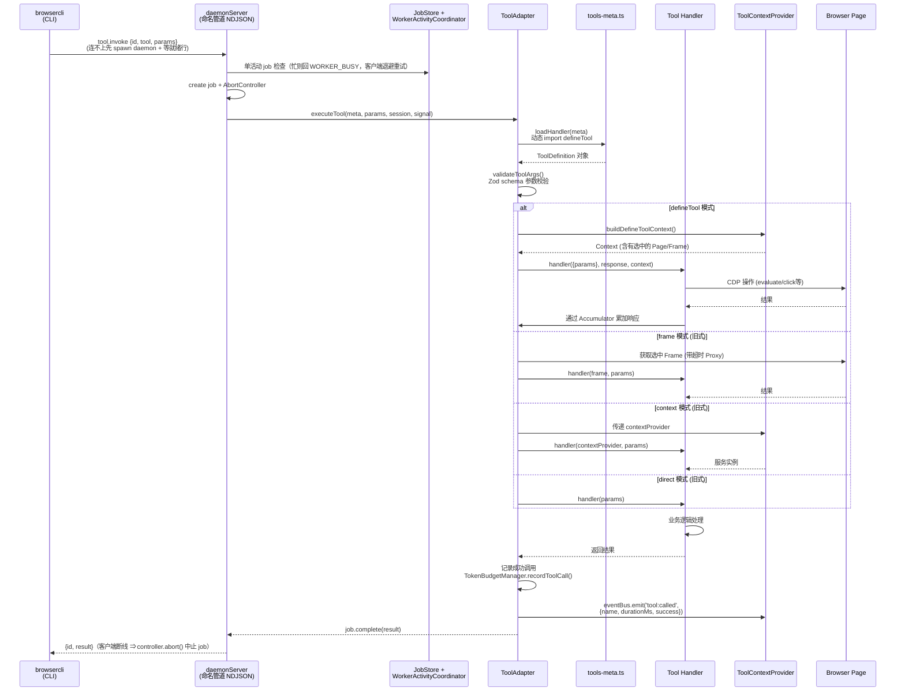
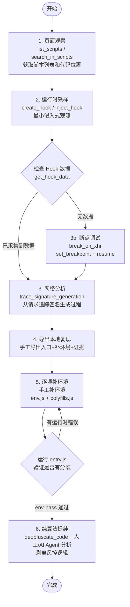

# Browser-CLI 项目全面技术分析文档

> **生成日期**: 2026-05-20
> **项目**: Browser-CLI (js-reverse-mcp)
> **版本**: 2.0.3
> **许可证**: Apache-2.0

---

## 目录

- [1. 项目概览](#1-项目概览)
- [反检测哲学（与 jshookmcp 对齐）](#反检测哲学与-jshookmcp-对齐)
- [2. 目录结构解析](#2-目录结构解析)
- [3. 核心模块分析](#3-核心模块分析)
- [4. 设计模式与架构风格分析](#4-设计模式与架构风格分析)
- [5. 可视化图表](#5-可视化图表)
- [6. 二次开发与架构优化建议](#6-二次开发与架构优化建议)
- [7. 新开发者实战入门指南](#7-新开发者实战入门指南)

---

## 1. 项目概览

Browser-CLI 是一个**前端 JavaScript 逆向流程标准化的浏览器自动化与调试工具集**，通过本地命名管道（POSIX 为 unix socket）暴露给 `browsercli` 命令行调用。其核心目标不是简单的页面调试，而是将**页面观察→运行时采样→本地复现→补环境→证据沉淀**串成一套可复用工作流。

### 核心方法论

| 原则                           | 含义                                       |
| ------------------------------ | ------------------------------------------ |
| **Observe-first**              | 先在浏览器里确认请求、脚本、函数和依赖来源 |
| **Hook-preferred**             | 先做最小化 Hook 采样，而非直接断点         |
| **Breakpoint-last**            | 只有 Hook 不够时才进入暂停式调试           |
| **Rebuild-oriented**           | 以本地可复现为最终产出目标                 |
| **Evidence-first**             | 每一步都沉淀为 task artifact，不留在对话里 |
| **Pure-extraction-after-pass** | 环境通过（env-pass）后才进入纯算法提纯     |

### 技术栈

| 领域             | 技术选型                                 |
| ---------------- | ---------------------------------------- |
| **语言**         | TypeScript 5.9 (ESM, ES2023 target)      |
| **运行时**       | Node.js ^20.19.0 \|\| ^22.12.0 \|\| >=23 |
| **浏览器自动化** | patchright (Playwright fork)             |
| **构建**         | SWC (编译) + Rollup (打包)               |
| **CDP 协议**     | Chrome DevTools Protocol 原生集成        |

| **IPC 协议** | 本地命名管道 NDJSON (daemon socket) |
| **CLI 框架** | yargs |
| **运行时校验** | Zod |
| **代码分析** | Babel (parser/traverse/generator) |
| **混淆处理** | javascript-obfuscator, terser |
| **WASM 处理** | wabt |
| **国密** | sm-crypto |
| **测试** | node:test + fast-check (属性测试) + Vitest |

---

## 反检测哲学（与 jshookmcp 对齐）

Browser-CLI 与兄弟项目 [jshookmcp](https://github.com/zhizhuodemao/js-reverse-mcp)
共享同一套反检测哲学：**默认零 JS 注入，反检测下沉到协议层和（可选的）源码层**。

`Object.defineProperty` hack 本身就是反爬系统的检测信号 —— 一旦页面检测到
"有人在覆盖 navigator / canvas / WebGL API"，整个隐身努力反而暴露。所以默认
启动时 JSReverser **不会**向页面注入任何 JS，分四层提供反检测能力：

| 层                             | 默认模式                                                                              | `--cloak` 模式                                                                                                    |
| ------------------------------ | ------------------------------------------------------------------------------------- | ----------------------------------------------------------------------------------------------------------------- |
| **协议层**（CDP）              | Patchright：不调 `Runtime.enable` / `Console.enable`，不在 isolated world 外 evaluate | 同                                                                                                                |
| **源码层**（C++ 二进制 patch） | 无 —— 直接用系统 Google Chrome                                                        | CloakBrowser 二进制（49 个 C++ patch：`navigator.webdriver`、canvas、WebGL、audio、GPU、字体、屏幕、WebRTC、TLS） |
| **Profile 目录**               | `~/.cache/chrome-devtools-mcp/chrome-profile`                                         | `~/.cache/chrome-devtools-mcp/cloak-profile`（与默认物理隔离）                                                    |
| **实际浏览器**                 | 你装的 Google Chrome（带 Web Store、扩展、sync）                                      | 定制 Chromium 编译版（无 Google 服务、无 Web Store）                                                              |

导航级措施（两种模式都生效）：

- **最小启动参数集**：默认只下 `--test-type`（banner 抑制器，不是检测信号）+
  `--hide-crash-restore-bubble`。历史 60+ 参数集（`FULL_STEALTH_ARGS`，其中
  多个 flag 本身已是反爬检测信号）通过 `--full-stealth-args` 回退启用。
- **Viewport `null`**：关掉 Playwright 默认的 1280×720 假视口，暴露真实 OS
  屏幕尺寸（1280×720 是自动化框架的常见 bot 信号）。

### 三个隐身相关 CLI flag

| Flag                  | 作用                                                                         | 默认    |
| --------------------- | ---------------------------------------------------------------------------- | ------- |
| `--cloak`             | CloakBrowser 二进制 + 49 C++ patch + cloak-profile                           | `false` |
| `--js-stealth`        | 页面里 opt-in 注入 `StealthScripts2025`（覆盖 navigator/canvas/WebGL/audio） | `false` |
| `--full-stealth-args` | 使用历史 60+ Chromium 启动参数集                                             | `false` |

`--cloak` 是强反爬的逃生通道，会启用 CloakBrowser 源码级反检测二进制（49 个 C++ patch，profile 与默认物理隔离）。
`--js-stealth` 是历史兼容 opt-in（旧代码依赖 `navigator.webdriver === false`
等覆盖时显式启用）。`--full-stealth-args` 不推荐：多个 flag 已是反爬检测信号。

---

## 2. 目录结构解析

```
Browser-CLI/
├── src/                              # 核心源码
│   ├── index.ts                      # ★ Worker 进程入口 — 仅 daemon 模式（MCP stdio 入口已移除）
│   ├── runtime.ts                    # ★ 运行时核心 — 单例，聚合所有模块实例
│   ├── config.ts                     # 配置出口 (re-export config/index)
│   ├── PageCollector.ts              # ★ 泛型页面数据收集器基类 (模板方法)
│   │
│   │
│   ├── (CLI 客户端已抽离)            # `browsercli` → 独立包 `browsercli/`
│   │                              #   daemon socket 客户端，经本地命名管道调用 detached daemon；
│   │                              #   本地 worker 进程管理(start/stop/status/repl)已删除
│   │

│   ├── config/                       # 配置系统
│   │   ├── resolver.ts              # ★ 核心解析管线 (830行) — CLI > Env > JSON > 默认值
│   │   ├── constants.ts             # 文件名常量与默认值
│   │   └── schema.ts                #   Zod 配置校验 schema
│   │
│   ├── ipc/                          # Daemon IPC 层
│   │   ├── socketConnection.ts      # ★ NDJSON 帧协议 + PROTOCOL_VERSION
│   │   ├── registry.ts              # 会话注册表（workspace-hash / session 文件）
│   │   ├── daemonArgs.ts            # --daemon 参数解析
│   │   └── daemonServer.ts          # ★ 命名管道服务端 — 方法分发 (tools/browser/jobs/events)
│   │
│   ├── worker/                       # Worker 层
│   │   ├── daemonMain.ts            # ★ daemon 模式启动（ConsoleServer + socket + 就绪握手）
│   │   ├── ToolAdapter.ts           # ★ 工具适配器 — defineTool → 管线执行
│   │   ├── ToolContext.ts           # ★ 执行上下文 Facade — 聚合4个子模块
│   │   ├── JobStore.ts              # 异步 Job 状态存储
│   │   ├── ToolResponseAccumulator.ts # 工具响应累加器
│   │   ├── WorkerArgs.ts            # Worker 参数解析
│   │   ├── WorkerLifecycle.ts       # ★ 优雅关闭生命周期
│   │   ├── collectors.ts            # 数据收集器定义
│   │   └── context/                 # ToolContextProvider 子模块:
│   │       ├── PageManager.ts       #   页面/Frame/Dialog/网络CPU节流管理
│   │       ├── DebuggerSessionManager.ts # CDP DebuggerManager 创建与释放
│   │       ├── DataCollectorManager.ts   # Network/Console/WebSocket 收集与查询
│   │       └── ServiceLocator.ts    #   分析服务惰性装配
│   │
│   ├── tools/                        # ★ 工具实现 (26个子目录, 114 个工具)
│   │   ├── ToolDefinition.ts        # ★ defineTool() — 工具定义 DSL
│   │   ├── categories.ts            # ★ ToolCategory 枚举 (11个分类)
│   │   ├── manifest.ts              # 工具清单接口
│   │   ├── generated-tools-index.ts # ★ 自动生成工具索引 — 引用所有工具文件
│   │   ├── hook/                    # Hook 工具 (create_hook, inject_hook, get_hook_data...)
│   │   ├── debugger/                # 调试器工具 (set_breakpoint, resume, step_into...)
│   │   ├── network/                 # 网络分析工具 (list_network_requests, get_request_initiator...)
│   │   ├── script/                  # 脚本管理工具 (list_scripts, get_script_source...)
│   │   ├── dom/                     # DOM 操作工具
│   │   ├── page/                    # 页面管理工具 (navigate_page, query_dom...)
│   │   ├── input/                   # 输入自动化工具 (click, fill, press_key, upload_file...)
│   │   ├── console/                 # 控制台工具 (list_console_messages)
│   │   ├── navigation/              # 导航工具
│   │   ├── screenshot/              # 截图工具
│   │   ├── emulation/              # 设备仿真工具 (emulate_network, emulate_mobile...)
│   │   ├── websocket/ (network/)   # WebSocket 观察工具
│   │   ├── storage/ (page/)        # 会话状态工具 (save_session_state...)
│   │   ├── collector/              # 代码采集工具 (collect_code)
│   │   ├── stealth/                # 隐身注入工具
│   │   ├── wasm/                   # WASM 分析工具
│   │   ├── frames/                 # Frame 管理工具
│   │   ├── dialog/                 # 弹窗处理工具
│   │   ├── anti-debug/             # 反调试工具
│   │   └── shared/                 # 共享辅助函数
│   │
│   ├── modules/                     # ★ 核心逆向模块
│   │   ├── browser/                # 浏览器管理层
│   │   │   ├── browser.ts          #   ★ BrowserManager — 单例 + 双模式连接/启动
│   │   │   ├── SessionManager.ts   #   多会话页面隔离管理
│   │   │   ├── cloak.ts            #   CloakBrowser 源码层反检测
│   │   │   └── stealth-args.ts     #   反检测启动参数
│   │   ├── collector/              # 代码收集
│   │   │   ├── CodeCollector.ts    #   CDP 网络拦截 + 脚本采集 + 依赖图
│   │   │   ├── CodeCache.ts        #   代码缓存
│   │   │   ├── CodeCompressor.ts   #   代码压缩
│   │   │   ├── SmartCodeCollector.ts # 智能收集策略
│   │   │   ├── PageController.ts   #   页面控制 (导航/刷新/回退)
│   │   │   ├── DOMInspector.ts     #   DOM 检查器
│   │   │   └── comboUrlParser.ts   #   Combo URL 解析
│   │   ├── hook/                   # Hook 系统
│   │   │   ├── HookManager.ts      #   Hook 管理器 (Facade)
│   │   │   ├── HookCodeBuilder.ts  #   Hook 脚本构建器
│   │   │   ├── HookTypeRegistry.ts #   Hook 类型注册表 (插件式)
│   │   │   ├── HookStore.ts        #   Hook 数据存储
│   │   │   ├── HookHeartbeat.ts    #   心跳检测
│   │   │   └── AIHookGenerator.ts  #   AI 辅助 Hook 生成
│   │   ├── deobfuscator/           # 反混淆
│   │   │   ├── Deobfuscator.ts     #   主管道 (策略调度)
│   │   │   ├── PackerDeobfuscator.ts   # Packer/AAEncode
│   │   │   ├── JSVMPDeobfuscator.ts    # JSVMP 虚拟机
│   │   │   ├── AdvancedDeobfuscator.ts # 高级混淆
│   │   │   └── ASTOptimizer.ts     #   AST 优化
│   │   ├── wasm/                   # WASM 分析
│   │   │   ├── WasmCollector.ts    #   WASM 收集 (CDP + 插桩)
│   │   │   ├── WasmAnalyzer.ts     #   WASM 二进制分析
│   │   │   ├── WasmDecompiler.ts   #   WASM 反编译
│   │   │   ├── WasmRuntimeInspector.ts # 运行时检查
│   │   │   └── WasmTypes.ts        #   类型定义
│   │   └── stealth/                # 隐身模块
│   │       └── StealthScripts2025.ts # 反检测脚本引擎
│   │
│   ├── utils/                       # 工具层
│   │   ├── EventBus.ts             # ★ 事件总线 (Pub/Sub + Zod 校验)
│   │   ├── UnifiedCacheManager.ts  # ★ 统一缓存协调器 (单例)
│   │   ├── CacheAdapters.ts        #   缓存适配器
│   │   ├── detailedDataManager.ts  #   分层数据存储 (LRU + TTL)
│   │   ├── TokenBudgetManager.ts   #   Token 预算 (三级预警)
│   │   ├── ToolExecutionScheduler.ts # 读写调度器
│   │   ├── AdaptiveDataSerializer.ts # 自适应序列化 (7种类型)
│   │   ├── Mutex.ts                #   FIFO 互斥锁
│   │   ├── logger.ts               #   日志器
│   │   ├── errors.ts               #   错误类型 (ToolError)
│   │   ├── safeJson.ts             #   安全 JSON 序列化
│   │   ├── pagination.ts           #   分页工具
│   │   ├── fsSafe.ts               #   文件安全校验
│   │   ├── keyboard.ts             #   按键校验
│   │   ├── projectPaths.ts         #   路径解析
│   │   ├── config.ts               #   旧配置别名 (即将废弃)
│   │   ├── features.ts             #   功能开关
│   │   └── DevtoolsUtils.ts        #   DevTools 工具
│   │
│   ├── types/                       # 类型定义
│   │   ├── index.ts                # ★ ~860行, 85+接口, 核心类型
│   │   ├── events.ts               #   AppEventMap + Zod 校验器
│   │   ├── platform.ts             #   平台类型
│   │   ├── devtools.ts             #   DevTools 抽象类型
│   │   └── chrome-devtools-frontend.d.ts
│   │
│   ├── third_party/                 # 第三方包装层
│   │   ├── index.ts                # ★ 统一导出入口 (185文件引用)
│   │   ├── playwright.ts           #   patchright 重导出 + 兼容别名
│   │   ├── puppeteer-compat.ts     #   Puppeteer 兼容层
│   │   ├── cdp.ts                  #   CDP 协议类型
│   │   └── stubs.ts                #   chrome-devtools-frontend 桩
│   │
│   ├── formatters/                  # 格式化器
│   │   ├── networkFormatter.ts     #   HTTP 请求/响应格式化
│   │   ├── websocketFormatter.ts   #   WebSocket 帧分析 + 分组 + 格式化
│   │   └── consoleFormatter.ts     #   控制台消息格式化
│   │
│   └── trace-processing/           # 性能追踪
│       └── parse.ts                #   TraceEngine 解析器
│
├── tests/                           # 测试
│   ├── unit/                       # 单元测试 (node:test)
│   │   ├── browser/               # BrowserManager 测试
│   │   ├── tools/                  # 工具测试
│   │   ├── services/               # 服务测试
│   │   └── utils/                  # 工具测试
│   ├── integration/                # 集成测试
│   ├── property/                   # 属性测试 (fast-check)
│   └── performance/                # 性能测试
│
├── scripts/                         # 脚本
│   ├── cases/                      # 公开逆向案例 (JD/KS/Douyin)
│   └── generate-tools-index.ts    # 工具索引自动生成
│
├── docs/                            # 文档
│   ├── guides/                     # 使用指南
│   └── reference/                  # 参考文档
│
├── artifacts/tasks/                 # 任务产物 (本地保留, git 忽略)
│   └── _TEMPLATE/                  # 模板目录
│
├── package.json                    # 依赖与脚本
├── tsconfig.json                   # TypeScript 配置
├── rollup.config.mjs              # Rollup 打包配置
├── .swcrc                          # SWC 编译器配置
└── PROJECT-ANALYSIS.md            # 本文件
```

---

## 3. 核心模块分析

### 3.1 系统架构分层

```
┌─────────────────────────────────────────────────────────┐
│            CLI 层 (browsercli/ 独立包)                   │
│   daemon socket 客户端：yargs 解析 → daemonClient →      │
│   本地命名管道 (NDJSON)，连不上自动 spawn detached daemon │
│   (本地 worker 进程管理 start/stop/status/repl 已删除)    │
└────────────────────┬────────────────────────────────────┘
                     │
┌────────────────────▼────────────────────────────────────┐
│              Daemon IPC 层 (src/ipc/)                    │
│   daemonServer — 命名管道 NDJSON 方法分发                │
│   (hello/tools.list/tool.invoke/browser.*/jobs.*/       │
│    subscribe/stop) + registry 会话注册表                  │
└────────────────────┬────────────────────────────────────┘
                     │
┌────────────────────▼────────────────────────────────────┐
│                  Worker 层 (src/worker/)                 │
│  ┌──────────────┐  ┌──────────────┐  ┌───────────────┐ │
│  │ daemonMain    │  │ ToolAdapter  │  │ ToolContext   │ │
│  │ 就绪握手/会话 │  │ defineTool → │  │  Provider     │ │
│  │ 文件/优雅关闭 │  │ 管线执行     │  │ (Facade)      │ │
│  └──────┬───────┘  └──────┬───────┘  └───────────────┘ │
└─────────┼─────────────────┼──────────────────────────────┘
          │                 │
┌─────────▼─────────────────▼──────────────────────────────┐
│                    Runtime 核心 (src/runtime.ts)          │
│     单例模式 — 聚合所有模块实例 (BrowserManager + 各模块) │
└──┬──────┬──────┬──────┬──────┬──────┬──────┬──────┬──────┘
   │      │      │      │      │      │      │      │
┌──▼──┐ ┌▼────┐ ┌▼───┐ ┌▼───┐ ┌▼──┐ ┌▼───┐ ┌▼──┐ ┌▼────┐
│Tools │ │Modules│ │Svc │ │Brsr│ │Rev│ │Utils│ │Fmt│ │Types│
│114   │ │ 6域  │ │    │ │Mgr │ │Task│ │Cache│ │rtr│ │85+  │
│Tools │ │分析  │ │    │ │CDP │ │FS  │ │Bus  │ │   │ │接口  │
└──────┘ └──────┘ └────┘ └────┘ └───┘ └─────┘ └───┘ └─────┘
```

### 3.2 模块职责与实现分析

#### 3.2.1 配置系统 (src/config/)

| 方面         | 分析                                                                                                                                                         |
| ------------ | ------------------------------------------------------------------------------------------------------------------------------------------------------------ |
| **职责**     | 统一管理所有运行时配置 — 浏览器连接、调试与会话设置                                                                                                          |
| **实现逻辑** | `resolveConfig()` 实现 CLI 参数 > 环境变量 (dotenv) > config.json > js-reverse.config.json > ~/.jsreverse/config.json > 内置默认值的优先级合并               |
| **关键函数** | `resolveConfig()` — 返回扁平 `ResolvedConfig`; `getSystemConfig()` — 构建 `SystemConfig` (Browser+Debug); `getBrowserManagerConfig()` — 解析 25 个浏览器参数 |
| **被调用方** | `src/index.ts` (Worker入口)、`src/worker/WorkerArgs.ts`、`src/runtime.ts`                                                                                    |

#### 3.2.2 浏览器管理层 (src/modules/browser/)

| 方面         | 分析                                                                                                                                                                                                          |
| ------------ | ------------------------------------------------------------------------------------------------------------------------------------------------------------------------------------------------------------- |
| **职责**     | 浏览器的启动、连接、会话管理、崩溃恢复、隐身注入                                                                                                                                                              |
| **实现逻辑** | **双模式连接**: 已有浏览器 (connectOverCDP) / 自动启动新浏览器 (launch)。**三层端口发现**: DevToolsActivePort > 常见端口扫描 > 默认候选列表。**崩溃自愈**: 双重检测 (事件 + 5s 轮询) → close → 1s 延迟 → 重启 |
| **关键类**   | `BrowserManager` (单例) — 核心; `SessionManager` — 多会话页面隔离; `DevToolsConnectionAdapter` — Playwright→CDPConnection 适配器; `CDPErrorMapper` — 10 种错误模式映射                                        |
| **被调用方** | `Runtime` 在 `getRuntime()` 中 init; `ToolContextProvider.PageManager` 持有引用                                                                                                                               |
| **隐式耦合** | `BrowserManager` 直接依赖 `patchright` 的 `Browser` / `BrowserContext` / `Page` 具体类型, 而不是抽象接口; 测试通过 `resetInstance()` 进行，但方案较脆弱                                                       |
| **设计模式** | **单例模式、适配器模式 (Playwright→CDPConnection)、策略模式 (端口发现三层策略)、观察者模式 (崩溃监听)**                                                                                                       |

#### 3.2.3 工具层 (src/tools/)

| 方面         | 分析                                                                                                                                                                                                                                         |
| ------------ | -------------------------------------------------------------------------------------------------------------------------------------------------------------------------------------------------------------------------------------------- |
| **职责**     | 实现 114 个工具，覆盖页面观察、Hook、断点、网络分析、WebSocket、代码分析、反混淆、加密检测、WASM、设备仿真、性能分析等全部能力                                                                                                               |
| **实现逻辑** | 工具通过 `defineTool()` DSL 定义 (name + description + Zod schema + handler)。索引在 `generated-tools-index.ts` 中自动生成，通过 `tools-meta.ts` 动态加载并缓存。`ToolAdapter.executeTool()` 经 `ToolExecutionPipeline` 完成校验→上下文→执行 |
| **关键文件** | `ToolDefinition.ts` — 工具定义接口; `generated-tools-index.ts` — 索引; `categories.ts` — 12 个分类枚举; `ToolAdapter.ts` — 执行入口                                                                                                          |
| **被调用方** | daemon socket 服务端 (`src/ipc/daemonServer.ts`) 收到 `tool.invoke` → 路由到 `ToolAdapter.executeTool()`；`ToolExecutionPipeline` 执行                                                                                                       |
| **边界问题** | 定义和使用之间有一层间接性 (modulePath → 动态 import)，加载失败时以警告非阻断方式处理                                                                                                                                                        |
| **改进空间** | 考虑将工具调用模式 (`frame`/`context`/`direct`) 表示为统一的 DSL 属性, 而非 ToolAdapter 中的条件分支                                                                                                                                         |

#### 3.2.4 代码收集模块 (src/modules/collector/)

| 方面         | 分析                                                                                                                                                   |
| ------------ | ------------------------------------------------------------------------------------------------------------------------------------------------------ |
| **职责**     | 采集页面所有 JavaScript 代码 (外部脚本、内联脚本、Service Worker、Web Worker)                                                                          |
| **实现逻辑** | CDP `Network.enable` 网络拦截 + `Page.enable` 脚本事件监听。支持 summary/priority/incremental 三种智能收集模式。收集后自动构建依赖图，支持按优先级获取 |
| **关键类**   | `CodeCollector` — 主收集器; `CodeCache` — 内存缓存; `CodeCompressor` — 按需压缩; `SmartCodeCollector` — 智能策略                                       |
| **被调用方** | Runtime → `collect_code` 工具                                                                                                                          |
| **改进空间** | 对大网站 (1000+ 脚本) 的收集性能需优化，当前智能模式可能仍会超时                                                                                       |

#### 3.2.5 Hook 系统 (src/modules/hook/)

| 方面         | 分析                                                                                                                                                                                                     |
| ------------ | -------------------------------------------------------------------------------------------------------------------------------------------------------------------------------------------------------- |
| **职责**     | 声明式 Hook 定义、注入、数据回传、反调试绕过                                                                                                                                                             |
| **实现逻辑** | **Facade 模式**: `HookManager` 聚合 `HookCodeBuilder` (脚本生成) + `HookTypeRegistry` (类型注册) + `HookStore` (数据存储)。支持 `create()` (声明式) 和 `createWithBuilder()` (链式 Builder) 两种创建方式 |
| **关键类**   | `HookManager` — 外观; `HookTypeRegistry` — 插件式扩展点; `AIHookGenerator` — AI 辅助生成                                                                                                                 |
| **设计模式** | **Facade 模式、Builder 模式、Plugin 模式 (通过 `registerType()` 注册自定义 Hook 类型)**                                                                                                                  |
| **改进空间** | HookTypeRegistry 内置类型以硬编码方式加载，未来可考虑完全插件化                                                                                                                                          |

#### 3.2.6 反混淆模块 (src/modules/deobfuscator/)

| 方面         | 分析                                                                                                                                                                                                                                     |
| ------------ | ---------------------------------------------------------------------------------------------------------------------------------------------------------------------------------------------------------------------------------------- |
| **职责**     | 多策略反混淆管道，支持多种混淆类型                                                                                                                                                                                                       |
| **实现逻辑** | **Pipeline + Strategy 模式**: 检测混淆类型 → 解包 Packer/AAEncode/URLEncode → JSVMP 虚拟化还原 → 高级混淆 (控制流平坦化、不透明谓词) → 基础管线 → AST 优化 → 变量重命名 → LLM 辅助分析。每个阶段独立 try-catch，非致命失败不阻断后续环节 |
| **关键类**   | `Deobfuscator` — 管道调度; `PackerDeobfuscator` / `JSVMPDeobfuscator` / `AdvancedDeobfuscator` — 策略实现; `ASTOptimizer` — AST 优化                                                                                                     |
| **设计模式** | **Pipeline 模式、Strategy 模式**                                                                                                                                                                                                         |
| **改进空间** | 阶段间数据共享通过 `DeobfuscationContext` 进行，接口可更明确                                                                                                                                                                             |

#### 3.2.7 调试器 (DebuggerManager / src/modules/debugger/)

| 方面         | 分析                                                                                                                                                                                                                                                                                                                                                                                                                                                                                                 |
| ------------ | ---------------------------------------------------------------------------------------------------------------------------------------------------------------------------------------------------------------------------------------------------------------------------------------------------------------------------------------------------------------------------------------------------------------------------------------------------------------------------------------------------- |
| **职责**     | CDP Debugger 域的封装：脚本追踪、断点管理、暂停状态、调用帧检查、自动断点循环恢复                                                                                                                                                                                                                                                                                                                                                                                                                    |
| **实现逻辑** | `DebuggerManager` 作为门面（Facade），协调 `BreakpointManager` / `ExecutionController` / `ScopeInspector` / `ScriptManager` / `ExecutionContextTracker` / `DebuggerSessionStore` 等策略模块。提供脚本搜索 `searchInScripts()`、断点管理 `setBreakpointByUrl/setBreakpointByUrlRegex`、执行控制 `pause/resume/stepOver/stepInto/stepOut`、作用域变量获取 `getScopeVariables()`、调用帧表达式求值 `evaluateOnCallFrame()`。**断点循环检测**: 2s 窗口内同一断点命中 3 次 → 自动恢复 (resume + 移除断点) |
| **关键类**   | `DebuggerManager` — 门面 ~600 行; `BreakpointManager` / `ExecutionController` / `ScopeInspector` / `ScriptManager` / `ExecutionContextTracker` / `DebuggerSessionStore` 等策略模块                                                                                                                                                                                                                                                                                                                   |
| **设计模式** | **Facade + Strategy 模式** — DebuggerManager 统一入口，策略模块各管 CDP 子域                                                                                                                                                                                                                                                                                                                                                                                                                         |
| **改进空间** | 已统一：原 `DebuggerContext`（869 行）已迁移至 `DebuggerManager` + 策略模块，消除了职责重叠                                                                                                                                                                                                                                                                                                                                                                                                          |

#### 3.2.9 事件总线 (src/utils/EventBus)

| 方面         | 分析                                                                                                                                                                                                                    |
| ------------ | ----------------------------------------------------------------------------------------------------------------------------------------------------------------------------------------------------------------------- |
| **职责**     | 提供模块间松耦合的事件通信机制                                                                                                                                                                                          |
| **实现逻辑** | 泛型 `EventBus<TMap>` 将事件名到 payload 类型通过类型参数 TMap 关联。`on()` 返回取消订阅函数。`emit()` 时通过 Option 中传入的 Zod validators 对 payload 进行运行时校验。异步 handler 以 `void` 调用，不阻塞 emit 调用方 |
| **事件映射** | 9 个全局事件: `browser:launched/closed`、`hook:injected/triggered`、`network:captured`、`debugger:paused/resumed`、`tool:called/error`                                                                                  |
| **设计模式** | **观察者模式 / Pub/Sub 模式**                                                                                                                                                                                           |
| **改进空间** | 无异步事件中间件能力 (如日志、过滤、重试); 有些事件 (如 `hook:triggered`) 实际未被任何模块使用                                                                                                                          |

#### 3.2.10 缓存系统 (src/utils/)

| 方面         | 分析                                                                                                                                                                                                            |
| ------------ | --------------------------------------------------------------------------------------------------------------------------------------------------------------------------------------------------------------- |
| **职责**     | 统一协调多级缓存，提供全局统计、智能清理、预警                                                                                                                                                                  |
| **实现逻辑** | `UnifiedCacheManager` (单例) 通过 `CacheAdapter` 适配器协调 3 个缓存: `DetailedDataManager` (LRU + TTL 自动续期)、`CodeCache` (代码文件)、`CodeCompressor` (压缩结果)。智能清理三阶段: 过期 → 低命中率 → 大体积 |
| **关键类**   | `UnifiedCacheManager` (协调者)、`DetailedDataManager` (分层存储 + LRU + 30min TTL + 自动续期)                                                                                                                   |
| **设计模式** | **单例模式、适配器模式 (3 个异构缓存统一接口)、协调者模式**                                                                                                                                                     |
| **改进空间** | 500MB 上限未软配置; `DetailedDataManager` 的大小估算不精确 (50KB/条固定); 预热 `preheat()` 仅为空壳                                                                                                             |

#### 3.2.11 Daemon IPC 层 (src/ipc/)

| 方面         | 分析                                                                                                                                                                                                                                                                                                                                                                                                                                                                                                                                                                                                                                  |
| ------------ | ------------------------------------------------------------------------------------------------------------------------------------------------------------------------------------------------------------------------------------------------------------------------------------------------------------------------------------------------------------------------------------------------------------------------------------------------------------------------------------------------------------------------------------------------------------------------------------------------------------------------------------- |
| **职责**     | CLI 与 detached daemon 之间的本地 socket 通信：会话注册表发现 + NDJSON 行协议请求/响应 + 事件推送                                                                                                                                                                                                                                                                                                                                                                                                                                                                                                                                     |
| **实现逻辑** | win32 命名管道 / POSIX unix socket，地址 `browsercli-<workspaceHash16>-<session>`。`SocketConnection` 做 NDJSON 分帧与重组；`registry.ts` 按 workspace-hash 目录读写 `<session>.session`（含 pid/socketPath/consolePort/protocol）。`daemonServer.ts` 分发 `hello`/`tools.list`/`tool.invoke`/`browser.*`/`jobs.*`/`subscribe`/`stop`；客户端断线 ⇒ `AbortController` 中止该连接上的运行中 job。CLI 侧连不上就 spawn detached daemon，等 stdout 就绪行 `Daemon listening on <pipePath>` 完成握手。`PROTOCOL_VERSION = 1` 两侧各自定义（与 `browsercli/src/daemonClient.ts` 注释互指保持同步），不匹配时报错提示 `close` + 重新 `open` |
| **关键文件** | `socketConnection.ts`（帧协议）、`registry.ts`（注册表）、`daemonArgs.ts`（参数解析）、`daemonServer.ts`（方法分发）                                                                                                                                                                                                                                                                                                                                                                                                                                                                                                                  |
| **被调用方** | `worker/daemonMain.ts` 启动时创建 `startDaemonServer()`；`browsercli` 包经 `daemonClient.ts` 连接                                                                                                                                                                                                                                                                                                                                                                                                                                                                                                                                     |
| **设计模式** | **行协议 RPC（请求-响应 + 无 id 推送共用一条连接）、注册表服务发现**                                                                                                                                                                                                                                                                                                                                                                                                                                                                                                                                                                  |

#### 3.2.12 Worker 层 (src/worker/)

| 方面         | 分析                                                                                                                                                                                                                                                                                                                                                                                                                  |
| ------------ | --------------------------------------------------------------------------------------------------------------------------------------------------------------------------------------------------------------------------------------------------------------------------------------------------------------------------------------------------------------------------------------------------------------------- |
| **职责**     | 提供工具的运行时执行入口（daemon socket `tool.invoke` 路径），管理执行上下文和生命周期                                                                                                                                                                                                                                                                                                                                |
| **实现逻辑** | `ToolAdapter` 从 `generated-tools-index.ts` 动态加载工具定义，`executeTool()` 经 `ToolExecutionPipeline`（校验→上下文→执行→响应）运行。`daemonMain.ts` 编排 daemon 启动顺序：config 播种 → runtime 初始化 → ConsoleServer(127.0.0.1) → `startDaemonServer` → 写 session 文件 → 打就绪行。`ToolContextProvider` (Facade) 聚合 4 个子模块: PageManager + DebuggerSessionManager + DataCollectorManager + ServiceLocator |
| **关键类**   | `ToolAdapter`、`ToolContextProvider`、`daemonMain.runDaemon()`、`WorkerLifecycle.createGracefulShutdown()`                                                                                                                                                                                                                                                                                                            |
| **设计模式** | **外观模式 (ToolContextProvider 统一 4 个子模块)、模板/编排 (daemonMain 固定启动顺序)**                                                                                                                                                                                                                                                                                                                               |
| **改进空间** | Frame evaluate 超时 (10s) 通过 Proxy 实现，调试器暂停时 10s 可能不够                                                                                                                                                                                                                                                                                                                                                  |

---

## 4. 设计模式与架构风格分析

### 4.1 已使用的设计模式

| 模式             | 使用位置                                                                                                                                                                   | 解决的问题                                                     | 评价                                       |
| ---------------- | -------------------------------------------------------------------------------------------------------------------------------------------------------------------------- | -------------------------------------------------------------- | ------------------------------------------ |
| **单例模式**     | `Runtime.getRuntime()`, `BrowserManager.getInstance()`, `UnifiedCacheManager.getInstance()`, `DetailedDataManager.getInstance()`, `TokenBudgetManager.getInstance()`       | 确保全局唯一实例，避免重复初始化浏览器连接、缓存               | ⚠️ 使测试略复杂，需 `resetInstance()` 方案 |
| **外观模式**     | `ToolContextProvider` 聚合 PageManager / DebuggerSessionManager / DataCollectorManager / ServiceLocator; `HookManager` 聚合 HookCodeBuilder / HookTypeRegistry / HookStore | 为 Tool handler 提供统一入口，隐藏底部 4 个子模块的复杂性      | ✅ 职责分离好，单个入口降低耦合            |
| **适配器模式**   | `DevToolsConnectionAdapter` (Playwright CDPSession → CDPConnection); `CacheAdapters` (3 个缓存 → CacheInstance); `third_party/puppeteer-compat.ts` (Puppeteer 兼容)        | 在不同接口间转换，实现 Puppeteer→Playwright 迁移、异构缓存统一 | ✅ 适配层干净，零侵入                      |
| **策略模式**     | `BrowserManager` 双模式 (connect vs launch) + 端口发现三层策略; `Deobfuscator` 通过子模块实现不同混淆策略                                                                  | 算法/策略的可替换性，运行时选择                                | ✅ Strategy 接口定义清晰                   |
| **模板方法模式** | `PageCollector<T>` 抽象基类: `attachListeners()` / `detachListeners()` 由子类实现                                                                                          | 多个收集器 (Network/Console/WSC) 共享导航分组和生命周期逻辑    | ✅ 减少大量重复代码                        |
| **管道模式**     | `Deobfuscator` 反混淆管线: 检测 → 解包 → JSVMP → 高级 → 基础 → AST → 重命名                                                                                                | 多阶段处理，每阶段独立失败                                     | ✅ 高容错: 每步独立 try-catch              |
| **观察者模式**   | `EventBus` (Pub/Sub 9 个事件); `DebuggerManager` CDP 事件监听 (scriptParsed/paused/resumed); `BrowserManager.on('disconnected')` 崩溃监听                                  | 模块间松散通信，事件驱动                                       | ✅ EventBus 有 Zod 校验加分                |
| **桥接模式**     | `ToolAdapter` 将 `defineTool` 定义桥接到传输层（daemon socket `tool.invoke`）                                                                                              | 分离工具定义和传输协议                                         | ✅ 可独立替换协议层                        |
| **命令模式**     | `daemonServer.ts` 按 `method` 名路由到分发函数（`hello`/`tools.list`/`tool.invoke`/...）                                                                                   | 请求封装为命令对象，支持注册/路由                              | ✅ 标准实现                                |
| **工厂模式**     | `getRuntime()` 首次创建所有实例                                                                                                                                            | 对象创建的集中管理                                             | ✅ 创建逻辑集中                            |
| **Builder 模式** | `HookManager.createWithBuilder()` 链式构建 Hook                                                                                                                            | 复杂 Hook 配置的逐步构建                                       | ✅ 链式 API 清晰                           |
| **协调者模式**   | `UnifiedCacheManager` 协调 3 个缓存实例                                                                                                                                    | 多个缓存的全局管理，不替代它们                                 | ✅ 非侵入式                                |
| **装饰器模式**   | `ToolResultRecorder` 在不改动 handler 的前提下落盘每次工具结果                                                                                                             | 在透明外层添加记录能力                                         | ✅ 关注点分离好                            |
| **代理模式**     | `Frame evaluateWithTimeout` Proxy 拦截 `frame.evaluate()` 添加超时保护                                                                                                     | 在不修改 Playwright 对象的情况下扩展超时                       | ✅ Proxy 方案轻量                          |

### 4.2 可以引入但尚未使用的设计模式

| 模式             | 建议位置                                            | 理由                                                                                                                        |
| ---------------- | --------------------------------------------------- | --------------------------------------------------------------------------------------------------------------------------- |
| **工厂方法模式** | `ToolAdapter.loadHandler()`                         | 当前动态 import + `if-else` 分派创建不同模式 handler，可抽象为 `HandlerFactory.create(meta)`                                |
| **访问者模式**   | JS AST 分析（skill `code-analysis` 的脚本）         | Babel traverse 已隐含访问者模式                                                                                             |
| **状态模式**     | `BrowserManager` 状态管理                           | 当前通过布尔 flags (`isRestarting`/`isConnected`) 控制，可引入显式状态机 (disconnected/connecting/connected/closing/closed) |
| **责任链模式**   | `ToolExecutionPipeline` 的校验/上下文/执行/响应阶段 | 当前参数校验、执行、日志记录在线性管线中分阶段展开，可拆为独立中间件                                                        |
| **命令队列模式** | `ToolExecutionScheduler`                            | 当前只有简单读写分离，未来可扩展为带优先级、延迟执行、取消的任务队列                                                        |
| **规格模式**     | `CryptoDetector` 规则引擎                           | 当前规则是简单 if-else 判断，可用规格模式组合复杂检测条件                                                                   |

### 4.3 架构层级模式分析

项目采用一种**改良的分层架构**，接近于 **Hexagonal Architecture (Ports and Adapters)** 的变体:

| 层级           | 对应目录                           | Ports (接口)                                | Adapters (实现)                                             |
| -------------- | ---------------------------------- | ------------------------------------------- | ----------------------------------------------------------- |
| **基础设施层** | `src/modules/browser/`, `src/ipc/` | CDPSession, socket 帧协议                   | BrowserManager (Chrome CDP), daemonServer (命名管道 NDJSON) |
| **核心领域层** | `src/modules/`                     | HookTypePlugin, DeobfuscatorStrategy (隐式) | HookManager, Deobfuscator                                   |
| **应用层**     | `src/tools/` + `src/worker/`       | ToolDefinition, Context                     | 114 个具体工具 + ToolAdapter                                |
| **配置层**     | `src/config/`                      | —                                           | 多源合并 + 环境变量                                         |

**不符合纯 Hexagonal 的地方**:

- `BrowserManager` 直接暴露 `patchright.Browser` 具体类型（而非抽象接口）
- 领域层模块之间硬编码的引用关系 (如 `WasmCollector` 接收 `PageController` 具体类)
- 没有明确的 UseCase / Interactor 层来编排复杂业务流程

---

## 5. 可视化图表

### 5.1 系统架构图

```mermaid
graph TB
    subgraph CLI_SRC["CLI层 (browsercli/ 独立包)"]
        BRC[browsercli 命令]
        YARGS[yargs CLI解析]
        DC[daemonClient<br/>socket 客户端]
        CALL[call 命令 → tool.invoke]
    end

    subgraph IPC["Daemon IPC层 (src/ipc/)"]
        SERVER[daemonServer<br/>命名管道 NDJSON]
        REG[registry<br/>workspace-hash 会话注册表]
        READY[就绪握手<br/>Daemon listening on pipe]
        BUSY[WORKER_BUSY<br/>单活动 job + 退避重试]
    end

    subgraph WORKER["Worker层 (src/worker/)"]
        ADAPTER[ToolAdapter<br/>defineTool → 管线执行]
        CONTEXTPROV[ToolContextProvider<br/>(Facade)]
        subgraph SUBMODULES["子模块"]
            PM[PageManager]
            DSM[Debugger<br/>SessionManager]
            DCM[DataCollector<br/>Manager]
            SL[ServiceLocator]
        end
        LIFECYCLE[WorkerLifecycle<br/>优雅关闭]
    end

    subgraph RUNTIME["Runtime核心<br/>单例模式聚合所有模块"]
        BM[BrowserManager]
        COLL[CodeCollector]
        HM[HookManager]
        DEO[Deobfuscator]
        WD[WasmDetector]
        EB[EventBus<br/>9 events]
        CACHE[UnifiedCacheManager<br/>500MB max]
    end

    subgraph MODULES["核心模块 (src/modules/)"]
        CC[collector模块<br/>代码收集/缓存/压缩]
        HK[hook模块<br/>Hook注入/管理/存储]
        DO[deobfuscator模块<br/>Packer→JSVMP→AST管线]
        WS[wasm模块<br/>WASM收集/分析/反编译]
    end

    subgraph TOOLS["工具层 (114 工具)"]
        TG[generated-tools-index<br/>自动生成索引]
        TD[ToolDefinition<br/>defineTool DSL]
        CAT[ToolCategory<br/>11个分类]
        HOOK[hook/ 工具集]
        DEBUG[debugger/ 工具集]
        NET[network/ 工具集]
        DOM[dom/ 工具集]
        WASM[wasm/ 工具集]
        OTHER[其他 20+ 子目录]
    end

    subgraph THIRDPARTY["第三方层 (src/third_party/)"]
        PW[patchright<br/>Playwright fork]
        CDP[CDP Protocol Types]
        PP[PuppeteerCompat]
        STUBS[DevTools Stubs]
    end

    subgraph CONFIG["配置管道 (src/config/)"]
        ENV[环境变量<br/>dotenv]
        FILE[JSON配置文件<br/>3个层级]
        DEF[内置默认值]
        RESOLVER[resolveConfig<br/>合并管线]
    end

    subgraph BROWSER["浏览器引擎"]
        CHROME[Chrome/Edge<br/>CDP协议]
        WS2[WebSocket]
    end

    %% 连接关系
    BRC --> YARGS
    YARGS --> CALL
    CALL --> DC
    DC -->|注册表发现 / 自动 spawn| REG
    DC --- READY
    DC -->|NDJSON tool.invoke| SERVER
    SERVER -->|WORKER_BUSY 退避| BUSY
    RESOLVER --> ENV & FILE & DEF
    SERVER --> ADAPTER
    RESOLVER --> RUNTIME
    ADAPTER -.- TG
    TG --> TD
    TD --> CAT
    TG --> HOOK & DEBUG & NET & DOM & PERF & WASM & OTHER
    ADAPTER --> CONTEXTPROV
    CONTEXTPROV --> PM & DSM & DCM & SL
    RUNTIME --- BM & COLL & HM & DEO & WD & EB & CACHE
    BM --- THIRDPARTY
    BM <---> CHROME
    CHROME --- WS2
    BM --- STUBS
    SL --> MODULES
    MODULES --- CC & HK & DO & WS
    CONFIG --> BM
    CONFIG --> RUNTIME
    LIFECYCLE --> BM & SERVER
    THIRDPARTY --- PW & CDP & PP & STUBS
    THIRDPARTY --> TOOLS
```

### 5.2 核心业务流程图 — 一次工具调用的完整生命周期



### 5.3 页面逆向标准流程



---

## 6. 二次开发与架构优化建议

### 🏆 建议 1: 引入显式状态机管理浏览器连接生命周期

| 维度           | 内容                                                                                                                                                                |
| -------------- | ------------------------------------------------------------------------------------------------------------------------------------------------------------------- |
| **目标模块**   | `src/modules/browser/browser.ts` — BrowserManager                                                                                                                   |
| **当前问题**   | 浏览器状态通过分散的布尔标志管理 (`isRestarting` / `isConnected`), 状态转换在条件分支中隐式发生, 并发重启保护和边界条件依赖多个标志组合, 新增状态容易漏掉旧状态转换 |
| **具体方案**   | 引入显式有限状态机 (可用 `typescript-state-machine` 或纯 TypeScript 实现)                                                                                           |
|                | **状态**: `DISCONNECTED → CONNECTING → CONNECTED → RESTARTING → CLOSING`                                                                                            |
|                | **迁移**: 每个状态转换有明确的 guard 条件和副作用, 不合法状态转换为编译错误                                                                                         |
|                | **继承**: 保留现有 API 签名, 内部将布尔标志替换为状态机                                                                                                             |
| **预期收益**   | 崩溃恢复路径 100% 可预测; 新增状态 (如 MAINTENANCE) 零风险; 并发竞态条件消除; 错误报告精确到具体状态                                                                |
| **风险与成本** | 中等: 需要仔细映射现有 ~15 种状态相关方法; 短期部分重写 `BrowserManager`; 测试用例需重新覆盖所有状态转换路径                                                        |

### 🏆 建议 2: 将 `BrowserManager` 接口抽象化, 解耦核心领域层对 `patchright` 的直接依赖

| 维度           | 内容                                                                                                                                                                                                                                                    |
| -------------- | ------------------------------------------------------------------------------------------------------------------------------------------------------------------------------------------------------------------------------------------------------- |
| **目标模块**   | `src/modules/browser/` / `runtime.ts` / 所有通过 Runtime 获取 Page/BrowserContext 的模块                                                                                                                                                                |
| **当前问题**   | `BrowserManager` 直接导出 `patchright.Page`, `patchright.BrowserContext` 等具体类型; 整个 ~185 个文件通过 `third_party/index.ts` 引入 Playwright 具体类型; 更换浏览器引擎 (如 Puppeteer 换回) 或引入无头模式替换方案需要修改所有引用                    |
| **具体方案**   | 在 `src/modules/browser/` 中定义纯 TypeScript 接口: `IBrowserPage {navigate, evaluate, screenshot, ...}`, `IBrowser {launch, close, createPage, ...}`; `BrowserManager` 实现这些接口 + 适配器适配到具体引擎; 目前通过 `third_party/` 的兼容层可作为过渡 |
| **预期收益**   | 核心模块不依赖具体浏览器实现; 可同时支持多种浏览器引擎; 测试时可注入 Mock Page 无需启动真实浏览器                                                                                                                                                       |
| **风险与成本** | 高: 涉及全仓库 185+ 文件引用链; 需定义完整接口 (Page/Browser/Frame/BrowserContext 各 20+ 方法); 实施需分层推进, 不能一次性替换                                                                                                                          |

### 🏆 建议 3: 完善配置系统的 Zod schema 验证

| 维度           | 内容                                                                                                                                                                                                                                |
| -------------- | ----------------------------------------------------------------------------------------------------------------------------------------------------------------------------------------------------------------------------------- |
| **目标模块**   | `src/config/schema.ts`                                                                                                                                                                                                              |
| **当前问题**   | 配置验证曾分散在 `resolver.ts` 的条件分支中; 对无效配置仅在运行时暴露; 嵌套配置对象 (browser) 处理不统一（`schema.ts` 现已提供 Zod 校验，仍有收敛空间）                                                                             |
| **具体方案**   | 使用 Zod 定义 `GlobalConfigSchema`, 在 `resolveConfig()` 最终合并后调用 `schema.parse()`; 利用 Zod 的能力: 默认值、类型强制、联合类型、`refine` 跨字段校验; 为空字段提供友好错误消息; 在 `getSystemConfig()` 等高扇入入口中重复使用 |
| **预期收益**   | 启动时验证, 配置错误立即暴露; 自文档化的 Schema (Zod 自动推导类型); 减少 `resolver.ts` 中 ~100 行条件校验代码                                                                                                                       |
| **风险与成本** | 低: 纯新增, 不影响现有功能; 项目已在广泛使用 Zod (仅工具层就 185+引用), 无新增依赖; 两个工时 + 测试时间                                                                                                                             |

### 🏆 建议 4: 引入 Design System / UI 规范 (如未来构建前端的备选)

| 维度           | 内容                                                                                                                                      |
| -------------- | ----------------------------------------------------------------------------------------------------------------------------------------- |
| **目标模块**   | 跨架构 — 构建 Web UI 时                                                                                                                   |
| **当前问题**   | 当前项目为纯 CLI + daemon 模式（Web 控制台已于 `c7dcd107` 移除）; 如果未来需要构建 Dashboard/Web UI, 目前无 UI 架构约定                   |
| **具体方案**   | 预留前端架构: 独立前端包 (如 `frontend/`); 使用 React + Tailwind CSS; daemon socket 工具 API 作为后端数据源; 工具执行结果标准化 JSON 格式 |
| **预期收益**   | 前端/后端分离; 工具层天然是 RESTful 数据源                                                                                                |
| **风险与成本** | 仅备选建议; 当前无需实施                                                                                                                  |

---

## 7. 新开发者实战入门指南

### 7.1 本地环境搭建

**所需软件**:

| 软件            | 版本要求                             | 说明                                  |
| --------------- | ------------------------------------ | ------------------------------------- |
| **Node.js**     | ^20.19.0 \|\| ^22.12.0 \|\| >=23.0.0 | 推荐使用 v22 LTS                      |
| **npm**         | ~10.x (随 Node 分发)                 | 包管理器                              |
| **Git**         | 任意现代版本                         | 版本控制                              |
| **Chrome/Edge** | 最新稳定版                           | 浏览器调试目标 (可选, 程序会自动启动) |

**依赖安装**:

```bash
# 克隆仓库
git clone https://github.com/zhizhuodemao/js-reverse-mcp.git
cd js-reverse-mcp

# 安装项目依赖
npm install

# 构建项目 (SWC 编译 TypeScript → build/)
npm run build

# 类型检查 (可选)
npm run typecheck
```

**环境变量配置** (可选):

```bash
# 复制 .env.example (如果存在) 或新建
# 浏览器调试等核心功能不需要任何环境变量
```

### 7.2 从 0 到运行

```bash
# 1. 构建
npm run build

# 2. 启动 Worker (直接模式)
npm run start

# 3. 或者: 接管已有浏览器
# 先手动启动 Chrome: chrome.exe --remote-debugging-port=9222
npm run start -- --browserUrl http://127.0.0.1:9222

# 4. 查看 CLI 交互 (新终端)
# 查看可用命令
node browsercli/build/bin/browsercli.js --help

# 查看所有可用工具（会话未运行时自动拉起 daemon）
node browsercli/build/bin/browsercli.js list-tools
```

### 7.3 最小改动示例 (Hello World)

**场景**: 新增一个获取当前页面标题的工具

**步骤 1: 定义工具**

新建 `src/tools/page/pageTitle.ts`:

```typescript
import {z} from 'zod';
import {defineTool, ToolCategory} from '../ToolDefinition.js';

export const getPageTitle = defineTool({
  name: 'get_page_title',
  description: '获取当前页面的标题 (title)',
  annotations: {
    title: '获取页面标题',
    category: ToolCategory.NAVIGATION,
    readOnlyHint: true,
  },
  schema: {}, // 无需参数
  handler: async (_request, response, context) => {
    const frame = context.getSelectedFrame();
    const title = await frame.evaluate(() => document.title);
    response.appendResponseLine(`页面标题: ${title}`);
  },
});
```

**步骤 2: 注册到工具索引**

在 `src/tools/generated-tools-index.ts` 的数组中加入:

```typescript
{modulePath: './page/pageTitle.js', handlerName: 'getPageTitle'},
```

> **说明**: `generated-tools-index.ts` 通过 `scripts/generate-tools-index.ts` 自动生成。你也可以手动添加，或者运行:
>
> ```bash
> node --experimental-strip-types scripts/generate-tools-index.ts
> ```

**步骤 3: 构建并测试**

```bash
npm run build

# 验证工具已注册
node browsercli/build/bin/browsercli.js call get_page_title --help

# 启动 Worker 并调用
npm run start  # 后台运行
node browsercli/build/bin/browsercli.js call get_page_title
```

### 7.4 常见开发任务

| 任务         | 命令                   |
| ------------ | ---------------------- |
| 构建项目     | `npm run build`        |
| 类型检查     | `npm run typecheck`    |
| 运行单元测试 | `npm run test:unit`    |
| 运行所有测试 | `npm test`             |
| 代码格式化   | `npm run format`       |
| 检查格式     | `npm run check-format` |
| 运行覆盖率   | `npm run coverage`     |

### 7.5 项目贡献指南

1. **核心原则**: 遵循 `Observe-first`、`Hook-preferred`、`Breakpoint-last`、`Evidence-first` 方法论
2. **代码风格**: TypeScript ESM, `singleQuote: true`, `trailingComma: all`, `arrowParens: avoid`
3. **提交风格**: Conventional Commits (`feat:` / `fix:` / `build:` / `docs:`)
4. **安全规范**: 不提交真实 Cookie、Storage、生产参数
5. **测试要求**: 新增代码补对应层级测试 (单元/集成/属性), 覆盖率目标 80%
6. **开发前必读**: `docs/reference/reverse-bootstrap.md`

---

## Tool Profiles

`Browser-CLI` 通过 `JS_REVERSE_TOOL_PROFILE` 环境变量在两档工具集中切换，用 token 成本换取覆盖范围。

| Profile    | 工具数 | 适用场景                                               |
| ---------- | ------ | ------------------------------------------------------ |
| `workflow` | 62     | 浏览器自动化 + JS 逆向日常：分析、Hook、采集、网络观察 |
| `full`     | 114    | 加上 debugger / wasm / anti-debug / perf / devtools    |

默认值是 `full`，与既有行为一致。示例：

```bash
JS_REVERSE_TOOL_PROFILE=workflow npm run cli:start
```

档位继承关系：`workflow ⊂ full`。即 `full` 包含所有 `workflow` 工具。

---

## 文档入口

### Guides

- 快速开始：[docs/guides/getting-started.md](docs/guides/getting-started.md)
- 浏览器连接：[docs/guides/browser-connection.md](docs/guides/browser-connection.md)
- 故障排查：[docs/guides/troubleshooting.md](docs/guides/troubleshooting.md)
- 完整使用指南：[docs/guides/full-usage-guide.md](docs/guides/full-usage-guide.md)

### Reference

- 全量工具参考（自动生成）：[docs/reference/tool-reference.md](docs/reference/tool-reference.md)
- 工具读写契约：[docs/reference/tool-io-contract.md](docs/reference/tool-io-contract.md)
- 模型首读入口：[docs/reference/reverse-bootstrap.md](docs/reference/reverse-bootstrap.md)
- 逆向任务索引：[docs/reference/reverse-task-index.md](docs/reference/reverse-task-index.md)
- 补环境规范：[docs/reference/env-patching.md](docs/reference/env-patching.md)
- 更新提示词模板：[docs/reference/reverse-update-prompt-template.md](docs/reference/reverse-update-prompt-template.md)
- 逆向报告模板：[docs/reference/reverse-report-template.md](docs/reference/reverse-report-template.md)

### 已沉淀链路

仓库内公开的参数 / 链路沉淀入口统一放在 `scripts/cases/`，仅保留抽象 case、方法论与验收口径：

- 案例索引：[scripts/cases/README.md](scripts/cases/README.md)
- 某东 `h5st` 参数：[jd-h5st-pure-node.mjs](scripts/cases/jd-h5st-pure-node.mjs)
- 某手 `falcon` 风控参数：[ks-hxfalcon-pure-node.mjs](scripts/cases/ks-hxfalcon-pure-node.mjs)
- 某音 `a-bogus` 参数：[douyin-a-bogus-pure-node.mjs](scripts/cases/douyin-a-bogus-pure-node.mjs)
- 通用工作流骨架：[mcp-reverse-pure-node-workflow.mjs](scripts/cases/mcp-reverse-pure-node-workflow.mjs)

Git 默认只提交 `artifacts/tasks/_TEMPLATE/`；真实 `artifacts/tasks/<task-id>/` 视为本地私有任务目录。

---

## 附录 A: AppEventMap (9 个全局事件)

```typescript
interface AppEventMap {
  'browser:launched': {url: string; mode: string};
  'browser:closed': {reason: string};
  'hook:injected': {hookId: string; target: string; url: string};
  'hook:triggered': {hookId: string; data: unknown};
  'network:captured': {requestId: string; url: string; method: string};
  'debugger:paused': {reason: string; scriptId: string};
  'debugger:resumed': Record<string, never>;
  'tool:called': {name: string; durationMs: number; success: boolean};
  'tool:error': {name: string; code: string; message: string};
}
```

## 附录 B: GitNexus Code Intelligence

```
项目索引状态 (AGENTS.md):
- 6825 个符号
- 15334 个关系
- 300 个执行流
```

有 GitNexus 索引支持, 开发者在修改符号前应运行 `gitnexus_impact()` 分析影响范围。
