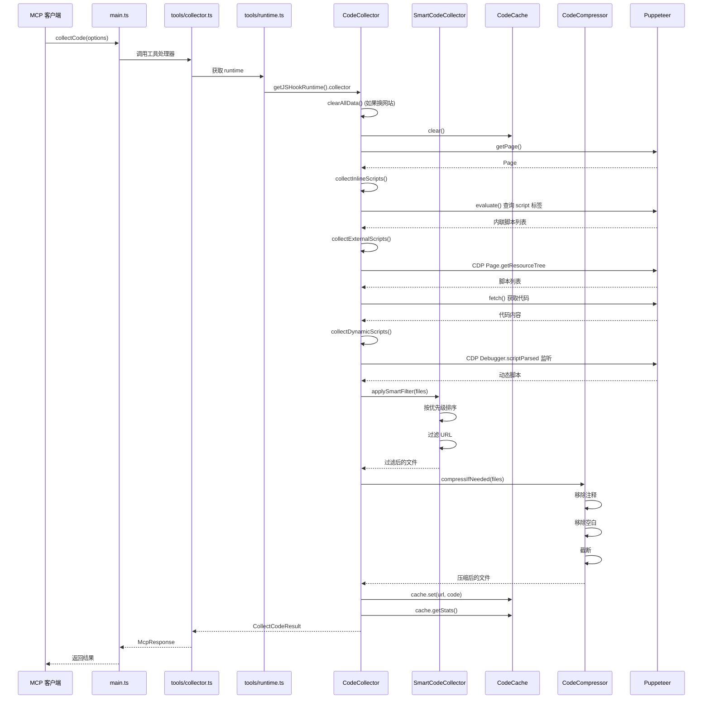
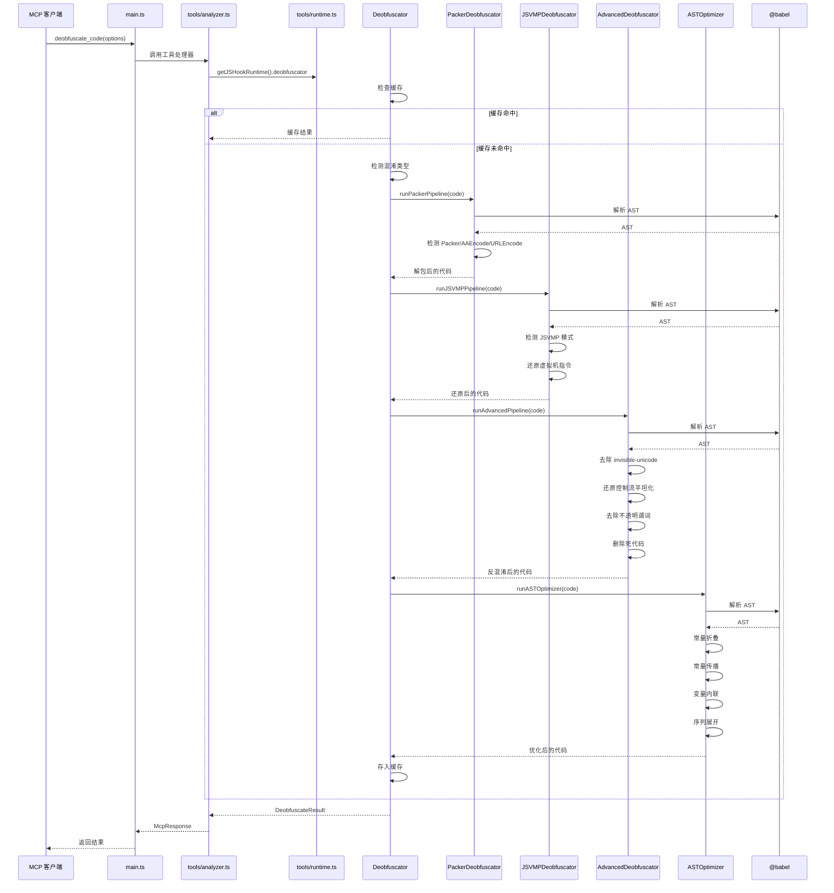
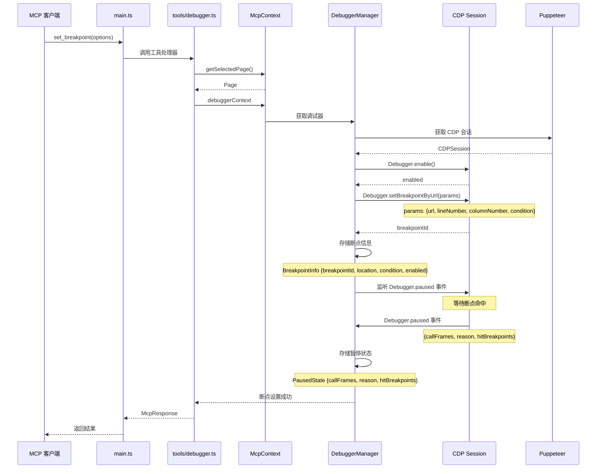
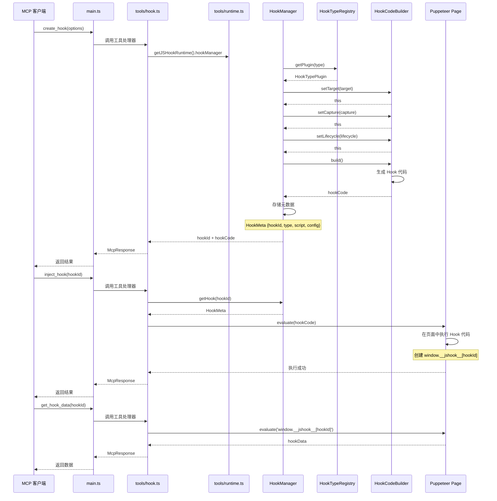

# JSReverser-MCP 项目全面技术分析文档

> 文档版本: 1.0.0
> 生成日期: 2026-03-19
> 项目版本: 2.0.3
> 分析对象: JSReverser-MCP 完整源码 (97个TypeScript文件)

---

## 目录

1. [项目整体与核心模块分析](#1-项目整体与核心模块分析)
2. [设计模式与架构风格分析](#2-设计模式与架构风格分析)
3. [可视化图表](#3-可视化图表)
4. [二次开发与架构优化建议](#4-二次开发与架构优化建议)
5. [项目目录结构解析](#5-项目目录结构解析)
6. [新开发者实战入门指南](#6-新开发者实战入门指南)

---

## 1. 项目整体与核心模块分析

### 1.1 项目概览

**JSReverser-MCP** 是一个基于 Model Context Protocol (MCP) 的 JavaScript 逆向工程工具链，旨在标准化前端 JavaScript 逆向流程。项目采用 TypeScript 编写，基于 Node.js 运行时，深度集成 Puppeteer 浏览器自动化和 Chrome DevTools Protocol (CDP)。

#### 核心定位
- **目标用户**: 安全研究员、逆向工程师、前端开发者
- **核心价值**: 将逆向工程流程从"临时调试"转变为"可复用工作流"
- **设计哲学**: Observe-first → Hook-preferred → Breakpoint-last → Rebuild-oriented → Evidence-first

#### 技术栈概览
- **运行时**: Node.js 20.19.0+ / 22.12.0+
- **语言**: TypeScript 5.9.2 (ES2023)
- **浏览器自动化**: Puppeteer 24.31.0 + puppeteer-extra-plugin-stealth
- **AST 处理**: @babel/parser, @babel/traverse, @babel/generator
- **AI 集成**: OpenAI, Anthropic, Gemini
- **协议**: Model Context Protocol (MCP) 1.21.1

---

### 1.2 核心模块架构图

```
JSReverser-MCP
├── 入口层
│   ├── main.ts - MCP 服务器启动与工具注册
│   ├── index.ts - 版本检查与模块加载
│   └── cli.ts - 命令行参数解析
│
├── 上下文层
│   ├── McpContext.ts - MCP 会话上下文 (页面/调试器/收集器管理)
│   ├── DebuggerContext.ts - CDP 调试器上下文
│   └── WaitForHelper.ts - 异步等待辅助
│
├── 工具层
│   ├── tools/debugger.ts - 断点、单步执行、脚本查询
│   ├── tools/analyzer.ts - AI 辅助代码分析、反混淆
│   ├── tools/hook.ts - Hook 注入与数据采集
│   ├── tools/collector.ts - 代码收集与导出
│   ├── tools/network.ts - 网络请求分析
│   ├── tools/page.ts - 页面自动化
│   └── tools/... (共15个工具文件)
│
├── 核心模块层
│   ├── modules/collector/ - 代码收集模块
│   │   ├── CodeCollector.ts - 代码收集器 (42.56KB)
│   │   ├── SmartCodeCollector.ts - 智能收集策略
│   │   ├── CodeCache.ts - 代码缓存管理
│   │   ├── CodeCompressor.ts - 代码压缩与截断
│   │   ├── DOMInspector.ts - DOM 检查器
│   │   └── PageController.ts - 页面控制器
│   │
│   ├── modules/debugger/ - 调试器模块
│   │   ├── DebuggerManager.ts - 调试器核心 (36.02KB)
│   │   ├── ScriptManager.ts - 脚本管理
│   │   ├── RuntimeInspector.ts - 运行时检查
│   │   ├── WatchExpressionManager.ts - 监视表达式
│   │   ├── EventBreakpointManager.ts - 事件断点
│   │   ├── XHRBreakpointManager.ts - XHR 断点
│   │   └── BlackboxManager.ts - 黑箱脚本管理
│   │
│   ├── modules/hook/ - Hook 模块
│   │   ├── HookManager.ts - Hook 管理器 (15.65KB)
│   │   ├── HookCodeBuilder.ts - Hook 代码构建器 (15.25KB)
│   │   ├── HookTypeRegistry.ts - Hook 类型注册表 (37.44KB)
│   │   ├── AIHookGenerator.ts - AI 驱动 Hook 生成
│   │   └── index.ts - 模块导出
│   │
│   ├── modules/deobfuscator/ - 反混淆模块
│   │   ├── Deobfuscator.ts - 反混淆主管线 (35KB)
│   │   ├── AdvancedDeobfuscator.ts - 高级反混淆 (42.81KB)
│   │   ├── JSVMPDeobfuscator.ts - JSVMP 专项还原 (36.95KB)
│   │   ├── ASTOptimizer.ts - AST 优化器 (9.59KB)
│   │   └── PackerDeobfuscator.ts - Packer 解包器 (8.4KB)
│   │
│   ├── modules/analyzer/ - 分析器模块
│   │   ├── CodeAnalyzer.ts - 代码分析器 (60.13KB)
│   │   └── AISummarizer.ts - AI 摘要器 (8.25KB)
│   │
│   ├── modules/crypto/ - 加密检测模块
│   │   ├── CryptoDetector.ts - 加密检测器 (8.71KB)
│   │   ├── CryptoDetectorEnhanced.ts - 增强检测器 (12.13KB)
│   │   └── CryptoRules.ts - 加密规则库 (11.51KB)
│   │
│   ├── modules/browser/ - 浏览器模块
│   │   └── BrowserModeManager.ts - 浏览器模式管理 (12.13KB)
│   │
│   └── modules/stealth/ - 反检测模块
│       └── StealthScripts2025.ts - 2025反检测脚本 (31.17KB)
│
├── 服务层
│   ├── services/LLMService.ts - LLM 服务抽象
│   ├── services/OpenAIProvider.ts - OpenAI 适配器
│   ├── services/AnthropicProvider.ts - Anthropic 适配器
│   ├── services/GeminiProvider.ts - Gemini 适配器
│   └── services/AIService.ts - AI 服务统一接口
│
├── 工具与适配器层
│   ├── utils/TokenBudgetManager.ts - Token 预算管理
│   ├── utils/UnifiedCacheManager.ts - 统一缓存管理
│   ├── utils/AdaptiveDataSerializer.ts - 自适应数据序列化
│   ├── utils/DetailedDataManager.ts - 详细数据管理
│   ├── utils/CacheAdapters.ts - 缓存适配器
│   ├── utils/config.ts - 配置管理
│   └── utils/logger.ts - 日志系统
│
├── 收集器层
│   ├── PageCollector.ts - 页面收集器 (网络/控制台)
│   ├── WebSocketCollector.ts - WebSocket 收集器
│   └── DevToolsConnectionAdapter.ts - DevTools 连接适配
│
├── 响应处理层
│   ├── McpResponse.ts - MCP 响应构建器 (18.78KB)
│   ├── formatters/ - 数据格式化器
│   │   ├── consoleFormatter.ts
│   │   ├── networkFormatter.ts
│   │   └── websocketFormatter.ts
│   └── trace-processing/ - 追踪处理
│
└── 类型定义层
    ├── types/index.ts - 核心类型定义 (20.76KB)
    ├── tools/ToolDefinition.ts - 工具定义基类
    └── tools/ToolRegistry.ts - 工具注册表
```

---

### 1.3 核心模块详细分析

#### 1.3.1 入口与启动模块

##### **模块**: `src/main.ts` + `src/index.ts`

**职责说明**
- 版本检查 (Node.js 20.19.0+ / 22.12.0+)
- MCP 服务器初始化
- 工具注册与路由
- 上下文管理与生命周期控制

**核心流程**
```typescript
index.ts → 版本检查 → main.ts
    ↓
解析命令行参数 (cli.ts)
    ↓
初始化 McpServer
    ↓
注册工具 (15个工具模块 → ToolRegistry → registerTool)
    ↓
连接 Stdio 传输层
    ↓
启动监听
```

**关键类/函数**
| 名称 | 类型 | 职责 |
|------|------|------|
| `parseArguments()` | Function | 解析 CLI 参数 (headless, browserUrl, wsEndpoint...) |
| `McpContext.from()` | Static Method | 创建 MCP 上下文，初始化收集器/调试器 |
| `registerTool()` | Function | 注册单个工具到 MCP 服务器 |
| `ToolRegistry` | Class | 工具注册表，支持别名、去重、分类 |
| `ToolExecutionScheduler` | Class | 工具执行调度器 (读写分离) |
| `TokenBudgetManager` | Class | Token 预算管理器，防止响应溢出 |

**模块依赖关系**
```
main.ts
├── cli.ts (参数解析)
├── browser.ts (浏览器连接)
├── McpContext.ts (上下文)
├── tools/* (工具模块)
│   ├── debugger.ts
│   ├── analyzer.ts
│   ├── hook.ts
│   ├── collector.ts
│   └── ...
├── third_party/index.ts (MCP SDK)
└── utils/ (工具类)
```

**潜在问题**
1. **启动时序依赖**: `McpContext.from()` 是异步初始化，但在工具调用时才首次创建，可能导致首次调用延迟
2. **单例模式限制**: `runtime` 在 `tools/runtime.ts` 中是单例，难以支持多浏览器实例
3. **错误处理**: 缺少全局异常捕获和优雅降级机制

---

#### 1.3.2 上下文管理模块

##### **模块**: `src/McpContext.ts` (19.05KB)

**职责说明**
- 管理 Page 选择与切换
- 协调三个收集器 (Network/Console/WebSocket)
- 管理 Debugger 上下文
- 处理 DevTools 窗口检测
- 超时与网络条件控制

**核心流程**
```
用户请求工具
    ↓
getContext() (首次调用时初始化 McpContext)
    ↓
选择 Page → 初始化三个 Collector
    ↓
绑定 Debugger (CDP 会话)
    ↓
执行工具逻辑
    ↓
返回结果 + 清理资源
```

**关键类/函数**

| 名称 | 类型 | 说明 |
|------|------|------|
| `McpContext` | Class | MCP 上下文核心类 |
| `#pages` | Private Field | 页面列表 |
| `#selectedPage` | Private Field | 当前选中页面 |
| `#debuggerContext` | Private Field | 调试器上下文 |
| `#networkCollector` | Private Field | 网络收集器 |
| `#consoleCollector` | Private Field | 控制台收集器 |
| `#webSocketCollector` | Private Field | WebSocket 收集器 |
| `getSelectedPage()` | Method | 获取当前选中页面，若已关闭则抛出错误 |
| `selectPage(newPage)` | Method | 切换选中页面，自动重新初始化调试器 |
| `getNetworkRequests()` | Method | 获取网络请求列表 |
| `getConsoleData()` | Method | 获取控制台消息 |
| `createPagesSnapshot()` | Method | 创建页面快照 |
| `detectOpenDevToolsWindows()` | Method | 检测并映射 DevTools 窗口 |

**设计模式应用**
- **Facade Pattern**: 对外提供统一接口，隐藏内部收集器复杂性
- **Observer Pattern**: 监听 Page 事件 (dialog, close)
- **Singleton Pattern (隐式)**: 通过 `getContext()` 单例访问

**模块依赖关系**
```
McpContext
├── DebuggerContext
├── PageCollector (网络/控制台)
├── WebSocketCollector
├── WaitForHelper
└── Puppeteer (Browser/Page)
```

**潜在问题**
1. **状态同步问题**: `#selectedPage` 切换时，收集器需要手动更新页面引用，存在忘记更新的风险
2. **内存泄漏风险**: WeakMap 用于存储配置，但 Collector 内部可能有强引用导致页面无法 GC
3. **DevTools 检测依赖**: `detectOpenDevToolsWindows()` 依赖 URL 匹配，可能误判

---

#### 1.3.3 代码收集模块

##### **模块**: `src/modules/collector/CodeCollector.ts` (42.56KB)

**职责说明**
- 收集页面 JavaScript 代码 (内联/外部/动态)
- 管理 CDP 会话与网络拦截
- 提供智能收集策略 (按优先级/范围)
- 缓存管理 (LRU 淘汰)
- 代码压缩与截断 (防止 MCP token 溢出)

**核心流程**
```
collectCode(options)
    ↓
清除旧缓存 (如果换网站)
    ↓
收集内联脚本 (DOM 查询)
    ↓
收集外部脚本 (CDP + fetch)
    ↓
收集动态脚本 (CDP 监听)
    ↓
智能过滤 (按优先级/大小)
    ↓
压缩代码 (CodeCompressor)
    ↓
返回摘要 + 完整数据(缓存)
```

**关键类/函数**

| 名称 | 类型 | 说明 |
|------|------|------|
| `CodeCollector` | Class | 代码收集器核心 |
| `SmartCodeCollector` | Class | 智能收集策略 |
| `CodeCache` | Class | 代码缓存 (LRU) |
| `CodeCompressor` | Class | 代码压缩器 |
| `collectCode()` | Method | 主收集方法 |
| `clearAllData()` | Method | 清除所有收集数据 |
| `collectInlineScripts()` | Method | 收集内联脚本 |
| `collectExternalScripts()` | Method | 收集外部脚本 |
| `collectDynamicScripts()` | Method | 收集动态脚本 |
| `applySmartFilter()` | Method | 应用智能过滤 |
| `compressIfNeeded()` | Method | 按需压缩代码 |

**核心策略**
```typescript
// 策略1: 收集阶段 - 可以收集大量文件
this.MAX_COLLECTED_URLS = 10000;
this.collectedFilesCache = new Map();

// 策略2: 返回阶段 - 限制单次响应大小
this.MAX_FILES_PER_COLLECT = 200;
this.MAX_RESPONSE_SIZE = 512 * 1024; // 512KB
this.MAX_SINGLE_FILE_SIZE = 200 * 1024; // 200KB
```

**模块依赖关系**
```
CodeCollector
├── CodeCache (缓存)
├── SmartCodeCollector (智能策略)
├── CodeCompressor (压缩)
├── BrowserModeManager (浏览器)
└── Puppeteer (CDP)
```

**潜在问题**
1. **内存泄漏风险**: `collectedFilesCache` 是强引用 Map，无上限，大型网站可能导致内存溢出
2. **CDP 会话泄漏**: `cdpSession` 和监听器未在页面关闭时清理
3. **超时问题**: `RESPONSE_BODY_TIMEOUT_MS` 固定为 3s，慢网络环境可能失败
4. **重复收集**: 缓存机制在跨页面时未自动清除

---

#### 1.3.4 调试器模块

##### **模块**: `src/modules/debugger/DebuggerManager.ts` (36.02KB)

**职责说明**
- 断点管理 (设置/删除/列出/条件断点)
- 执行控制 (暂停/继续/单步执行)
- 调用栈管理
- 作用域变量获取
- 监视表达式管理
- XHR/事件断点

**核心流程**
```
setBreakpoint(location, condition)
    ↓
通过 CDP 发送 Debugger.setBreakpointByUrl
    ↓
存储断点信息 (BreakpointInfo)
    ↓
等待 Paused 事件
    ↓
记录调用帧、作用域、命中断点
    ↓
通过 getScopeVariables() 获取变量
```

**关键类/函数**

| 名称 | 类型 | 说明 |
|------|------|------|
| `DebuggerManager` | Class | 调试器管理器 |
| `ScriptManager` | Class | 脚本管理器 |
| `RuntimeInspector` | Class | 运行时检查器 |
| `WatchExpressionManager` | Class | 监视表达式管理器 |
| `EventBreakpointManager` | Class | 事件断点管理器 |
| `XHRBreakpointManager` | Class | XHR 断点管理器 |
| `enable()` | Method | 启用调试器 (CDP) |
| `setBreakpoint()` | Method | 设置断点 |
| `removeBreakpoint()` | Method | 删除断点 |
| `stepOver/stepInto/stepOut` | Method | 单步执行 |
| `getScopeVariables()` | Method | 获取作用域变量 |
| `evaluate()` | Method | 在暂停上下文中求值 |

**断点数据结构**
```typescript
interface BreakpointInfo {
  breakpointId: string;
  location: {
    scriptId?: string;
    url?: string;
    lineNumber: number;
    columnNumber?: number;
  };
  condition?: string;
  enabled: boolean;
  hitCount: number;
  createdAt: number;
}

interface PausedState {
  callFrames: CallFrame[];
  reason: string;
  data?: any;
  hitBreakpoints?: string[];
  timestamp: number;
}
```

**模块依赖关系**
```
DebuggerManager
├── CDPSession (Puppeteer)
├── WatchExpressionManager
├── EventBreakpointManager
├── XHRBreakpointManager
└── BlackboxManager
```

**潜在问题**
1. **状态不一致**: 断点状态与 CDP 实际状态可能不同步
2. **内存泄漏**: `breakpointId` 到 `BreakpointInfo` 的映射未清理
3. **单步执行卡死**: 未设置超时，可能导致无限等待
4. **SourceMap 支持**: 未充分利用 SourceMap 信息

---

#### 1.3.5 Hook 模块

##### **模块**: `src/modules/hook/HookManager.ts` (15.65KB)

**职责说明**
- Hook 代码生成 (基于 HookCodeBuilder)
- Hook 类型注册 (HookTypeRegistry)
- Hook 元数据管理
- 数据回传与导出
- 反调试脚本生成

**核心流程**
```
createHook(options)
    ↓
查询 HookTypeRegistry 获取插件
    ↓
通过 HookCodeBuilder 生成代码
    ↓
存储 Hook 元数据
    ↓
返回代码字符串

injectHook(hookId)
    ↓
获取 Hook 代码
    ↓
通过 Page.evaluate() 注入到页面
    ↓
开始监听数据

getHookData(hookId)
    ↓
从页面全局对象读取数据
    ↓
格式化并返回
```

**关键类/函数**

| 名称 | 类型 | 说明 |
|------|------|------|
| `HookManager` | Class | Hook 管理器 (Facade) |
| `HookCodeBuilder` | Class | Hook 代码构建器 |
| `HookTypeRegistry` | Class | Hook 类型注册表 |
| `AIHookGenerator` | Class | AI 驱动 Hook 生成 |
| `createHook()` | Method | 创建 Hook 定义 |
| `generateHookCode()` | Method | 生成 Hook 代码 |
| `injectHook()` | Method | 注入 Hook 到页面 |
| `getHookData()` | Method | 获取 Hook 数据 |
| `listHooks()` | Method | 列出所有 Hook |
| `registerHookType()` | Method | 注册新的 Hook 类型 |

**Hook 配置结构**
```typescript
interface HookCreateOptions {
  type: string;  // Hook 类型名称
  params?: Record<string, unknown>;
  hookId?: string;
  description?: string;
  action?: 'log' | 'block' | 'modify' | 'passthrough';
  capture?: {
    args?: boolean;
    returnValue?: boolean;
    stack?: boolean | number;
    timing?: boolean;
    thisContext?: boolean;
  };
  condition?: {
    expression?: string;
    maxCalls?: number;
    minInterval?: number;
    urlPattern?: string;
  };
  lifecycle?: {
    before?: string;
    after?: string;
    onError?: string;
    onFinally?: string;
    replace?: string;
  };
  store?: {
    globalKey?: string;
    maxRecords?: number;
    console?: boolean;
  };
  asyncAware?: boolean;
}
```

**模块依赖关系**
```
HookManager
├── HookCodeBuilder
├── HookTypeRegistry
└── AIHookGenerator (可选)
```

**设计模式应用**
- **Facade Pattern**: HookManager 对外提供统一接口
- **Builder Pattern**: HookCodeBuilder 构建复杂 Hook 代码
- **Registry Pattern**: HookTypeRegistry 管理可扩展的 Hook 类型
- **Strategy Pattern**: 不同 Hook 类型对应不同代码生成策略

**潜在问题**
1. **全局污染**: Hook 数据存储在 `window.__jshook__`，可能与页面代码冲突
2. **内存泄漏**: Hook 数据无自动清理机制
3. **异步 Hook 未完善**: `asyncAware` 选项未完全实现
4. **代码注入检测**: Hook 代码可能被反检测机制识别

---

#### 1.3.6 反混淆模块

##### **模块**: `src/modules/deobfuscator/Deobfuscator.ts` (35KB)

**职责说明**
- 统一调度所有反混淆子模块
- 自动检测混淆类型并选择管线
- 管线执行: Packer → JSVMP → Advanced → AST Optimizer → 基础清理
- 结果缓存与 LRU 淘汰
- 警告与未解决部分收集

**核心流程**
```
deobfuscate(options)
    ↓
检查缓存
    ↓
检测混淆类型
    ↓
按顺序执行管线:
  1. PackerDeobfuscator (解包)
  2. JSVMPDeobfuscator (VM 保护还原)
  3. AdvancedDeobfuscator (高级混淆)
  4. ASTOptimizer (AST 优化)
  5. 基础管线 (字符串解码/变量重命名)
    ↓
收集警告与未解决部分
    ↓
返回结果
```

**关键类/函数**

| 名称 | 类型 | 说明 |
|------|------|------|
| `Deobfuscator` | Class | 反混淆主管线 |
| `AdvancedDeobfuscator` | Class | 高级反混淆 (42.81KB) |
| `JSVMPDeobfuscator` | Class | JSVMP 专项还原 (36.95KB) |
| `ASTOptimizer` | Class | AST 优化器 |
| `PackerDeobfuscator` | Class | Packer 解包器 |
| `deobfuscate()` | Method | 主反混淆方法 |
| `detectObfuscationType()` | Method | 检测混淆类型 |
| `runPackerPipeline()` | Method | 执行 Packer 管线 |
| `runJSVMPPipeline()` | Method | 执行 JSVMP 管线 |
| `runAdvancedPipeline()` | Method | 执行高级反混淆管线 |
| `runASTOptimizer()` | Method | 执行 AST 优化 |

**反混淆管线**
```typescript
// 管线1: Packer / AAEncode / URLEncode 解包
UniversalUnpacker.unpack()

// 管线2: JSVMP 虚拟机保护还原
JSVMPDeobfuscator.restore()

// 管线3: 高级混淆还原
AdvancedDeobfuscator.deobfuscate()
  ├── invisible-unicode 去除
  ├── 控制流平坦化还原
  ├── 不透明谓词去除
  ├── 死代码删除
  └── ...

// 管线4: AST 优化
ASTOptimizer.optimize()
  ├── 常量折叠
  ├── 常量传播
  ├── 变量内联
  ├── 序列展开
  └── ...

// 管线5: 基础管线
  ├── 字符串数组提取/替换
  ├── 字符串解码
  ├── 表达式简化
  └── 变量重命名
```

**模块依赖关系**
```
Deobfuscator
├── PackerDeobfuscator
├── JSVMPDeobfuscator
├── AdvancedDeobfuscator
├── ASTOptimizer
├── LLMService (可选)
└── @babel/* (AST 处理)
```

**设计模式应用**
- **Pipeline Pattern**: 多个反混淆步骤串联执行
- **Strategy Pattern**: 不同混淆类型使用不同策略
- **Template Method Pattern**: 固定管线顺序，子步骤可配置

**潜在问题**
1. **AST 性能**: 大型文件 AST 遍历可能非常慢
2. **误判风险**: 混淆类型检测可能误判，导致执行错误的管线
3. **回滚机制**: 单步失败不影响整体，但也无法回滚
4. **Token 溢出**: LLM 辅助分析可能导致 token 超限

---

#### 1.3.7 分析器模块

##### **模块**: `src/modules/analyzer/CodeAnalyzer.ts` (60.13KB)

**职责说明**
- 静态代码分析 (结构/业务逻辑/安全风险)
- AI 辅助代码理解
- 加密算法检测
- 风险评估与评分

**核心流程**
```
understand(options)
    ↓
静态分析
  ├── 解析 AST
  ├── 提取函数/类/变量
  ├── 分析控制流
  ├── 检测敏感模式
  └── 计算复杂度
    ↓
AI 辅助分析 (可选)
  ├── 结构分析
  ├── 业务逻辑分析
  └── 安全风险分析
    ↓
聚合结果
```

**关键类/函数**

| 名称 | 类型 | 说明 |
|------|------|------|
| `CodeAnalyzer` | Class | 代码分析器 |
| `AISummarizer` | Class | AI 摘要器 |
| `understand()` | Method | 代码理解主方法 |
| `analyzeStructure()` | Method | 结构分析 |
| `analyzeBusinessLogic()` | Method | 业务逻辑分析 |
| `analyzeSecurity()` | Method | 安全风险分析 |
| `detectCrypto()` | Method | 加密检测 |
| `extractFunctions()` | Method | 提取函数 |
| `extractClasses()` | Method | 提取类 |

**分析结果结构**
```typescript
interface CodeAnalysisResult {
  structure: {
    functions: FunctionInfo[];
    classes: ClassInfo[];
    variables: VariableInfo[];
    imports: ImportInfo[];
  };
  businessLogic: {
    purpose: string;
    keyAlgorithms: string[];
    dataFlow: DataFlowInfo[];
  };
  security: {
    risks: RiskInfo[];
    score: number;
    recommendations: string[];
  };
  crypto: {
    detected: boolean;
    algorithms: string[];
    libraries: string[];
  };
}
```

**模块依赖关系**
```
CodeAnalyzer
├── CryptoDetector
├── LLMService (可选)
└── @babel/* (AST 处理)
```

**潜在问题**
1. **AST 解析失败**: 某些非标准语法会导致解析失败
2. **AI 依赖**: 大部分分析依赖 LLM，离线场景受限
3. **误报/漏报**: 静态分析可能产生误报
4. **性能问题**: 大文件分析非常慢

---

#### 1.3.8 服务层

##### **模块**: `src/services/`

**职责说明**
- LLM 服务抽象与多提供商支持
- API 调用封装
- 流式响应处理
- 错误重试与降级

**核心架构**
```
LLMService (抽象接口)
├── OpenAIProvider (OpenAI API)
├── AnthropicProvider (Anthropic API)
└── GeminiProvider (Gemini API + CLI)
```

**关键类/函数**

| 名称 | 类型 | 说明 |
|------|------|------|
| `LLMService` | Class | LLM 服务抽象 |
| `OpenAIProvider` | Class | OpenAI 适配器 |
| `AnthropicProvider` | Class | Anthropic 适配器 |
| `GeminiProvider` | Class | Gemini 适配器 |
| `chat()` | Method | 聊天接口 |
| `streamChat()` | Method | 流式聊天 |
| `analyzeCode()` | Method | 代码分析 |

**设计模式应用**
- **Strategy Pattern**: 不同 LLM 提供商使用不同策略
- **Factory Pattern**: 根据配置动态创建 Provider
- **Adapter Pattern**: 统一不同提供商的 API 差异

**潜在问题**
1. **API 密钥管理**: 密钥硬编码在环境变量中，安全性一般
2. **成本控制**: 未设置调用频率限制和成本上限
3. **降级策略**: API 失败时无降级方案

---

#### 1.3.9 工具层 (Tools Layer)

##### **模块**: `src/tools/` (15个工具文件)

**职责说明**
- 将核心模块能力封装为 MCP 工具
- 处理工具参数验证 (Zod Schema)
- 管理工具元数据 (描述/分类/权限)
- 处理工具执行与响应构建

**核心架构**
```
ToolDefinition (基类)
├── defineTool() - 工具定义函数
└── ToolRegistry - 工具注册表

具体工具:
├── debugger.ts (断点/脚本/调试控制)
├── analyzer.ts (代码分析/反混淆/摘要)
├── hook.ts (Hook 管理/注入)
├── collector.ts (代码收集)
├── network.ts (网络请求)
├── page.ts (页面自动化)
├── frames.ts (Frame 管理)
├── console.ts (控制台)
├── script.ts (脚本管理)
├── screenshot.ts (截图)
├── websocket.ts (WebSocket)
├── dom.ts (DOM 操作)
├── stealth.ts (反检测)
├── pages.ts (页面列表)
├── rebuild.ts (本地复现)
├── input.ts (输入自动化)
├── emulation.ts (设备仿真)
└── dialog.ts (弹窗处理)
```

**工具注册流程**
```typescript
// main.ts 中的工具注册
const toolSources = [
  {source: 'console', tools: asTools(consoleTools)},
  {source: 'debugger', tools: asTools(debuggerTools)},
  {source: 'jshookAnalyzer', tools: asTools(jshookAnalyzerTools)},
  // ...
];

const registry = new ToolRegistry();
registry.registerMany(applyCanonicalSelection(tools));

for (const tool of registeredTools) {
  registerTool(tool); // 注册到 MCP 服务器
}
```

**工具分类**
```typescript
enum ToolCategory {
  NAVIGATION = 'navigation',
  NETWORK = 'network',
  DEBUGGING = 'debugging',
  REVERSE_ENGINEERING = 'reverse_engineering',
  INPUT = 'input',
  EMULATION = 'emulation',
}
```

**潜在问题**
1. **工具爆炸**: 15个工具文件，200+ 工具函数，难以维护
2. **参数冗余**: 相似工具参数重复定义
3. **工具冲突**: 别名机制可能导致工具重复注册
4. **测试覆盖**: 工具层测试不足

---

### 1.4 模块间调用关系图

```mermaid
graph TD
    A[main.ts 入口] --> B[McpContext 上下文]
    A --> C[ToolRegistry 工具注册]
    A --> D[ToolExecutionScheduler 调度器]

    B --> E[DebuggerContext 调试器]
    B --> F[PageCollector 网络收集]
    B --> G[WebSocketCollector WS收集]
    B --> H[ConsoleCollector 控制台收集]

    I[tools/debugger] --> E
    I --> J[DebuggerManager]
    J --> K[ScriptManager]
    J --> L[WatchExpressionManager]
    J --> M[EventBreakpointManager]
    J --> N[XHRBreakpointManager]

    O[tools/analyzer] --> P[CodeAnalyzer]
    O --> Q[Deobfuscator]
    P --> R[CryptoDetector]
    P --> S[AISummarizer]
    Q --> T[AdvancedDeobfuscator]
    Q --> U[JSVMPDeobfuscator]
    Q --> V[ASTOptimizer]
    Q --> W[PackerDeobfuscator]

    X[tools/hook] --> Y[HookManager]
    Y --> Z[HookCodeBuilder]
    Y --> AA[HookTypeRegistry]
    Y --> AB[AIHookGenerator]

    AC[tools/collector] --> AD[CodeCollector]
    AD --> AE[SmartCodeCollector]
    AD --> AF[CodeCache]
    AD --> AG[CodeCompressor]
    AD --> AH[BrowserModeManager]

    AI[tools/page] --> AH
    AI --> AJ[PageController]
    AI --> AK[DOMInspector]

    AL[services/LLMService] --> AM[OpenAIProvider]
    AL --> AN[AnthropicProvider]
    AL --> AO[GeminiProvider]
    S --> AL
    AB --> AL
    P --> AL

    AP[utils/TokenBudgetManager] -.监控.-> A
    AQ[utils/UnifiedCacheManager] -.缓存管理.-> AD
    AR[utils/DetailedDataManager] -.数据管理.-> AD

    style A fill:#e1f5ff
    style B fill:#fff4e1
    style I fill:#ffe1e1
    style O fill:#ffe1e1
    style X fill:#ffe1e1
    style AC fill:#ffe1e1
```



---

### 1.5 潜在架构问题总结

#### 1.5.1 耦合问题
1. **循环依赖**: `McpContext` 依赖 `DebuggerContext`，调试工具又依赖 `McpContext`
2. **隐式依赖**: `tools/runtime.ts` 中的单例 `JSHookRuntime` 被多处隐式使用
3. **全局状态**: `TokenBudgetManager`、`UnifiedCacheManager` 等单例难以测试

#### 1.5.2 性能问题
1. **内存泄漏**:
   - `CodeCollector.collectedFilesCache` 无上限
   - CDP 会话和监听器未清理
   - Hook 数据无自动清理
2. **重复计算**:
   - 反混淆管线每次都完整执行
   - 代码收集未充分利用缓存
3. **阻塞操作**:
   - AST 遍历阻塞主线程
   - 大型文件收集耗时过长

#### 1.5.3 可维护性问题
1. **模块职责不清**: `main.ts` 承担了太多责任 (启动/注册/调度)
2. **工具层爆炸**: 15个工具文件，200+ 工具函数
3. **配置分散**: 配置分散在 `cli.ts`、`utils/config.ts`、环境变量中
4. **错误处理不一致**: 不同模块错误处理方式不同

#### 1.5.4 可扩展性问题
1. **硬编码限制**: 各种 `MAX_*` 常量硬编码，难以动态调整
2. **工具注册繁琐**: 新增工具需要修改多处
3. **Hook 类型扩展困难**: 需要修改 `HookTypeRegistry` 核心代码

---

## 2. 设计模式与架构风格分析

### 2.1 已使用的设计模式

#### 2.1.1 创建型模式

##### **Singleton Pattern (单例模式)**
- **使用位置**:
  - `src/tools/runtime.ts`: `JSHookRuntime` 单例
  - `src/utils/DetailedDataManager.ts`: `getInstance()`
  - `src/utils/UnifiedCacheManager.ts`: `getInstance()`
  - `src/utils/TokenBudgetManager.ts`: `getInstance()`
- **解决的问题**: 确保全局只有一个实例，避免重复初始化
- **实现方式**:
  ```typescript
  let runtime: JSHookRuntime | undefined;
  export function getJSHookRuntime(): JSHookRuntime {
    if (runtime) {
      return runtime;
    }
    runtime = { /* 初始化 */ };
    return runtime;
  }
  ```
- **优点**:
  - 简单直观
  - 确保资源只初始化一次
- **缺点**:
  - 难以测试 (无法 mock)
  - 难以支持多实例场景
  - 违反依赖注入原则
- **优化建议**: 引入依赖注入容器，将单例改为服务注册

---

##### **Factory Pattern (工厂模式)**
- **使用位置**:
  - `src/services/LLMService.ts`: 根据配置创建不同的 Provider
  - `src/tools/runtime.ts`: 创建各种模块实例
- **解决的问题**: 封装对象创建逻辑，支持不同实现
- **实现方式**:
  ```typescript
  export class LLMService {
    private provider: LLMProvider;

    constructor() {
      const providerType = process.env.DEFAULT_LLM_PROVIDER;
      switch (providerType) {
        case 'openai':
          this.provider = new OpenAIProvider();
          break;
        case 'anthropic':
          this.provider = new AnthropicProvider();
          break;
        case 'gemini':
          this.provider = new GeminiProvider();
          break;
        default:
          throw new Error(`Unknown provider: ${providerType}`);
      }
    }
  }
  ```
- **优点**:
  - 解耦对象创建与使用
  - 易于扩展新的 Provider
- **缺点**:
  - switch-case 难以维护
  - 违反开闭原则
- **优化建议**: 使用注册表模式替代 switch-case

---

##### **Builder Pattern (建造者模式)**
- **使用位置**:
  - `src/modules/hook/HookCodeBuilder.ts`: 构建 Hook 代码
  - `src/McpResponse.ts`: 构建 MCP 响应
- **解决的问题**: 构建复杂对象，避免构造函数参数过多
- **实现方式**:
  ```typescript
  export class HookCodeBuilder {
    private config: BuilderConfig = {};

    setTarget(target: string): this {
      this.config.target = target;
      return this;
    }

    setCapture(capture: CaptureConfig): this {
      this.config.capture = capture;
      return this;
    }

    setLifecycle(lifecycle: LifecycleConfig): this {
      this.config.lifecycle = lifecycle;
      return this;
    }

    build(): string {
      // 生成 Hook 代码
      return generateCode(this.config);
    }
  }

  // 使用
  const hookCode = new HookCodeBuilder()
    .setTarget('window.fetch')
    .setCapture({ args: true, returnValue: true })
    .setLifecycle({ before: 'console.log("Before")' })
    .build();
  ```
- **优点**:
  - 链式调用，代码可读性好
  - 分步构建，灵活性高
- **缺点**:
  - 可能产生大量中间对象
  - 难以保证构建状态一致性
- **评价**: 实现良好，符合 Builder 模式标准

---

#### 2.1.2 结构型模式

##### **Facade Pattern (外观模式)**
- **使用位置**:
  - `src/McpContext.ts`: 对外提供统一接口，隐藏内部收集器复杂性
  - `src/modules/hook/HookManager.ts`: Hook 模块的统一入口
  - `src/modules/deobfuscator/Deobfuscator.ts`: 反混淆管线的统一入口
- **解决的问题**: 简化复杂子系统的访问
- **实现方式**:
  ```typescript
  export class McpContext {
    // 外部只看到这些简单接口
    getNetworkRequests(): HTTPRequest[] {
      return this.#networkCollector.getData(page);
    }

    getConsoleData(): ConsoleMessage[] {
      return this.#consoleCollector.getData(page);
    }

    // 内部复杂性被隐藏
  }
  ```
- **优点**:
  - 降低客户端与子系统的耦合
  - 提高代码可读性
- **缺点**:
  - 可能过度简化，暴露了不必要的接口
- **评价**: 实现良好，是 Facade 模式的典型应用

---

##### **Adapter Pattern (适配器模式)**
- **使用位置**:
  - `src/utils/CacheAdapters.ts`: 适配不同的缓存实现
  - `src/services/OpenAIProvider.ts` / `AnthropicProvider.ts` / `GeminiProvider.ts`: 适配不同 LLM API
  - `src/formatters/consoleFormatter.ts` / `networkFormatter.ts` / `websocketFormatter.ts`: 适配不同数据格式
- **解决的问题**: 统一不同接口，使其可以互换使用
- **实现方式**:
  ```typescript
  export class CodeCacheAdapter implements CacheAdapter {
    constructor(private cache: CodeCache) {}

    async get(key: string): Promise<any> {
      return this.cache.get(key);
    }

    async set(key: string, value: any): Promise<void> {
      this.cache.set(key, value);
    }
  }

  export class CodeCompressorAdapter implements CacheAdapter {
    constructor(private compressor: CodeCompressor) {}

    async get(key: string): Promise<any> {
      return this.compressor.get(key);
    }

    async set(key: string, value: any): Promise<void> {
      this.compressor.set(key, value);
    }
  }
  ```
- **优点**:
  - 解耦接口实现
  - 易于扩展新的适配器
- **缺点**:
  - 可能引入额外的间接层
- **评价**: 实现良好，符合 Adapter 模式标准

---

##### **Decorator Pattern (装饰器模式)**
- **使用位置**:
  - `src/modules/collector/CodeCompressor.ts`: 装饰收集到的代码，添加压缩功能
  - `src/modules/stealth/StealthScripts2025.ts`: 装饰浏览器，添加反检测能力
- **解决的问题**: 动态添加功能，无需修改原有代码
- **实现方式**:
  ```typescript
  export class CodeCompressor {
    compress(code: string, maxSize: number): string {
      // 原始代码
      let compressed = code;

      // 装饰1: 移除注释
      compressed = this.removeComments(compressed);

      // 装饰2: 移除空白
      compressed = this.removeWhitespace(compressed);

      // 装饰3: 截断
      if (compressed.length > maxSize) {
        compressed = compressed.substring(0, maxSize);
      }

      return compressed;
    }
  }
  ```
- **优点**:
  - 灵活组合功能
  - 符合开闭原则
- **缺点**:
  - 可能产生过多小类
- **评价**: 部分实现，可以更明确地使用装饰器模式

---

#### 2.1.3 行为型模式

##### **Strategy Pattern (策略模式)**
- **使用位置**:
  - `src/modules/collector/SmartCodeCollector.ts`: 不同收集策略 (summary/priority/incremental/full)
  - `src/modules/hook/HookTypeRegistry.ts`: 不同 Hook 类型对应不同代码生成策略
  - `src/modules/deobfuscator/Deobfuscator.ts`: 不同混淆类型使用不同反混淆策略
  - `src/services/LLMService.ts`: 不同 LLM 提供商使用不同调用策略
- **解决的问题**: 封装可互换的算法，运行时选择
- **实现方式**:
  ```typescript
  // HookTypeRegistry
  export class HookTypeRegistry {
    private plugins = new Map<string, HookTypePlugin>();

    register(name: string, plugin: HookTypePlugin): void {
      this.plugins.set(name, plugin);
    }

    generateCode(type: string, params: Record<string, unknown>): string {
      const plugin = this.plugins.get(type);
      if (!plugin) {
        throw new Error(`Unknown hook type: ${type}`);
      }
      return plugin.generateCode(params);
    }
  }

  // 使用
  const registry = new HookTypeRegistry();
  registry.register('function', new FunctionHookPlugin());
  registry.register('method', new MethodHookPlugin());
  registry.register('constructor', new ConstructorHookPlugin());

  // 运行时选择
  const code = registry.generateCode('function', { target: 'fetch' });
  ```
- **优点**:
  - 算法可互换
  - 易于扩展新策略
- **缺点**:
  - 策略数量可能过多
  - 客户端需要了解策略差异
- **评价**: 实现良好，是 Strategy 模式的典型应用

---

##### **Observer Pattern (观察者模式)**
- **使用位置**:
  - `src/McpContext.ts`: 监听 Page 事件 (dialog, close)
  - `src/PageCollector.ts`: 监听网络/控制台事件
  - `src/WebSocketCollector.ts`: 监听 WebSocket 事件
- **解决的问题**: 对象间的一对多依赖，状态变化自动通知
- **实现方式**:
  ```typescript
  export class McpContext {
    selectPage(newPage: Page): void {
      const oldPage = this.#selectedPage;
      if (oldPage) {
        oldPage.off('dialog', this.#dialogHandler); // 取消订阅
      }
      this.#selectedPage = newPage;
      newPage.on('dialog', this.#dialogHandler); // 订阅
    }

    #dialogHandler = (dialog: Dialog): void => {
      this.#dialog = dialog;
    };
  }
  ```
- **优点**:
  - 松耦合
  - 动态订阅/取消订阅
- **缺点**:
  - 可能导致内存泄漏 (忘记取消订阅)
  - 调用顺序不确定
- **评价**: 实现良好，符合 Observer 模式标准

---

##### **Command Pattern (命令模式)**
- **使用位置**:
  - `src/tools/debugger.ts`: 断点操作、单步执行等命令
  - `src/tools/page.ts`: 页面操作命令 (导航、点击、输入)
- **解决的问题**: 将请求封装为对象，支持撤销、重做、队列
- **实现方式**:
  ```typescript
  interface ToolHandler {
    handler(request: ToolRequest, response: McpResponse, context: McpContext): Promise<void>;
  }

  export const resume = defineTool({
    name: 'resume',
    description: '继续执行',
    handler: async (request, response, context) => {
      await context.debuggerContext.resume();
      response.appendResponseLine('已继续执行');
    },
  });

  export const stepOver = defineTool({
    name: 'step_over',
    description: '单步跳过',
    handler: async (request, response, context) => {
      await context.debuggerContext.stepOver();
      response.appendResponseLine('已单步跳过');
    },
  });
  ```
- **优点**:
  - 解耦请求发送者和接收者
  - 支持命令队列
- **缺点**:
  - 可能产生大量命令类
- **评价**: 部分实现，工具函数可以看作命令的简化形式

---

##### **Template Method Pattern (模板方法模式)**
- **使用位置**:
  - `src/modules/deobfuscator/Deobfuscator.ts`: 反混淆管线模板
  - `src/modules/collector/CodeCollector.ts`: 代码收集模板
- **解决的问题**: 定义算法骨架，子步骤可变
- **实现方式**:
  ```typescript
  export class Deobfuscator {
    async deobfuscate(options: DeobfuscateFullOptions): Promise<DeobfuscateResult> {
      // 模板方法：定义管线骨架
      let code = options.code;
      const warnings: string[] = [];
      const unresolved: UnresolvedPart[] = [];

      // 步骤1: Packer 解包
      if (options.unpack) {
        const result = await this.runPackerPipeline(code);
        code = result.code;
        warnings.push(...result.warnings);
      }

      // 步骤2: JSVMP 还原
      if (options.jsvmp) {
        const result = await this.runJSVMPPipeline(code);
        code = result.code;
        warnings.push(...result.warnings);
      }

      // 步骤3: 高级反混淆
      if (options.advanced) {
        const result = await this.runAdvancedPipeline(code);
        code = result.code;
        warnings.push(...result.warnings);
      }

      // 步骤4: AST 优化
      if (options.astOptimize) {
        const result = await this.runASTOptimizer(code);
        code = result.code;
      }

      return { code, warnings, unresolved };
    }
  }
  ```
- **优点**:
  - 算法结构清晰
  - 易于维护和扩展
- **缺点**:
  - 子步骤顺序固定，灵活性受限
- **评价**: 实现良好，符合 Template Method 模式标准

---

##### **Registry Pattern (注册表模式)**
- **使用位置**:
  - `src/tools/ToolRegistry.ts`: 工具注册表
  - `src/modules/hook/HookTypeRegistry.ts`: Hook 类型注册表
- **解决的问题**: 集中管理可扩展的实体
- **实现方式**:
  ```typescript
  export class ToolRegistry {
    private tools = new Map<string, ToolDefinition>();
    private aliases = new Map<string, string>();

    register(tool: ToolDefinition): void {
      this.tools.set(tool.name, tool);
    }

    registerMany(tools: ToolDefinition[]): void {
      for (const tool of tools) {
        this.register(tool);
      }
    }

    get(name: string): ToolDefinition | undefined {
      return this.tools.get(name);
    }

    aliasesFor(name: string): string[] {
      const aliases: string[] = [];
      for (const [alias, target] of this.aliases.entries()) {
        if (target === name) {
          aliases.push(alias);
        }
      }
      return aliases;
    }
  }
  ```
- **优点**:
  - 集中管理
  - 易于查找和遍历
- **缺点**:
  - 需要手动注册
  - 可能产生注册冲突
- **评价**: 实现良好，符合 Registry 模式标准

---

#### 2.1.4 架构层级模式

##### **MVC (Model-View-Controller)**
- **使用位置**: 工具层架构
  - **Model**: `src/modules/*` 核心模块 (数据/逻辑)
  - **View**: `src/McpResponse.ts` 响应构建器 (输出格式化)
  - **Controller**: `src/tools/*` 工具函数 (请求处理)
- **解决的问题**: 分离关注点，提高可维护性
- **实现方式**:
  ```typescript
  // Controller
  export const deobfuscateCode = defineTool({
    name: 'deobfuscate_code',
    handler: async (request, response, context) => {
      // 调用 Model
      const result = await context.deobfuscator.deobfuscate(request.params);

      // 通过 View 返回
      response.appendResponseLine('```json');
      response.appendResponseLine(JSON.stringify(result, null, 2));
      response.appendResponseLine('```');
    },
  });
  ```
- **优点**:
  - 职责清晰
  - 易于测试
- **缺点**:
  - View 层较简单，可能过度设计
- **评价**: 部分实现，MVC 边界可以更清晰

---

##### **Layered Architecture (分层架构)**
- **使用位置**: 整体架构
  - **入口层**: `main.ts`, `index.ts`
  - **上下文层**: `McpContext.ts`, `DebuggerContext.ts`
  - **工具层**: `tools/*`
  - **模块层**: `modules/*`
  - **服务层**: `services/*`
  - **工具层**: `utils/*`
- **解决的问题**: 关注点分离，提高可维护性
- **优点**:
  - 层次清晰
  - 易于理解
- **缺点**:
  - 跨层调用较多 (例如工具层直接调用模块层)
  - 层次划分不够严格
- **评价**: 实现良好，但可以更严格地遵循分层原则

---

##### **Plugin Architecture (插件架构)**
- **使用位置**:
  - `src/modules/hook/HookTypeRegistry.ts`: Hook 类型插件
  - `src/modules/crypto/CryptoRules.ts`: 加密规则插件
- **解决的问题**: 运行时扩展功能
- **实现方式**:
  ```typescript
  export interface HookTypePlugin {
    name: string;
    description: string;
    generateCode(params: Record<string, unknown>): string;
    validate(params: Record<string, unknown>): boolean;
  }

  export class HookTypeRegistry {
    private plugins = new Map<string, HookTypePlugin>();

    register(plugin: HookTypePlugin): void {
      this.plugins.set(plugin.name, plugin);
    }
  }

  // 第三方可以注册自己的插件
  registry.register({
    name: 'custom-hook',
    description: '自定义 Hook',
    generateCode: (params) => { /* ... */ },
    validate: (params) => true,
  });
  ```
- **优点**:
  - 高扩展性
  - 低耦合
- **缺点**:
  - 插件发现机制不完善
  - 插件间依赖关系未处理
- **评价**: 实现良好，但可以更完善

---

### 2.2 可以引入但尚未使用的设计模式

#### 2.2.1 Dependency Injection (依赖注入)
- **当前问题**:
  - `JSHookRuntime` 单例被到处使用
  - 模块间硬编码依赖
  - 难以测试和 mock
- **建议引入**:
  ```typescript
  // 使用依赖注入容器
  export class DIContainer {
    private services = new Map<string, any>();

    register<T>(key: string, factory: () => T): void {
      this.services.set(key, factory);
    }

    resolve<T>(key: string): T {
      const factory = this.services.get(key);
      if (!factory) {
        throw new Error(`Service not found: ${key}`);
      }
      return factory();
    }
  }

  // 注册服务
  container.register('collector', () => new CodeCollector(config));
  container.register('debugger', () => new DebuggerManager());

  // 使用
  const collector = container.resolve<CodeCollector>('collector');
  ```
- **预期收益**:
  - 提高可测试性
  - 降低耦合
  - 支持多实例

---

#### 2.2.2 Repository Pattern (仓储模式)
- **当前问题**:
  - 数据访问逻辑分散在各个模块中
  - 缓存和持久化逻辑混杂
- **建议引入**:
  ```typescript
  export interface IRepository<T> {
    getById(id: string): Promise<T | undefined>;
    save(entity: T): Promise<void>;
    delete(id: string): Promise<void>;
    query(filter: QueryFilter): Promise<T[]>;
  }

  export class ScriptRepository implements IRepository<Script> {
    constructor(private cache: Cache) {}

    async getById(id: string): Promise<Script | undefined> {
      // 先查缓存
      const cached = await this.cache.get(`script:${id}`);
      if (cached) return cached;

      // 再查 CDP
      const script = await this.fetchFromCDP(id);
      if (script) {
        await this.cache.set(`script:${id}`, script);
      }
      return script;
    }

    // ...
  }
  ```
- **预期收益**:
  - 数据访问逻辑统一管理
  - 缓存策略可配置
  - 易于切换数据源

---

#### 2.2.3 Chain of Responsibility (责任链模式)
- **当前问题**:
  - 反混淆管线中，各步骤之间耦合严重
  - 难以动态调整管线顺序
- **建议引入**:
  ```typescript
  export interface PipelineHandler<T> {
    handle(input: T, next: () => Promise<T>): Promise<T>;
  }

  export class Pipeline<T> {
    private handlers: PipelineHandler<T>[] = [];

    use(handler: PipelineHandler<T>): this {
      this.handlers.push(handler);
      return this;
    }

    async execute(input: T): Promise<T> {
      let result = input;
      for (const handler of this.handlers) {
        result = await handler.handle(result, () => Promise.resolve(result));
      }
      return result;
    }
  }

  // 使用
  const pipeline = new Pipeline<string>()
    .use(new PackerHandler())
    .use(new JSVMPHandler())
    .use(new AdvancedHandler())
    .use(new ASTOptimizerHandler());

  const result = await pipeline.execute(code);
  ```
- **预期收益**:
  - 管线顺序可动态调整
  - 每个步骤可独立测试
  - 易于扩展新步骤

---

#### 2.2.4 State Pattern (状态模式)
- **当前问题**:
  - 调试器状态 (运行/暂停/断点命中) 用 if-else 分散判断
  - 状态转换逻辑复杂
- **建议引入**:
  ```typescript
  export interface DebuggerState {
    resume(context: DebuggerContext): Promise<void>;
    pause(context: DebuggerContext): Promise<void>;
    stepOver(context: DebuggerContext): Promise<void>;
    stepInto(context: DebuggerContext): Promise<void>;
  }

  export class RunningState implements DebuggerState {
    async resume(context: DebuggerContext): Promise<void> {
      throw new Error('Already running');
    }

    async pause(context: DebuggerContext): Promise<void> {
      await context.sendCommand('Debugger.pause');
      context.setState(new PausedState());
    }

    async stepOver(context: DebuggerContext): Promise<void> {
      throw new Error('Not paused');
    }
  }

  export class PausedState implements DebuggerState {
    async resume(context: DebuggerContext): Promise<void> {
      await context.sendCommand('Debugger.resume');
      context.setState(new RunningState());
    }

    async stepOver(context: DebuggerContext): Promise<void> {
      await context.sendCommand('Debugger.stepOver');
    }
  }
  ```
- **预期收益**:
  - 状态转换逻辑清晰
  - 易于添加新状态
  - 避免条件判断

---

#### 2.2.5 Composite Pattern (组合模式)
- **当前问题**:
  - Hook 配置结构复杂，难以嵌套
  - 响应构建不够灵活
- **建议引入**:
  ```typescript
  export interface Component {
    render(): string;
  }

  export class TextComponent implements Component {
    constructor(private text: string) {}

    render(): string {
      return this.text;
    }
  }

  export class CodeBlockComponent implements Component {
    constructor(private code: string, private language: string) {}

    render(): string {
      return `\`\`\`${this.language}\n${this.code}\n\`\`\``;
    }
  }

  export class ContainerComponent implements Component {
    private children: Component[] = [];

    add(component: Component): void {
      this.children.push(component);
    }

    render(): string {
      return this.children.map(c => c.render()).join('\n');
    }
  }

  // 使用
  const response = new ContainerComponent()
    .add(new TextComponent('分析结果:'))
    .add(new CodeBlockComponent(code, 'javascript'))
    .render();
  ```
- **预期收益**:
  - 复杂结构易于构建
  - 组件可复用
  - 易于扩展

---

### 2.3 架构风格总结

#### 2.3.1 整体架构风格
- **分层架构**: 入口层 → 上下文层 → 工具层 → 模块层 → 服务层
- **插件架构**: Hook 类型、加密规则等支持插件扩展
- **事件驱动**: 大量使用事件监听 (CDP 事件、Page 事件)
- **管道架构**: 反混淆管线、数据收集管线

#### 2.3.2 设计原则遵循情况
- **单一职责原则 (SRP)**: 大部分类职责单一，但 `main.ts` 职责过多
- **开闭原则 (OCP)**: Hook 类型、加密规则支持扩展，但部分代码需要修改
- **里氏替换原则 (LSP)**: LLM Provider、Cache Adapter 实现良好
- **接口隔离原则 (ISP)**: 接口设计较为合理
- **依赖倒置原则 (DIP)**: 存在较多具体类依赖，可以使用依赖注入改进

#### 2.3.3 架构优点
1. **模块化**: 模块职责清晰，易于理解和维护
2. **可扩展**: 插件机制支持扩展
3. **可测试**: 大部分模块可以独立测试
4. **可配置**: 配置项丰富，支持多种场景

#### 2.3.4 架构缺点
1. **单例滥用**: 过多单例，难以测试
2. **循环依赖**: 部分模块存在循环依赖
3. **全局状态**: 全局状态过多，难以追踪
4. **过度设计**: 部分模块可能过度抽象

---

## 3. 可视化图表

### 3.1 系统架构图

```mermaid
graph TB
    subgraph "Client Layer (客户端层)"
        A[Claude Desktop / 其他 MCP 客户端]
    end

    subgraph "MCP Server Layer (MCP 服务器层)"
        B[main.ts - 入口]
        C[ToolRegistry - 工具注册]
        D[ToolExecutionScheduler - 执行调度]
        E[TokenBudgetManager - Token 管理]
    end

    subgraph "Context Layer (上下文层)"
        F[McpContext - 上下文管理]
        G[DebuggerContext - 调试器上下文]
        H[PageCollector - 页面收集]
        I[WebSocketCollector - WS 收集]
        J[WaitForHelper - 等待辅助]
    end

    subgraph "Tools Layer (工具层)"
        K[debugger.ts - 调试工具]
        L[analyzer.ts - 分析工具]
        M[hook.ts - Hook 工具]
        N[collector.ts - 收集工具]
        O[network.ts - 网络工具]
        P[page.ts - 页面工具]
        Q[其他工具...]
    end

    subgraph "Core Modules (核心模块层)"
        subgraph "Collector Module (收集模块)"
            R[CodeCollector - 代码收集]
            S[SmartCodeCollector - 智能收集]
            T[CodeCache - 代码缓存]
            U[CodeCompressor - 代码压缩]
            V[DOMInspector - DOM 检查]
            W[PageController - 页面控制]
        end

        subgraph "Debugger Module (调试模块)"
            X[DebuggerManager - 调试器]
            Y[ScriptManager - 脚本管理]
            Z[RuntimeInspector - 运行时检查]
            AA[WatchExpressionManager - 监视表达式]
            AB[EventBreakpointManager - 事件断点]
            AC[XHRBreakpointManager - XHR 断点]
            AD[BlackboxManager - 黑箱管理]
        end

        subgraph "Hook Module (Hook 模块)"
            AE[HookManager - Hook 管理]
            AF[HookCodeBuilder - Hook 构建]
            AG[HookTypeRegistry - Hook 注册]
            AH[AIHookGenerator - AI Hook]
        end

        subgraph "Deobfuscator Module (反混淆模块)"
            AI[Deobfuscator - 反混淆]
            AJ[AdvancedDeobfuscator - 高级]
            AK[JSVMPDeobfuscator - JSVMP]
            AL[ASTOptimizer - AST 优化]
            AM[PackerDeobfuscator - Packer]
        end

        subgraph "Analyzer Module (分析模块)"
            AN[CodeAnalyzer - 代码分析]
            AO[AISummarizer - AI 摘要]
            AP[CryptoDetector - 加密检测]
        end

        subgraph "Browser Module (浏览器模块)"
            AQ[BrowserModeManager - 浏览器管理]
            AR[StealthScripts2025 - 反检测]
        end
    end

    subgraph "Services Layer (服务层)"
        AS[LLMService - LLM 服务]
        AT[OpenAIProvider - OpenAI]
        AU[AnthropicProvider - Anthropic]
        AV[GeminiProvider - Gemini]
    end

    subgraph "Utils Layer (工具层)"
        AW[UnifiedCacheManager - 统一缓存]
        AX[DetailedDataManager - 详细数据]
        AY[AdaptiveDataSerializer - 序列化]
        AZ[config - 配置管理]
        BA[logger - 日志]
    end

    subgraph "External Dependencies (外部依赖)"
        BB[Puppeteer - 浏览器自动化]
        BC[Chrome DevTools Protocol - CDP]
        BD[OpenAI API / Anthropic API / Gemini API - LLM API]
        BE[@babel - AST 处理]
        BF[Node.js Runtime - 运行时]
    end

    A -->|MCP Protocol| B
    B --> C
    C --> D
    D -->|Token Budget Check| E

    D --> F
    F --> G
    F --> H
    F --> I
    F --> J

    D --> K
    D --> L
    D --> M
    D --> N
    D --> O
    D --> P
    D --> Q

    K --> X
    K --> Y
    K --> Z
    K --> AA
    K --> AB
    K --> AC
    K --> AD

    L --> AN
    L --> AO
    L --> AP
    L --> AI

    M --> AE
    M --> AF
    M --> AG
    M --> AH

    N --> R
    N --> S
    N --> T
    N --> U
    N --> V
    N --> W

    O --> H
    P --> W
    P --> AQ

    AI --> AJ
    AI --> AK
    AI --> AL
    AI --> AM

    AN --> AP
    AO --> AS
    AH --> AS

    AS --> AT
    AS --> AU
    AS --> AV

    R --> T
    R --> AW
    U --> AW

    style A fill:#e1f5ff
    style B fill:#fff4e1
    style F fill:#ffe1e1
    style X fill:#ffe1e1
    style AE fill:#ffe1e1
    style AI fill:#ffe1e1
    style AN fill:#ffe1e1
    style AS fill:#e1ffe1
```

---

### 3.2 核心业务流程图: collectCode 代码收集



---

### 3.3 核心业务流程图: deobfuscate 反混淆



---

### 3.4 核心业务流程图: setBreakpoint 断点设置



---

### 3.5 核心业务流程图: createHook + injectHook



---

## 4. 二次开发与架构优化建议

### 4.1 优化建议 1: 引入依赖注入容器，解耦单例依赖

#### 目标模块
- `src/tools/runtime.ts` (JSHookRuntime 单例)
- `src/utils/DetailedDataManager.ts` (单例)
- `src/utils/UnifiedCacheManager.ts` (单例)
- `src/utils/TokenBudgetManager.ts` (单例)
- `src/main.ts` (工具注册)

#### 当前问题
1. **测试困难**: 单例无法 mock，单元测试困难
2. **多实例限制**: 无法支持多浏览器实例、多任务并行
3. **隐式依赖**: 单例在代码中隐式使用，难以追踪依赖关系
4. **循环依赖**: `JSHookRuntime` 包含所有模块，模块又依赖 `JSHookRuntime`

#### 具体实施方案
```typescript
// 1. 创建依赖注入容器
// src/di/Container.ts
export class Container {
  private services = new Map<string, () => any>();
  private singletons = new Map<string, any>();

  register<T>(key: string, factory: () => T, singleton = true): void {
    this.services.set(key, factory);
    if (singleton) {
      this.singletons.set(key, null);
    }
  }

  resolve<T>(key: string): T {
    const factory = this.services.get(key);
    if (!factory) {
      throw new Error(`Service not found: ${key}`);
    }

    // 检查是否是单例
    if (this.singletons.has(key)) {
      let instance = this.singletons.get(key);
      if (!instance) {
        instance = factory();
        this.singletons.set(key, instance);
      }
      return instance;
    }

    return factory();
  }

  clear(): void {
    this.singletons.clear();
  }
}

// 2. 定义服务键
// src/di/ServiceKeys.ts
export const SERVICE_KEYS = {
  BROWSER_MANAGER: 'browser_manager',
  CODE_COLLECTOR: 'code_collector',
  DEBUGGER_MANAGER: 'debugger_manager',
  HOOK_MANAGER: 'hook_manager',
  LLM_SERVICE: 'llm_service',
  ANALYZER: 'analyzer',
  DEOBFUSCATOR: 'deobfuscator',
  CRYPTO_DETECTOR: 'crypto_detector',
  REVERSE_TASK_STORE: 'reverse_task_store',
} as const;

// 3. 注册服务
// src/di/registerServices.ts
import { Container } from './Container.js';
import { SERVICE_KEYS } from './ServiceKeys.js';
import { BrowserModeManager } from '../modules/browser/BrowserModeManager.js';
import { CodeCollector } from '../modules/collector/CodeCollector.js';
import { DebuggerManager } from '../modules/debugger/DebuggerManager.js';
import { HookManager } from '../modules/hook/HookManager.js';
import { LLMService } from '../services/LLMService.js';
import { CodeAnalyzer } from '../modules/analyzer/CodeAnalyzer.js';
import { Deobfuscator } from '../modules/deobfuscator/Deobfuscator.js';
import { CryptoDetector } from '../modules/crypto/CryptoDetector.js';
import { ReverseTaskStore } from '../reverse/ReverseTaskStore.js';

export function registerServices(container: Container): void {
  // 注册非单例服务
  container.register(SERVICE_KEYS.CODE_COLLECTOR, () => {
    const browserManager = container.resolve<BrowserModeManager>(
      SERVICE_KEYS.BROWSER_MANAGER
    );
    return new CodeCollector(/* config */, browserManager);
  }, false);

  // 注册单例服务
  container.register(SERVICE_KEYS.LLM_SERVICE, () => new LLMService(), true);
  container.register(SERVICE_KEYS.HOOK_MANAGER, () => new HookManager(), true);

  // 注册依赖其他服务的服务
  container.register(SERVICE_KEYS.ANALYZER, () => {
    const llmService = container.resolve<LLMService>(SERVICE_KEYS.LLM_SERVICE);
    return new CodeAnalyzer(llmService);
  }, true);

  container.register(SERVICE_KEYS.DEOBFUSCATOR, () => {
    const llmService = container.resolve<LLMService>(SERVICE_KEYS.LLM_SERVICE);
    return new Deobfuscator(llmService);
  }, true);

  container.register(SERVICE_KEYS.CRYPTO_DETECTOR, () => {
    const llmService = container.resolve<LLMService>(SERVICE_KEYS.LLM_SERVICE);
    return new CryptoDetector(llmService);
  }, true);
}

// 4. 修改工具处理器使用依赖注入
// 修改 tools/analyzer.ts
import { container } from '../di/Container.js';
import { SERVICE_KEYS } from '../di/ServiceKeys.js';

export const deobfuscateCode = defineTool({
  name: 'deobfuscate_code',
  description: 'AI-assisted JavaScript deobfuscation.',
  annotations: {category: ToolCategory.REVERSE_ENGINEERING, readOnlyHint: true},
  schema: {
    code: zod.string(),
    aggressive: zod.boolean().optional(),
    renameVariables: zod.boolean().optional(),
  },
  handler: async (request, response) => {
    const deobfuscator = container.resolve<Deobfuscator>(
      SERVICE_KEYS.DEOBFUSCATOR
    );
    const result = await deobfuscator.deobfuscate(request.params);
    response.appendResponseLine('```json');
    response.appendResponseLine(JSON.stringify(result, null, 2));
    response.appendResponseLine('```');
  },
});

// 5. 支持多容器 (多浏览器实例)
// src/di/ContainerFactory.ts
export class ContainerFactory {
  private static containers = new Map<string, Container>();

  static create(id: string): Container {
    if (this.containers.has(id)) {
      return this.containers.get(id)!;
    }

    const container = new Container();
    registerServices(container);
    this.containers.set(id, container);
    return container;
  }

  static get(id: string): Container | undefined {
    return this.containers.get(id);
  }

  static remove(id: string): void {
    const container = this.containers.get(id);
    if (container) {
      container.clear();
      this.containers.delete(id);
    }
  }
}
```

#### 预期收益
1. **可测试性**: 可以轻松 mock 服务进行单元测试
2. **灵活性**: 支持多实例、多任务并行
3. **可维护性**: 依赖关系清晰，易于重构
4. **可扩展性**: 易于添加新服务

#### 潜在风险与实施成本
- **风险**:
  - 引入新的学习成本
  - 可能影响现有代码
- **成本**:
  - 预计工作量: 3-5 人天
  - 需要修改的文件: 20-30 个
  - 测试工作量: 2-3 人天

---

### 4.2 优化建议 2: 解决内存泄漏，实现自动资源清理

#### 目标模块
- `src/modules/collector/CodeCollector.ts` (代码缓存泄漏)
- `src/McpContext.ts` (CDP 会话泄漏)
- `src/modules/debugger/DebuggerManager.ts` (断点泄漏)
- `src/modules/hook/HookManager.ts` (Hook 数据泄漏)

#### 当前问题
1. **CodeCollector**:
   - `collectedFilesCache` 是强引用 Map，无上限
   - CDP 监听器未在页面关闭时清理
   - 换网站时未自动清除缓存

2. **McpContext**:
   - Page 切换时，旧页面的 CDP 监听器未清理
   - WeakMap 使用不当，仍有强引用

3. **DebuggerManager**:
   - 断点信息 `breakpointId` 到 `BreakpointInfo` 的映射未清理
   - 监听表达式未清理

4. **HookManager**:
   - Hook 数据存储在 `window.__jshook__`，无自动清理
   - 调用计数无上限

#### 具体实施方案
```typescript
// 1. CodeCollector 添加资源清理
// src/modules/collector/CodeCollector.ts

export class CodeCollector {
  // 改用 LRU Cache
  private collectedFilesCache: LRUCache<string, CodeFile>;

  // CDP 监听器清理
  private cdpListeners: Array<{
    eventName: string;
    handler: (...args: any[]) => void;
    session: CDPSession;
  }> = [];

  constructor(config: PuppeteerConfig, browserManager: BrowserModeManager) {
    // 使用 LRU Cache，限制大小
    this.collectedFilesCache = new LRUCache({
      max: this.MAX_FILES_CACHE_SIZE,
      ttl: 30 * 60 * 1000, // 30分钟过期
    });
  }

  // 添加 CDP 监听器时记录
  private addCDPListener(
    session: CDPSession,
    eventName: string,
    handler: (...args: any[]) => void
  ): void {
    session.on(eventName, handler);
    this.cdpListeners.push({ eventName, handler, session });
  }

  // 清理 CDP 监听器
  private cleanupCDPListeners(): void {
    for (const listener of this.cdpListeners) {
      listener.session.off(listener.eventName, listener.handler);
    }
    this.cdpListeners = [];
  }

  // 清理页面相关资源
  async cleanupForPage(page: Page): Promise<void> {
    logger.info(`Cleaning up resources for page: ${page.url()}`);

    // 清理 CDP 监听器
    this.cleanupCDPListeners();

    // 清理缓存 (如果需要)
    // this.collectedFilesCache.clear(); // 或选择性清理
  }

  // 清理所有资源
  async cleanupAll(): Promise<void> {
    logger.info('Cleaning up all resources');

    // 清理 CDP 监听器
    this.cleanupCDPListeners();

    // 清理缓存
    this.collectedFilesCache.clear();

    // 清理压缩缓存
    this.compressor.clearCache();

    // 重置统计
    this.compressor.resetStats();

    // 清除已收集的 URL
    this.collectedUrls.clear();
  }
}

// 2. DebuggerManager 添加资源清理
// src/modules/debugger/DebuggerManager.ts

export class DebuggerManager {
  private breakpoints = new Map<string, BreakpointInfo>();
  private watchExpressions = new Map<string, WatchExpression>();

  // 清理所有断点
  async clearAllBreakpoints(): Promise<void> {
    logger.info('Clearing all breakpoints');

    for (const breakpointId of this.breakpoints.keys()) {
      try {
        await this.cdpSession?.send('Debugger.removeBreakpoint', { breakpointId });
      } catch (error) {
        logger.error(`Failed to remove breakpoint ${breakpointId}:`, error);
      }
    }

    this.breakpoints.clear();
  }

  // 清理监视表达式
  async clearAllWatchExpressions(): Promise<void> {
    logger.info('Clearing all watch expressions');

    this.watchExpressions.clear();
  }

  // 清理所有资源
  async cleanup(): Promise<void> {
    logger.info('Cleaning up debugger resources');

    await this.clearAllBreakpoints();
    await this.clearAllWatchExpressions();

    if (this.enabled) {
      try {
        await this.cdpSession?.send('Debugger.disable');
      } catch (error) {
        logger.error('Failed to disable debugger:', error);
      }
      this.enabled = false;
    }
  }
}

// 3. HookManager 添加资源清理
// src/modules/hook/HookManager.ts

export class HookManager {
  private hooks = new Map<string, HookMeta>();

  // 清理 Hook 数据
  async cleanupHookData(page: Page, hookId: string): Promise<void> {
    logger.info(`Cleaning up hook data: ${hookId}`);

    try {
      await page.evaluate((id) => {
        if (window.__jshook__?.[id]) {
          delete window.__jshook__[id];
        }
      }, hookId);
    } catch (error) {
      logger.error(`Failed to cleanup hook ${hookId}:`, error);
    }
  }

  // 清理所有 Hook 数据
  async cleanupAllHooks(page: Page): Promise<void> {
    logger.info('Cleaning up all hooks');

    const hookIds = Array.from(this.hooks.keys());

    for (const hookId of hookIds) {
      await this.cleanupHookData(page, hookId);
    }

    this.hooks.clear();
  }
}

// 4. McpContext 添加自动清理
// src/McpContext.ts

export class McpContext implements Context {
  // 监听页面关闭事件
  async setupPageCleanup(): Promise<void> {
    for (const page of this.#pages) {
      page.on('close', () => {
        this.handlePageClosed(page);
      });
    }
  }

  private async handlePageClosed(page: Page): Promise<void> {
    logger.info(`Page closed: ${page.url()}`);

    // 清理调试器资源
    await this.#debuggerContext.cleanup();

    // 清理 Hook 数据
    await this.hookManager?.cleanupAllHooks(page);

    // 清理代码收集器资源
    await this.collector?.cleanupForPage(page);
  }

  // 清理所有资源
  async cleanupAll(): Promise<void> {
    logger.info('Cleaning up all context resources');

    // 清理收集器
    this.#networkCollector.dispose();
    this.#consoleCollector.dispose();
    this.#webSocketCollector.dispose();

    // 清理调试器
    await this.#debuggerContext.disable();

    // 清理代码收集器
    await this.collector?.cleanupAll();

    // 清理 Hook
    for (const page of this.#pages) {
      await this.hookManager?.cleanupAllHooks(page);
    }
  }
}

// 5. 添加全局资源管理器
// src/utils/ResourceManager.ts

export class ResourceManager {
  private static instance = new ResourceManager();
  private resources = new WeakMap<object, Resource>();

  static getInstance(): ResourceManager {
    return ResourceManager.instance;
  }

  register(key: object, resource: Resource): void {
    this.resources.set(key, resource);
  }

  async cleanup(key: object): Promise<void> {
    const resource = this.resources.get(key);
    if (resource) {
      await resource.cleanup();
      this.resources.delete(key);
    }
  }

  async cleanupAll(): Promise<void> {
    // WeakMap 无法遍历，需要显式追踪
    // 可以改用 Map<symbol, Resource> + WeakRef
  }
}

interface Resource {
  cleanup(): Promise<void>;
}
```

#### 预期收益
1. **内存优化**: 显著减少内存占用，避免内存泄漏
2. **稳定性**: 长时间运行更稳定
3. **可扩展性**: 支持更长时间的任务

#### 潜在风险与实施成本
- **风险**:
  - 清理时机不当可能导致功能异常
  - 清理失败可能导致资源泄漏
- **成本**:
  - 预计工作量: 5-7 人天
  - 需要修改的文件: 15-20 个
  - 测试工作量: 3-5 人天

---

### 4.3 优化建议 3: 实现管线模式，重构反混淆流程

#### 目标模块
- `src/modules/deobfuscator/Deobfuscator.ts`
- `src/modules/deobfuscator/AdvancedDeobfuscator.ts`
- `src/modules/deobfuscator/JSVMPDeobfuscator.ts`

#### 当前问题
1. **管线顺序固定**: 无法动态调整管线顺序
2. **步骤耦合严重**: 各步骤之间直接依赖，难以独立测试
3. **错误处理不完善**: 单步失败影响整体
4. **扩展困难**: 新增步骤需要修改主类

#### 具体实施方案
```typescript
// 1. 定义管线处理器接口
// src/pipeline/PipelineHandler.ts

export interface PipelineInput {
  code: string;
  metadata: Record<string, unknown>;
}

export interface PipelineOutput {
  code: string;
  metadata: Record<string, unknown>;
  warnings: string[];
  unresolved: UnresolvedPart[];
}

export interface PipelineHandler {
  name: string;
  description: string;
  enabled?(input: PipelineInput): boolean; // 是否启用
  handle(input: PipelineInput, next: () => Promise<PipelineOutput>): Promise<PipelineOutput>;
}

// 2. 定义管线
// src/pipeline/Pipeline.ts

export class Pipeline {
  private handlers: PipelineHandler[] = [];
  private context = new Map<string, unknown>();

  use(handler: PipelineHandler): this {
    this.handlers.push(handler);
    return this;
  }

  setContext(key: string, value: unknown): this {
    this.context.set(key, value);
    return this;
  }

  async execute(input: PipelineInput): Promise<PipelineOutput> {
    let result: PipelineOutput = {
      code: input.code,
      metadata: { ...input.metadata },
      warnings: [],
      unresolved: [],
    };

    for (let i = 0; i < this.handlers.length; i++) {
      const handler = this.handlers[i];

      // 检查是否启用
      if (handler.enabled && !handler.enabled(result)) {
        continue;
      }

      logger.info(`Running pipeline handler: ${handler.name}`);

      try {
        result = await handler.handle(result, async () => {
          // next 回调，用于支持短路
          return Promise.resolve(result);
        });
      } catch (error) {
        const message = error instanceof Error ? error.message : String(error);
        logger.error(`Pipeline handler ${handler.name} failed:`, error);

        result.warnings.push(`Handler ${handler.name} failed: ${message}`);
        result.unresolved.push({
          type: 'pipeline_error',
          handler: handler.name,
          message,
        });
      }
    }

    return result;
  }
}

// 3. 实现各管线处理器
// src/pipeline/handlers/PackerHandler.ts

export class PackerHandler implements PipelineHandler {
  name = 'PackerDeobfuscator';
  description = 'Packer / AAEncode / URLEncode 解包';

  constructor(private packer: PackerDeobfuscator) {}

  async handle(input: PipelineInput): Promise<PipelineOutput> {
    const result = await this.packer.unpack(input.code);

    return {
      code: result.code,
      metadata: { ...input.metadata, packer: result.metadata },
      warnings: result.warnings,
      unresolved: [],
    };
  }
}

// src/pipeline/handlers/JSVMPHandler.ts

export class JSVMPHandler implements PipelineHandler {
  name = 'JSVMPDeobfuscator';
  description = 'JSVMP 虚拟机保护还原';

  constructor(private jsvmp: JSVMPDeobfuscator) {}

  enabled?(input: PipelineInput): boolean {
    // 检测 JSVMP 模式
    return this.jsvmp.detect(input.code);
  }

  async handle(input: PipelineInput): Promise<PipelineOutput> {
    const result = await this.jsvmp.restore(input.code);

    return {
      code: result.code,
      metadata: { ...input.metadata, jsvmp: result.metadata },
      warnings: result.warnings,
      unresolved: [],
    };
  }
}

// src/pipeline/handlers/AdvancedHandler.ts

export class AdvancedHandler implements PipelineHandler {
  name = 'AdvancedDeobfuscator';
  description = '高级混淆还原';

  constructor private advanced: AdvancedDeobfuscator) {}

  async handle(input: PipelineInput): Promise<PipelineOutput> {
    const result = await this.advanced.deobfuscate(input.code);

    return {
      code: result.code,
      metadata: { ...input.metadata, advanced: result.metadata },
      warnings: result.warnings,
      unresolved: result.unresolved,
    };
  }
}

// src/pipeline/handlers/ASTOptimizerHandler.ts

export class ASTOptimizerHandler implements PipelineHandler {
  name = 'ASTOptimizer';
  description = 'AST 优化';

  constructor private optimizer: ASTOptimizer) {}

  async handle(input: PipelineInput): Promise<PipelineOutput> {
    const result = await this.optimizer.optimize(input.code);

    return {
      code: result.code,
      metadata: { ...input.metadata, optimizer: result.metadata },
      warnings: [],
      unresolved: [],
    };
  }
}

// 4. 重构 Deobfuscator
// src/modules/deobfuscator/Deobfuscator.ts

export class Deobfuscator {
  private pipeline: Pipeline;

  constructor(llm?: LLMService) {
    // 创建管线
    this.pipeline = new Pipeline();

    // 添加处理器
    this.pipeline
      .use(new PackerHandler(new UniversalUnpacker()))
      .use(new JSVMPHandler(new JSVMPDeobfuscator(llm)))
      .use(new AdvancedHandler(new AdvancedDeobfuscator(llm)))
      .use(new ASTOptimizerHandler(new ASTOptimizer()));
  }

  async deobfuscate(options: DeobfuscateFullOptions): Promise<DeobfuscateResult> {
    const startTime = Date.now();

    // 执行管线
    const result = await this.pipeline.execute({
      code: options.code,
      metadata: { options },
    });

    // 转换结果
    return {
      code: result.code,
      transformations: [],
      warnings: result.warnings,
      unresolvedParts: result.unresolved,
      stats: {
        duration: Date.now() - startTime,
        handlersRun: this.pipeline.getHandlerCount(),
      },
    };
  }

  // 支持自定义管线
  async deobfuscateWithPipeline(
    options: DeobfuscateFullOptions,
    customPipeline: Pipeline
  ): Promise<DeobfuscateResult> {
    const result = await customPipeline.execute({
      code: options.code,
      metadata: { options },
    });

    return {
      code: result.code,
      transformations: [],
      warnings: result.warnings,
      unresolvedParts: result.unresolved,
      stats: {
        duration: Date.now() - Date.now(),
        handlersRun: customPipeline.getHandlerCount(),
      },
    };
  }
}

// 5. 支持管线编排
// src/pipeline/PipelineBuilder.ts

export class PipelineBuilder {
  private pipeline = new Pipeline();

  addPacker(enabled = true): this {
    if (enabled) {
      this.pipeline.use(new PackerHandler(new UniversalUnpacker()));
    }
    return this;
  }

  addJSVMP(enabled = true): this {
    if (enabled) {
      this.pipeline.use(new JSVMPHandler(new JSVMPDeobfuscator()));
    }
    return this;
  }

  addAdvanced(enabled = true): this {
    if (enabled) {
      this.pipeline.use(new AdvancedHandler(new AdvancedDeobfuscator()));
    }
    return this;
  }

  addASTOptimizer(enabled = true): this {
    if (enabled) {
      this.pipeline.use(new ASTOptimizerHandler(new ASTOptimizer()));
    }
    return this;
  }

  addCustomHandler(handler: PipelineHandler): this {
    this.pipeline.use(handler);
    return this;
  }

  build(): Pipeline {
    return this.pipeline;
  }
}

// 使用示例
const pipeline = new PipelineBuilder()
  .addPacker(true)
  .addJSVMP(true)
  .addAdvanced(false) // 禁用高级反混淆
  .addASTOptimizer(true)
  .addCustomHandler({
    name: 'CustomHandler',
    description: '自定义处理器',
    async handle(input) {
      // 自定义逻辑
      return input;
    },
  })
  .build();

const result = await deobfuscator.deobfuscateWithPipeline(options, pipeline);
```

#### 预期收益
1. **灵活性**: 可以动态调整管线顺序和配置
2. **可测试性**: 每个处理器可以独立测试
3. **可扩展性**: 易于添加新的处理器
4. **可维护性**: 管线逻辑清晰，易于理解

#### 潜在风险与实施成本
- **风险**:
  - 管线配置错误可能导致结果不正确
  - 处理器之间的数据传递需要明确定义
- **成本**:
  - 预计工作量: 7-10 人天
  - 需要修改的文件: 10-15 个
  - 测试工作量: 5-7 人天

---

## 5. 项目目录结构解析

### 5.1 完整目录树

```
JSReverser-MCP/
├── .env.example                          # 环境变量示例
├── .gitignore                            # Git 忽略规则
├── .nvmrc                                # Node.js 版本配置
├── .prettierignore                       # Prettier 忽略规则
├── .prettierrc.cjs                       # Prettier 配置
├── CLAUDE.md                             # Claude 专用文档
├── eslint.config.mjs                     # ESLint 配置
├── LICENSE                               # Apache-2.0 许可证
├── package-lock.json                     # 依赖锁定文件
├── package.json                          # 项目配置
├── puppeteer.config.cjs                  # Puppeteer 配置
├── README.md                             # 项目说明 (中文)
├── README.en.md                          # 项目说明 (英文)
├── tsconfig.json                         # TypeScript 配置
│
├── artifacts/                            # 产物目录
│   └── tasks/                            # 逆向任务产物
│       └── _TEMPLATE/                    # 任务模板
│
├── docs/                                 # 文档目录
│   ├── guides/                           # 指南文档
│   └── reference/                        # 参考文档
│
├── scripts/                              # 脚本目录
│   ├── cases/                            # 逆向案例
│   │   ├── jd-h5st-pure-node.mjs         # 某东 h5st 案例
│   │   ├── ks-hxfalcon-pure-node.mjs     # 某手 falcon 案例
│   │   └── douyin-a-bogus-pure-node.mjs # 某音 a-bogus 案例
│   ├── eslint_rules/                     # ESLint 规则
│   ├── generate-docs.ts                 # 生成文档脚本
│   ├── post-build.ts                    # 构建后处理脚本
│   ├── prepare.ts                       # 准备脚本
│   ├── sed.ts                           # sed 工具
│   ├── tsconfig.json                     # 脚本 TS 配置
│   └── verify-server-json-version.ts    # 验证版本脚本
│
├── skills/                               # MCP Skills 目录
│   └── mcp-js-reverse-playbook/          # JS 逆向 playbook skill
│
├── src/                                  # 源代码目录
│   ├── browser.ts                        # 浏览器管理 (17.38 KB)
│   ├── cli.ts                            # 命令行参数解析 (6.96 KB)
│   ├── DebuggerContext.ts                # 调试器上下文 (19.45 KB)
│   ├── devtools.d.ts                     # DevTools 类型定义
│   ├── DevToolsConnectionAdapter.ts      # DevTools 连接适配器 (3.36 KB)
│   ├── DevtoolsUtils.ts                  # DevTools 工具函数 (3.68 KB)
│   ├── features.ts                       # 功能开关
│   ├── index.ts                          # 入口文件 (版本检查)
│   ├── issue-descriptions.ts             # 问题描述
│   ├── logger.ts                         # 日志工具
│   ├── main.ts                           # 主入口 (9.91 KB)
│   ├── McpContext.ts                     # MCP 上下文 (19.05 KB)
│   ├── McpResponse.ts                    # MCP 响应构建器 (18.78 KB)
│   ├── Mutex.ts                          # 互斥锁
│   ├── PageCollector.ts                  # 页面收集器 (13.84 KB)
│   ├── polyfill.ts                       # Polyfill
│   ├── WaitForHelper.ts                  # 等待辅助工具 (5.19 KB)
│   └── WebSocketCollector.ts             # WebSocket 收集器 (9.38 KB)
│
│   ├── formatters/                       # 格式化器目录
│   │   ├── consoleFormatter.ts           # 控制台格式化 (4.77 KB)
│   │   ├── networkFormatter.ts           # 网络格式化 (3.04 KB)
│   │   └── websocketFormatter.ts         # WebSocket 格式化 (16.24 KB)
│   │
│   ├── modules/                          # 核心模块目录
│   │   ├── analyzer/                     # 分析器模块
│   │   │   ├── AISummarizer.ts           # AI 摘要器 (8.25 KB)
│   │   │   └── CodeAnalyzer.ts           # 代码分析器 (60.13 KB)
│   │   │
│   │   ├── browser/                      # 浏览器模块
│   │   │   └── BrowserModeManager.ts     # 浏览器模式管理 (12.13 KB)
│   │   │
│   │   ├── collector/                    # 收集器模块
│   │   │   ├── CodeCache.ts              # 代码缓存 (7.64 KB)
│   │   │   ├── CodeCollector.ts          # 代码收集器 (42.56 KB)
│   │   │   ├── CodeCompressor.ts         # 代码压缩器 (12.57 KB)
│   │   │   ├── DOMInspector.ts           # DOM 检查器 (18.67 KB)
│   │   │   ├── PageController.ts         # 页面控制器 (18.29 KB)
│   │   │   ├── SmartCodeCollector.ts     # 智能收集器 (9.88 KB)
│   │   │   └── types.ts                  # 类型定义
│   │   │
│   │   ├── crypto/                       # 加密检测模块
│   │   │   ├── CryptoDetector.ts         # 加密检测器 (8.71 KB)
│   │   │   ├── CryptoDetectorEnhanced.ts # 增强检测器 (12.13 KB)
│   │   │   └── CryptoRules.ts            # 加密规则 (11.51 KB)
│   │   │
│   │   ├── debugger/                     # 调试器模块
│   │   │   ├── BlackboxManager.ts        # 黑箱管理器 (4.01 KB)
│   │   │   ├── DebuggerManager.ts        # 调试器管理器 (36.02 KB)
│   │   │   ├── EventBreakpointManager.ts # 事件断点管理器 (7.33 KB)
│   │   │   ├── RuntimeInspector.ts       # 运行时检查器 (12.36 KB)
│   │   │   ├── ScriptManager.ts          # 脚本管理器 (23.26 KB)
│   │   │   ├── WatchExpressionManager.ts # 监视表达式管理器 (7.08 KB)
│   │   │   └── XHRBreakpointManager.ts   # XHR 断点管理器 (3.69 KB)
│   │   │
│   │   ├── deobfuscator/                 # 反混淆模块
│   │   │   ├── AdvancedDeobfuscator.ts   # 高级反混淆 (42.81 KB)
│   │   │   ├── ASTOptimizer.ts           # AST 优化器 (9.59 KB)
│   │   │   ├── Deobfuscator.ts           # 反混淆主管线 (35 KB)
│   │   │   ├── JSVMPDeobfuscator.ts      # JSVMP 反混淆 (36.95 KB)
│   │   │   ├── PackerDeobfuscator.ts     # Packer 解包器 (8.4 KB)
│   │   │   └── index.ts                  # 模块导出
│   │   │
│   │   ├── hook/                         # Hook 模块
│   │   │   ├── AIHookGenerator.ts        # AI Hook 生成器 (14.4 KB)
│   │   │   ├── HookCodeBuilder.ts        # Hook 代码构建器 (15.25 KB)
│   │   │   ├── HookManager.ts           # Hook 管理器 (15.65 KB)
│   │   │   ├── HookTypeRegistry.ts       # Hook 类型注册表 (37.44 KB)
│   │   │   └── index.ts                  # 模块导出
│   │   │
│   │   └── stealth/                      # 反检测模块
│   │       ├── index.ts                  # 模块导出
│   │       └── StealthScripts2025.ts      # 2025 反检测脚本 (31.17 KB)
│   │
│   ├── reverse/                          # 逆向任务模块
│   │   └── ReverseTaskStore.ts           # 逆向任务存储 (5.2 KB)
│   │
│   ├── services/                         # 服务层目录
│   │   ├── AIService.ts                  # AI 服务接口
│   │   ├── AnthropicProvider.ts          # Anthropic 适配器 (6.02 KB)
│   │   ├── GeminiProvider.ts             # Gemini 适配器 (10.17 KB)
│   │   ├── index.ts                      # 模块导出
│   │   ├── LLMService.ts                 # LLM 服务抽象 (2.85 KB)
│   │   └── OpenAIProvider.ts             # OpenAI 适配器 (5.21 KB)
│   │
│   ├── third_party/                      # 第三方库包装
│   │   └── index.ts                      # 统一导出
│   │
│   ├── tools/                            # 工具层目录
│   │   ├── analyzer.ts                   # 分析工具 (40.59 KB)
│   │   ├── categories.ts                 # 工具分类
│   │   ├── collector.ts                  # 收集工具 (5.95 KB)
│   │   ├── console.ts                    # 控制台工具 (2.79 KB)
│   │   ├── debugger.ts                   # 调试工具 (81.38 KB)
│   │   ├── dom.ts                        # DOM 工具 (2.27 KB)
│   │   ├── frames.ts                     # Frame 工具 (2.93 KB)
│   │   ├── hook.ts                       # Hook 工具 (9.25 KB)
│   │   ├── network.ts                    # 网络工具 (3.37 KB)
│   │   ├── page.ts                       # 页面工具 (17.69 KB)
│   │   ├── pages.ts                      # 页面列表工具 (5.47 KB)
│   │   ├── rebuild.ts                    # 复现工具 (14.58 KB)
│   │   ├── runtime.ts                    # 运行时入口
│   │   ├── screenshot.ts                 # 截图工具 (2.66 KB)
│   │   ├── script.ts                     # 脚本工具 (3.07 KB)
│   │   ├── stealth.ts                    # 反检测工具 (2.61 KB)
│   │   ├── ToolDefinition.ts             # 工具定义基类 (5.27 KB)
│   │   ├── ToolRegistry.ts               # 工具注册表 (1.98 KB)
│   │   └── websocket.ts                  # WebSocket 工具 (8.34 KB)
│   │
│   ├── trace-processing/                 # 追踪处理目录
│   │   └── parse.ts                      # 追踪解析 (3.64 KB)
│   │
│   ├── types/                            # 类型定义目录
│   │   └── index.ts                      # 核心类型定义 (20.76 KB)
│   │
│   └── utils/                            # 工具函数目录
│       ├── AdaptiveDataSerializer.ts    # 自适应序列化 (9.72 KB)
│       ├── CacheAdapters.ts             # 缓存适配器 (3.55 KB)
│       ├── config.ts                    # 配置管理 (7.51 KB)
│       ├── detailedDataManager.ts       # 详细数据管理 (9.87 KB)
│       ├── errors.ts                    # 错误定义
│       ├── keyboard.ts                  # 键盘工具 (4.03 KB)
│       ├── logger.ts                    # 日志工具 (2.5 KB)
│       ├── pagination.ts                # 分页工具 (1.96 KB)
│       ├── projectPaths.ts              # 项目路径 (1.4 KB)
│       ├── safeJson.ts                  # 安全 JSON (2.51 KB)
│       ├── TokenBudgetManager.ts        # Token 管理 (10.57 KB)
│       ├── ToolExecutionScheduler.ts    # 工具调度
│       ├── types.ts                     # 工具类型
│       └── UnifiedCacheManager.ts       # 统一缓存管理 (10.39 KB)
│
└── tests/                                # 测试目录
    ├── README.md                         # 测试说明
    ├── integration/                      # 集成测试
    ├── manual/                           # 手动测试
    ├── performance/                      # 性能测试
    ├── property/                         # 属性测试
    ├── setup.js                          # 测试设置
    └── unit/                             # 单元测试
```

---

### 5.2 关键目录说明

#### 5.2.1 `src/` - 核心源代码目录
- **职责**: 所有 TypeScript 源代码
- **关键文件**:
  - `main.ts`: MCP 服务器启动入口
  - `index.ts`: 版本检查与模块加载
  - `McpContext.ts`: MCP 会话上下文管理
  - `DebuggerContext.ts`: CDP 调试器上下文
- **子目录**:
  - `modules/`: 核心功能模块 (收集器/调试器/Hook/反混淆...)
  - `tools/`: MCP 工具定义
  - `services/`: 外部服务适配 (LLM)
  - `utils/`: 工具函数与辅助类
  - `types/`: TypeScript 类型定义

#### 5.2.2 `src/modules/` - 核心模块目录
- **职责**: 项目核心功能实现
- **子模块**:
  - `collector/`: 代码收集与缓存
  - `debugger/`: 断点与调试控制
  - `hook/`: Hook 注入与数据采集
  - `deobfuscator/`: 反混淆管线
  - `analyzer/`: 代码分析与加密检测
  - `browser/`: 浏览器管理与反检测
  - `crypto/`: 加密算法检测

#### 5.2.3 `src/tools/` - MCP 工具目录
- **职责**: 将核心模块能力封装为 MCP 工具
- **关键文件**:
  - `debugger.ts`: 断点、脚本、调试控制工具
  - `analyzer.ts`: 代码分析、反混淆工具
  - `hook.ts`: Hook 管理与注入工具
  - `collector.ts`: 代码收集工具
  - `network.ts`: 网络请求分析工具
  - `page.ts`: 页面自动化工具
- **支持的工具数量**: 约 200+ 工具函数

#### 5.2.4 `src/services/` - 服务层目录
- **职责**: 外部服务适配与抽象
- **关键服务**:
  - `LLMService`: LLM 服务抽象
  - `OpenAIProvider`: OpenAI API 适配器
  - `AnthropicProvider`: Anthropic API 适配器
  - `GeminiProvider`: Gemini API 适配器

#### 5.2.5 `src/utils/` - 工具函数目录
- **职责**: 通用工具函数与辅助类
- **关键工具**:
  - `TokenBudgetManager`: Token 预算管理
  - `UnifiedCacheManager`: 统一缓存管理
  - `DetailedDataManager`: 详细数据管理
  - `AdaptiveDataSerializer`: 自适应序列化
  - `logger`: 日志系统
  - `config`: 配置管理

#### 5.2.6 `tests/` - 测试目录
- **职责**: 各类测试
- **子目录**:
  - `unit/`: 单元测试
  - `integration/`: 集成测试
  - `performance/`: 性能测试
  - `property/`: 属性测试
  - `manual/`: 手动测试

#### 5.2.7 `scripts/` - 脚本目录
- **职责**: 构建与辅助脚本
- **关键脚本**:
  - `cases/`: 逆向案例 (jd-h5st, ks-hxfalcon, douyin-a-bogus)
  - `generate-docs.ts`: 文档生成
  - `post-build.ts`: 构建后处理

#### 5.2.8 `artifacts/` - 产物目录
- **职责**: 存放逆向任务产物
- **子目录**:
  - `tasks/`: 任务产物
    - `_TEMPLATE/`: 任务模板

#### 5.2.9 `docs/` - 文档目录
- **职责**: 项目文档
- **子目录**:
  - `guides/`: 指南文档
  - `reference/`: 参考文档

---

### 5.3 关键文件说明

#### 5.3.1 启动入口
- `src/index.ts`: 版本检查，确保 Node.js 版本符合要求
- `src/main.ts`: MCP 服务器启动、工具注册、上下文初始化

#### 5.3.2 上下文管理
- `src/McpContext.ts`: MCP 会话上下文，管理 Page、收集器、调试器
- `src/DebuggerContext.ts`: CDP 调试器上下文，管理断点、执行控制

#### 5.3.3 核心模块
- `src/modules/collector/CodeCollector.ts`: 代码收集器，最大文件 (42.56 KB)
- `src/modules/debugger/DebuggerManager.ts`: 调试器管理器 (36.02 KB)
- `src/modules/hook/HookTypeRegistry.ts`: Hook 类型注册表 (37.44 KB)
- `src/modules/deobfuscator/AdvancedDeobfuscator.ts`: 高级反混淆 (42.81 KB)
- `src/modules/analyzer/CodeAnalyzer.ts`: 代码分析器 (60.13 KB)

#### 5.3.4 工具定义
- `src/tools/debugger.ts`: 调试工具 (81.38 KB)
- `src/tools/analyzer.ts`: 分析工具 (40.59 KB)
- `src/tools/ToolDefinition.ts`: 工具定义基类
- `src/tools/ToolRegistry.ts`: 工具注册表

#### 5.3.5 配置文件
- `package.json`: 项目配置、依赖、脚本
- `tsconfig.json`: TypeScript 编译配置
- `eslint.config.mjs`: ESLint 配置
- `.prettierrc.cjs`: Prettier 配置

---

## 6. 新开发者实战入门指南

### 6.1 本地环境搭建

#### 6.1.1 所需软件与版本

| 软件 | 版本要求 | 说明 |
|------|----------|------|
| Node.js | 20.19.0 LTS / 22.12.0 LTS / 23+ | 运行时环境 |
| npm | 9.0+ | 包管理器 (随 Node.js 安装) |
| Git | 2.0+ | 版本控制 (可选) |
| VS Code | 最新版 | 推荐编辑器 (可选) |

#### 6.1.2 验证 Node.js 版本

```bash
# 检查 Node.js 版本
node --version

# 如果版本不符合要求，使用 nvm 安装
# 安装 nvm (如果未安装)
curl -o- https://raw.githubusercontent.com/nvm-sh/nvm/v0.39.0/install.sh | bash

# 重启终端或运行
source ~/.bashrc

# 安装 Node.js 20.19.0 LTS
nvm install 20.19.0
nvm use 20.19.0
```

#### 6.1.3 克隆代码

```bash
# 克隆仓库
git clone https://github.com/zhizhuodemao/js-reverse-mcp.git
cd js-reverse-mcp

# 或使用 SSH
git clone git@github.com:zhizhuodemao/js-reverse-mcp.git
cd js-reverse-mcp
```

#### 6.1.4 安装依赖

```bash
# 安装项目依赖
npm install

# 安装 TypeScript (全局，可选)
npm install -g typescript

# 安装 ESLint (全局，可选)
npm install -g eslint
```

#### 6.1.5 配置环境变量

创建 `.env` 文件:

```bash
# 复制示例文件
cp .env.example .env

# 编辑 .env 文件
nano .env
```

`.env` 文件示例:

```bash
# ==================== LLM 配置 ====================

# 三选一：openai / anthropic / gemini
DEFAULT_LLM_PROVIDER=gemini

# OpenAI
OPENAI_API_KEY=your_openai_api_key
OPENAI_MODEL=gpt-4o
OPENAI_BASE_URL=

# Anthropic / Claude
ANTHROPIC_API_KEY=your_anthropic_api_key
ANTHROPIC_MODEL=claude-3-5-sonnet-20241022
ANTHROPIC_BASE_URL=

# Gemini
GEMINI_API_KEY=your_gemini_api_key
GEMINI_MODEL=gemini-2.0-flash-exp

# 如果不用 API，也可以走本地 CLI
GEMINI_CLI_PATH=gemini-cli

# ==================== 浏览器配置 ====================

# 远程调试 URL (可选，用于连接已运行的浏览器)
REMOTE_DEBUGGING_URL=http://localhost:9222
REMOTE_DEBUGGING_PORT=9222

# 是否使用反检测脚本
USE_STEALTH_SCRIPTS=true

# ==================== 调试配置 ====================

# 调试日志
DEBUG=mcp:*
DEBUG_COLORS=true
```

---

### 6.2 从 0 到运行

#### 6.2.1 编译 TypeScript

```bash
# 编译 TypeScript
npm run build

# 或使用 TypeScript 直接编译
npm run build:dev
```

编译成功后，`build/` 目录将生成:

```
build/
├── src/
│   ├── main.js
│   ├── index.js
│   ├── modules/
│   ├── tools/
│   └── ...
└── node_modules/
```

#### 6.2.2 启动 MCP 服务器

```bash
# 方式1: 使用 npm script
npm run start

# 方式2: 使用 npm script (调试模式)
npm run start-debug

# 方式3: 直接运行 Node.js
node build/src/index.js

# 方式4: 连接到远程浏览器
REMOTE_DEBUGGING_URL=http://localhost:9222 npm run start
```

启动成功后，会看到:

```
Starting Chrome DevTools MCP Server v2.0.3
Chrome DevTools MCP Server connected
chrome-devtools-mcp exposes content of the browser instance to the MCP clients allowing them to inspect, debug, and modify any data in the browser or DevTools.
Avoid sharing sensitive or personal information that you do not want to share with MCP clients.
```

#### 6.2.3 配置 MCP 客户端 (以 Claude Desktop 为例)

编辑 Claude Desktop 配置文件:

**macOS**: `~/Library/Application Support/Claude/claude_desktop_config.json`

**Windows**: `%APPDATA%\Claude\claude_desktop_config.json`

```json
{
  "mcpServers": {
    "js-reverse": {
      "command": "node",
      "args": [
        "/ABSOLUTE/PATH/TO/js-reverse-mcp/build/src/index.js"
      ],
      "env": {
        "DEFAULT_LLM_PROVIDER": "anthropic",
        "ANTHROPIC_API_KEY": "your_anthropic_api_key",
        "ANTHROPIC_MODEL": "claude-3-5-sonnet-20241022"
      }
    }
  }
}
```

重启 Claude Desktop，即可看到 `js-reverse-mcp` 工具。

---

### 6.3 最小改动示例

#### 6.3.1 示例1: 新增一个简单的工具

**目标**: 新增一个 `hello_world` 工具，返回 "Hello, World!"

**步骤1**: 创建工具文件

创建 `src/tools/hello.ts`:

```typescript
/**
 * @license
 * Copyright 2026 Google LLC
 * SPDX-License-Identifier: Apache-2.0
 */

import {zod} from '../third_party/index.js';
import {ToolCategory} from './categories.js';
import {defineTool} from './ToolDefinition.js';

export const helloWorld = defineTool({
  name: 'hello_world',
  description: '返回 Hello, World!',
  annotations: {category: ToolCategory.DEBUGGER, readOnlyHint: true},
  schema: {
    name: zod.string().optional().describe('您的名字'),
  },
  handler: async (request, response, context) => {
    const name = request.params.name ?? 'World';
    response.appendResponseLine(`Hello, ${name}!`);
  },
});
```

**步骤2**: 注册工具

编辑 `src/main.ts`:

```typescript
// 添加导入
import * as helloTools from './tools/hello.js';

// 在 toolSources 中添加
const toolSources: Array<{source: string; tools: ToolDefinition[]}> = [
  {source: 'console', tools: asTools(consoleTools)},
  {source: 'debugger', tools: asTools(debuggerTools)},
  // ... 其他工具
  {source: 'hello', tools: asTools(helloTools)}, // 添加这一行
];
```

**步骤3**: 编译并运行

```bash
# 编译
npm run build

# 启动
npm run start
```

**步骤4**: 测试工具

在 Claude Desktop 中:

```
调用 hello_world 工具，参数 name="John"
```

预期输出:

```
Hello, John!
```

---

#### 6.3.2 示例2: 修改现有工具

**目标**: 修改 `collect_code` 工具，添加一个 `exclude_patterns` 参数，用于排除匹配的 URL

**步骤1**: 修改工具定义

编辑 `src/tools/collector.ts`:

```typescript
export const collectCode = defineTool({
  name: 'collect_code',
  description: '收集页面 JavaScript 代码',
  annotations: {category: ToolCategory.REVERSE_ENGINEERING, readOnlyHint: true},
  schema: {
    url: zod.string().describe('目标页面 URL'),
    // ... 其他参数
    exclude_patterns: zod.array(zod.string()).optional().describe('排除的 URL 模式列表'),
  },
  handler: async (request, response, context) => {
    const runtime = getJSHookRuntime();

    // 传递 exclude_patterns
    const options: CollectCodeOptions = {
      url: request.params.url,
      exclude_patterns: request.params.exclude_patterns, // 添加这一行
      // ... 其他参数
    };

    const result = await runtime.collector.collectCode(options);

    // 格式化响应
    response.appendResponseLine(`## 收集结果`);
    response.appendResponseLine(`总计: ${result.summary.total} 个文件`);
    response.appendResponseLine(`内联脚本: ${result.summary.inline}`);
    response.appendResponseLine(`外部脚本: ${result.summary.external}`);
    response.appendResponseLine(`动态脚本: ${result.summary.dynamic}`);

    // 返回文件列表
    response.appendResponseLine(`\n## 文件列表`);
    for (const file of result.files) {
      response.appendResponseLine(`- ${file.url} (${file.type}, ${file.size} bytes)`);
    }
  },
});
```

**步骤2**: 修改类型定义

编辑 `src/types/index.ts`:

```typescript
export interface CollectCodeOptions {
  url: string;
  // ... 其他参数
  exclude_patterns?: string[]; // 添加这一行
}
```

**步骤3**: 修改收集器逻辑

编辑 `src/modules/collector/CodeCollector.ts`:

```typescript
export class CodeCollector {
  async collectCode(options: CollectCodeOptions): Promise<CollectCodeResult> {
    // ... 初始化代码

    // 添加排除逻辑
    const excludePatterns = options.exclude_patterns ?? [];

    // 在收集时排除匹配的 URL
    const shouldExclude = (url: string): boolean => {
      for (const pattern of excludePatterns) {
        if (url.includes(pattern)) {
          return true;
        }
      }
      return false;
    };

    // 收集内联脚本
    const inlineScripts = await this.collectInlineScripts();
    const filteredInlineScripts = inlineScripts.filter(
      (script) => !shouldExclude(script.url)
    );

    // 收集外部脚本
    const externalScripts = await this.collectExternalScripts();
    const filteredExternalScripts = externalScripts.filter(
      (script) => !shouldExclude(script.url)
    );

    // ... 其余代码
  }
}
```

**步骤4**: 编译并测试

```bash
# 编译
npm run build

# 启动
npm run start
```

在 Claude Desktop 中测试:

```
调用 collect_code 工具，参数:
- url: "https://example.com"
- exclude_patterns: ["analytics", "ads"]
```

预期结果: 收集结果中不包含包含 "analytics" 或 "ads" 的 URL。

---

#### 6.3.3 示例3: 新增一个 Hook 类型

**目标**: 新增一个 `window.localStorage` 的 Hook 类型

**步骤1**: 创建 Hook 类型插件

创建 `src/modules/hook/plugins/LocalStorageHookPlugin.ts`:

```typescript
import type {HookTypePlugin} from '../HookTypeRegistry.js';

export class LocalStorageHookPlugin implements HookTypePlugin {
  name = 'local_storage';
  description = 'Hook window.localStorage';
  version = '1.0.0';

  validate(params: Record<string, unknown>): boolean {
    return !!params.target;
  }

  generateCode(params: Record<string, unknown>): string {
    const target = params.target as string;
    const capture = params.capture as any;
    const store = params.store as any;

    const code = `
(function() {
  const original = window.localStorage.${target};

  window.localStorage.${target} = function(...args) {
    ${capture?.args ? `console.log('[LocalStorage Hook] ${target} called with:', args);` : ''}
    const result = original.apply(this, args);
    ${capture?.returnValue ? `console.log('[LocalStorage Hook] ${target} returned:', result);` : ''}

    ${store?.globalKey ? `
    if (!window.__jshook__['${store.globalKey}']) {
      window.__jshook__['${store.globalKey}'] = [];
    }
    window.__jshook__['${store.globalKey}'].push({
      timestamp: Date.now(),
      method: '${target}',
      args: args,
      result: result,
      stack: new Error().stack
    });
    ` : ''}

    return result;
  };

  console.log('[LocalStorage Hook] ${target} hooked');
})();
    `.trim();

    return code;
  }
}
```

**步骤2**: 注册 Hook 类型

编辑 `src/modules/hook/HookManager.ts`:

```typescript
import {LocalStorageHookPlugin} from './plugins/LocalStorageHookPlugin.js';

export class HookManager {
  private registry: HookTypeRegistry;

  constructor() {
    this.registry = new HookTypeRegistry();

    // 注册内置 Hook 类型
    this.registry.register(new FunctionHookPlugin());
    this.registry.register(new MethodHookPlugin());
    this.registry.register(new ConstructorHookPlugin());
    this.registry.register(new LocalStorageHookPlugin()); // 添加这一行
  }
}
```

**步骤3**: 编译并测试

```bash
# 编译
npm run build

# 启动
npm run start
```

在 Claude Desktop 中测试:

```
1. 调用 create_hook 工具，参数:
   - type: "local_storage"
   - params: {target: "getItem"}
   - store: {globalKey: "localStorage_getItem"}

2. 调用 inject_hook 工具，参数: hookId

3. 调用 get_hook_data 工具，参数: hookId
```

预期结果: 可以看到所有 `localStorage.getItem` 的调用记录。

---

### 6.4 常见问题排查

#### 6.4.1 编译错误

**问题**: TypeScript 编译失败

**解决方案**:
```bash
# 清理构建产物
npm run clean

# 重新安装依赖
rm -rf node_modules package-lock.json
npm install

# 重新编译
npm run build
```

#### 6.4.2 运行时错误

**问题**: Node.js 版本不兼容

**解决方案**:
```bash
# 检查版本
node --version

# 如果版本不符合要求，使用 nvm 安装正确版本
nvm install 20.19.0
nvm use 20.19.0
```

#### 6.4.3 浏览器启动失败

**问题**: Puppeteer 无法启动浏览器

**解决方案**:
```bash
# 使用远程调试模式
# 1. 启动 Chrome 远程调试
chrome --remote-debugging-port=9222

# 2. 设置环境变量
export REMOTE_DEBUGGING_URL=http://localhost:9222

# 3. 启动 MCP 服务器
npm run start
```

#### 6.4.4 LLM API 调用失败

**问题**: LLM API 返回错误

**解决方案**:
```bash
# 检查 API Key
echo $ANTHROPIC_API_KEY

# 检查网络连接
curl https://api.anthropic.com/v1/messages

# 启用调试日志
DEBUG=mcp:* npm run start-debug
```

---

### 6.5 开发工作流建议

#### 6.5.1 日常开发流程

```bash
# 1. 创建功能分支
git checkout -b feature/my-new-feature

# 2. 修改代码
# ... 编辑文件 ...

# 3. 类型检查
npm run typecheck

# 4. 代码格式化
npm run format

# 5. 编译
npm run build

# 6. 运行测试
npm run test

# 7. 提交代码
git add .
git commit -m "feat: add my new feature"
git push
```

#### 6.5.2 调试技巧

**方式1: 使用 VS Code 调试器**

创建 `.vscode/launch.json`:

```json
{
  "version": "0.2.0",
  "configurations": [
    {
      "type": "node",
      "request": "launch",
      "name": "Debug MCP Server",
      "skipFiles": ["<node_internals>/**"],
      "program": "${workspaceFolder}/build/src/index.js",
      "preLaunchTask": "tsc: build - tsconfig.json",
      "env": {
        "DEBUG": "mcp:*",
        "DEBUG_COLORS": "true"
      }
    }
  ]
}
```

**方式2: 使用 Chrome DevTools**

```bash
# 启动 Chrome 远程调试
chrome --remote-debugging-port=9222

# 启动 MCP 服务器
REMOTE_DEBUGGING_URL=http://localhost:9222 npm run start

# 访问 http://localhost:9222 查看调试信息
```

#### 6.5.3 测试策略

```bash
# 运行所有测试
npm run test

# 运行单元测试
npm run test:unit

# 运行快速测试
npm run test:quick

# 运行集成测试
npm run test:integration

# 运行性能测试
npm run test:perf

# 更新快照
npm run test:update-snapshots
```

---

## 附录

### A. 参考文献

1. [Model Context Protocol (MCP) 官方文档](https://modelcontextprotocol.io/)
2. [Chrome DevTools Protocol (CDP) 文档](https://chromedevtools.github.io/devtools-protocol/)
3. [Puppeteer API 文档](https://pptr.dev/)
4. [TypeScript 官方文档](https://www.typescriptlang.org/)

### B. 术语表

| 术语 | 说明 |
|------|------|
| MCP | Model Context Protocol，模型上下文协议 |
| CDP | Chrome DevTools Protocol，Chrome 开发者工具协议 |
| AST | Abstract Syntax Tree，抽象语法树 |
| Hook | 钩子，在特定事件发生时注入的代码 |
| Deobfuscator | 反混淆工具 |
| LLM | Large Language Model，大语言模型 |
| Reverse Engineering | 逆向工程 |
| Stealth Scripts | 反检测脚本 |
| Breakpoint | 断点 |
| Watch Expression | 监视表达式 |

### C. 联系方式

- **GitHub**: https://github.com/zhizhuodemao/js-reverse-mcp
- **Issues**: https://github.com/zhizhuodemao/js-reverse-mcp/issues
- **Discussions**: https://github.com/zhizhuodemao/js-reverse-mcp/discussions

---

## 文档变更记录

| 版本 | 日期 | 变更内容 | 作者 |
|------|------|----------|------|
| 1.0.0 | 2026-03-19 | 初始版本，完整技术分析 | Claude |

---

**文档结束**
