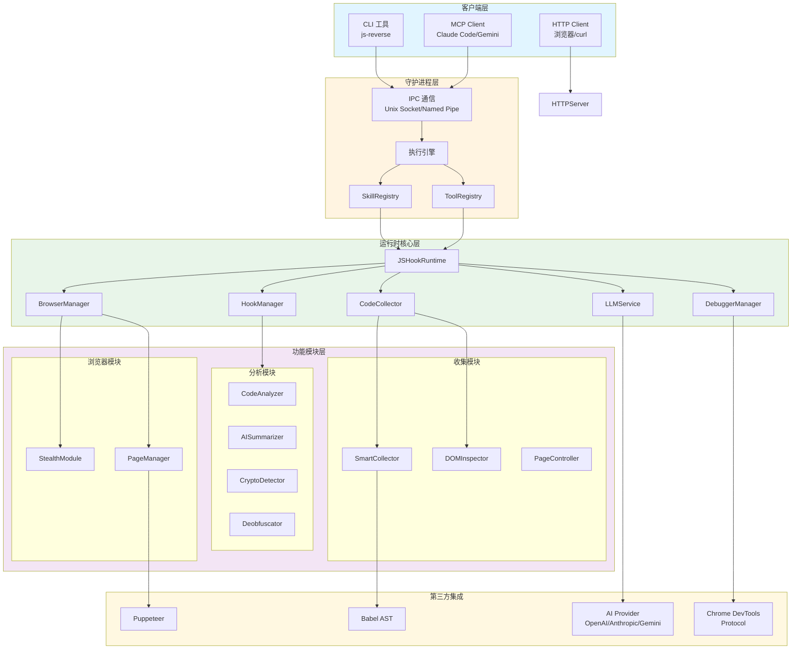
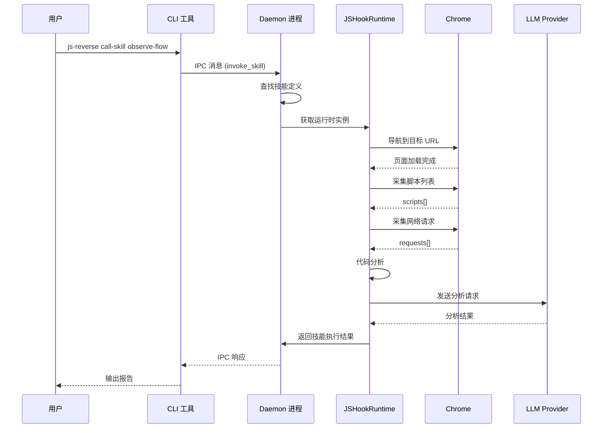
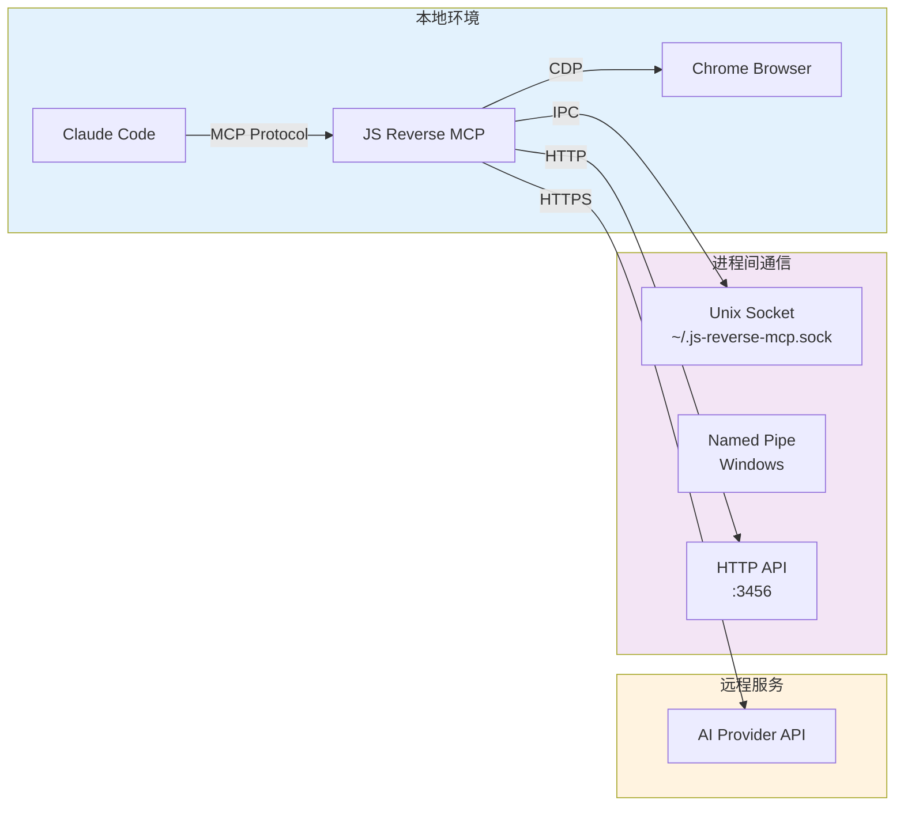
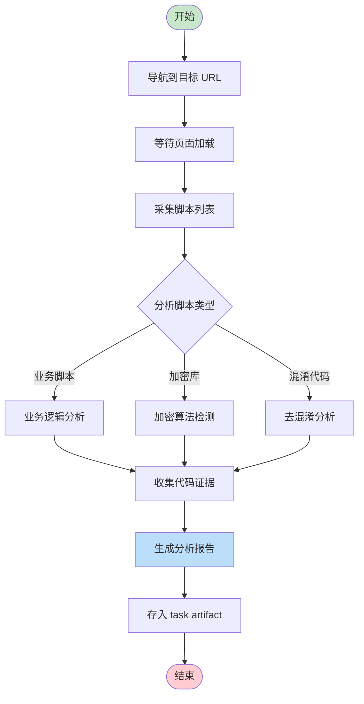
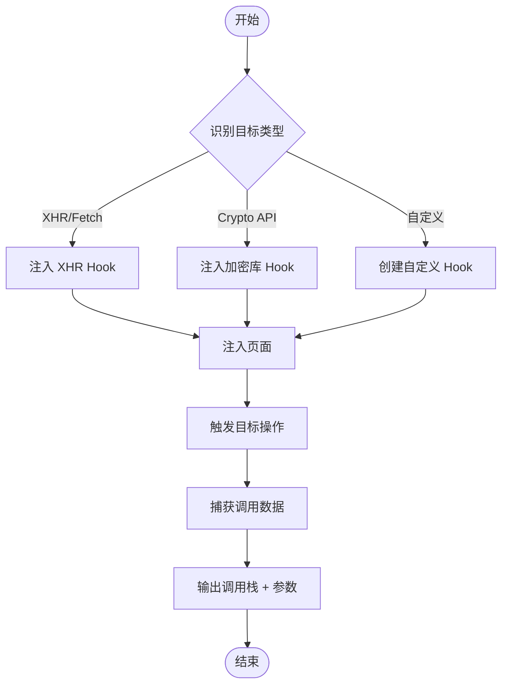
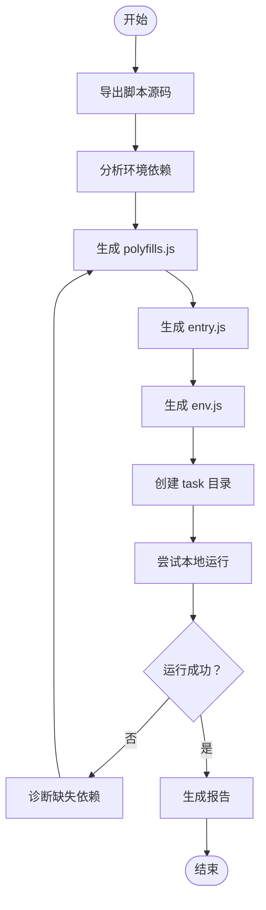
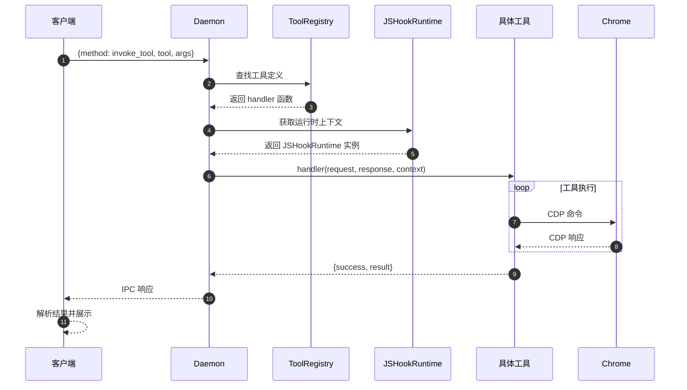

# JS Reverse MCP - 技术架构与二次开发规划文档

**版本**: 2.0.3  
**分析日期**: 2026-04-05  
**项目类型**: JavaScript 逆向工程 MCP 服务器

---

## 目录

1. [项目概述](#1-项目概述)
2. [模块分解分析](#2-模块分解分析)
3. [设计模式分析](#3-设计模式分析)
4. [系统架构可视化](#4-系统架构可视化)
5. [核心业务流程图](#5-核心业务流程图)
6. [二次开发与架构优化建议](#6-二次开发与架构优化建议)
7. [项目目录结构解析](#7-项目目录结构解析)
8. [新开发者实战入门指南](#8-新开发者实战入门指南)

---

## 1. 项目概述

### 1.1 项目定位

JS Reverse MCP 是一个基于 Model Context Protocol (MCP) 的 JavaScript 逆向工程工具，专注于将前端逆向流程标准化。项目核心价值在于将页面观察、运行时采样、本地复现、补环境和证据沉淀串成一套可复用工作流。

### 1.2 技术栈

| 层级 | 技术 |
|------|------|
| 运行时 | Node.js 20.19.0+ / 22.12.0+ / 23+ |
| 语言 | TypeScript 5.9.2 |
| 构建工具 | SWC 0.8.1, Rollup 4.53.3 |
| 浏览器自动化 | Puppeteer 24.31.0, puppeteer-extra |
| 协议 | Model Context Protocol SDK 1.29.0 |
| AI/LLM | @anthropic-ai/sdk, openai, Gemini |
| 代码分析 | Babel (parser, traverse, generator, types) |
| 数据库 | Drizzle ORM, PostgreSQL |
| Web 框架 | Express 5.2.1 |

### 1.3 核心方法论

项目遵循以下核心原则：

- **Observe-first**: 先观察页面脚本分布
- **Hook-preferred**: 优先使用 Hook 进行运行时采样
- **Breakpoint-last**: 断点调试作为最后手段
- **Rebuild-oriented**: 以本地复现为最终目标
- **Evidence-first**: 每一步都沉淀为 task artifact
- **Pure-extraction-after-pass**: 环境补全后再做纯算法提取

---

## 2. 模块分解分析

### 2.1 系统模块总览

```
┌─────────────────────────────────────────────────────────────┐
│                      CLI / MCP Interface                     │
├─────────────────────────────────────────────────────────────┤
│  Daemon Layer  │  Commands  │  Skills  │  Tools Registry    │
├─────────────────────────────────────────────────────────────┤
│                    Runtime Core (JSHookRuntime)              │
├───────────┬───────────┬────────────┬──────────┬─────────────┤
│ Browser   │ Code      │ Hook       │ Debugger │ Analyzer    │
│ Manager   │ Collector │ Manager    │ Manager  │ Service     │
├───────────┴───────────┴────────────┴──────────┴─────────────┤
│                    Third Party Integration                   │
│            Puppeteer │ Babel │ LLM Providers │ CDP          │
└─────────────────────────────────────────────────────────────┘
```

### 2.2 核心模块详解

#### 2.2.1 入口与守护进程模块 (`src/index.ts`, `src/daemon/daemon.ts`)

**职责**: 守护进程生命周期管理、IPC 通信、工具懒加载

**核心类**:
- `SkillRegistry`: 技能注册表
- `SkillRunner`: 技能执行器
- `ToolRegistry`: 工具注册表

**关键流程**:
```
启动 → 检查已有进程 → 写入 PID 文件 → 创建 Unix Socket → 注册工具 → 连接浏览器 → 等待请求
```

**依赖关系**:
```
index.ts → daemon/daemon.ts → skills/index.ts → tools/index.ts → tools/runtime.ts
```

**潜在问题**:
- 懒加载工具时 `_loadToolsPromise` 未处理并发竞态
- Unix Socket 清理在 Windows 上存在兼容性问题

---

#### 2.2.2 浏览器管理模块 (`src/browser.ts`)

**职责**: 浏览器生命周期管理、远程连接、崩溃检测、隐身注入

**核心类**:
- `BrowserManager` (单例模式)
- `StealthScripts2025`

**关键方法**:
| 方法 | 功能 |
|------|------|
| `ensureBrowser()` | 确保浏览器连接/启动 |
| `connectToRemoteBrowser()` | 连接远程调试端口 |
| `injectStealth()` | 注入反检测脚本 |
| `setupCrashDetection()` | 崩溃检测与自动重启 |

**设计亮点**:
- 支持 `browserURL` 和 `wsEndpoint` 两种连接模式
- 自动发现 Chrome 调试端口（DevToolsActivePort + 端口扫描 + TCP 探测）
- 崩溃后自动重启机制（5 秒轮询检测）

**潜在问题**:
- 单例模式在测试场景下需要 `resetInstance()` 手动清理
- 崩溃检测轮询可能遗漏瞬时崩溃

---

#### 2.2.3 运行时核心模块 (`src/tools/runtime.ts`)

**职责**: 提供统一的 `JSHookRuntime` 运行时上下文，聚合所有核心能力

**接口定义**:
```typescript
interface JSHookRuntime {
  browserManager: BrowserModeManager;
  collector: CodeCollector;
  domInspector: DOMInspector;
  pageController: PageController;
  hookManager: HookManager;
  llmService: LLMService;
  analyzer: CodeAnalyzer;
  summarizer: AISummarizer;
  deobfuscator: Deobfuscator;
  cryptoDetector: CryptoDetector;
  reverseTaskStore: ReverseTaskStore;
  bindPageContext: (resolver: () => Page) => void;
  syncPageContext: (page: Page) => void;
  clearPageContext: () => void;
}
```

**设计模式**: 组合模式 (Composition) + 依赖注入

---

#### 2.2.4 工具注册表模块 (`src/tools/index.ts`, `src/tools/ToolRegistry.ts`)

**职责**: 工具注册、发现、分类管理

**工具分类**:
| 分类 | 工具数量 | 示例 |
|------|---------|------|
| DOM 操作 | 3 | `queryDom`, `getDomStructure` |
| 网络分析 | 2 | `listNetworkRequests`, `getNetworkRequest` |
| 调试器 | 19 | `setBreakpoint`, `traceFunction` |
| Hook | 4 | `createHook`, `injectHook` |
| 代码分析 | 8 | `deobfuscateCode`, `understandCode` |
| 页面控制 | 12 | `click`, `type_text`, `screenshot` |
| CDP Proxy | 11 | `cdp_eval`, `cdp_click` |

**注册机制**:
```typescript
registry.registerMany([
  invokeSkill, listSkills,  // 技能工具
  queryDom, getDomStructure, // DOM 工具
  // ... 其他工具
]);
```

---

#### 2.2.5 Hook 管理模块 (`src/modules/hook/HookManager.ts`)

**职责**: Hook 脚本生成、元数据管理、数据收集

**架构**:
```
HookManager (外观模式)
├── HookCodeBuilder (建造者模式)
├── HookTypeRegistry (策略模式)
│   ├── XHR Hook 插件
│   ├── Crypto Hook 插件
│   └── Custom Hook 插件
└── HookDataStore (数据管理)
```

**创建流程**:
```typescript
HookManager.create({
  type: 'xhr',
  params: { urlPattern: '/api/*' },
  action: 'log',
  capture: { args: true, returnValue: true, stack: true }
});
```

**设计亮点**:
- 插件化 Hook 类型注册
- 声明式配置生成 Hook 脚本
- 支持 async 感知和生命周期钩子

---

#### 2.2.6 代码分析模块 (`src/modules/analyzer/`)

**子模块**:
| 类 | 职责 |
|---|------|
| `CodeAnalyzer` | 代码结构分析、业务逻辑提取 |
| `AISummarizer` | AI 驱动的代码摘要 |
| `CryptoDetector` | 加密算法检测 |

**依赖**: `LLMService` 进行 AI 增强分析

**Prompt 模板**:
- 代码分析: `techStack`, `businessLogic`, `securityRisks`
- 加密检测: `algorithms[]` with confidence scores
- 去混淆：obfuscation techniques + remediation strategy

---

#### 2.2.7 技能系统模块 (`src/skills/`)

**内置技能**:
| 技能 | 职责 | 类别 |
|------|------|------|
| `observe-flow` | 观察模式：收集分析页面脚本 | observe |
| `auto-hook` | 自动 Hook：注入调试 Hook 和加密库 Hook | hook |
| `rebuild-bundle` | 本地复现：构建 Node.js 环境复现 | rebuild |

**执行流程**:
```
CLI call-skill → Daemon.invoke_skill → SkillRunner.run → 技能逻辑 → 返回结果
```

---

#### 2.2.8 LLM 服务模块 (`src/services/`)

**架构**:
```
LLMService
├── AIService (接口)
│   ├── OpenAIProvider
│   ├── AnthropicProvider
│   └── GeminiProvider
└── 内置 Prompt 模板
    ├── generateCodeAnalysisPrompt
    ├── generateCryptoDetectionPrompt
    └── generateDeobfuscationPrompt
```

**配置方式**:
```bash
DEFAULT_LLM_PROVIDER=anthropic
ANTHROPIC_API_KEY=xxx
ANTHROPIC_MODEL=claude-3-5-sonnet-20241022
```

---

#### 2.2.9 代码收集模块 (`src/modules/collector/`)

**核心类**:
| 类 | 职责 |
|---|------|
| `CodeCollector` | 代码采集基类 |
| `SmartCodeCollector` | 智能采集（优先级控制） |
| `CodeCache` | 代码缓存 |
| `CodeCompressor` | 代码压缩 |
| `DOMInspector` | DOM 结构检查 |
| `PageController` | 页面导航控制 |

---

#### 2.2.10 反混淆模块 (`src/modules/deobfuscator/`)

**子模块**:
| 类 | 职责 |
|---|------|
| `Deobfuscator` | 通用去混淆 |
| `AdvancedDeobfuscator` | 高级去混淆 |
| `ASTOptimizer` | AST 优化 |
| `PackerDeobfuscator` | 打包器反解 |
| `JSVMPDeobfuscator` | JS 虚拟机保护破解 |

---

#### 2.2.11 调试器模块 (`src/modules/debugger/`)

**子模块**:
| 类 | 职责 |
|---|------|
| `DebuggerManager` | 调试器管理 |
| `BlackboxManager` | 黑盒脚本管理 |
| `ScriptManager` | 脚本加载管理 |
| `EventBreakpointManager` | 事件断点 |
| `XHRBreakpointManager` | XHR 断点 |
| `WatchExpressionManager` | 监视表达式 |
| `AIContinuousDebugger` | AI 辅助调试 |

---

#### 2.2.12 隐身模块 (`src/modules/stealth/`)

**核心类**: `StealthScripts2025`

**隐身特性** (14 项):
1. `hideWebDriver`
2. `mockChrome`
3. `setUserAgent`
4. `fixPermissions`
5. `mockPlugins`
6. `canvasNoise`
7. `webglOverride`
8. `audioContextNoise`
9. `fixLanguages`
10. `mockBattery`
11. `mockMediaDevices`
12. `mockNotifications`
13. `mockConnection`
14. `performanceNoise`

**预设平台**:
- `windows-chrome`
- `mac-chrome`
- `linux-chrome`

---

#### 2.2.13 CLI 命令模块 (`src/commands/`)

**命令列表**:
| 命令 | 功能 |
|------|------|
| `start` | 启动 daemon |
| `stop` | 停止 daemon |
| `status` | 检查状态 |
| `call-skill` | 调用技能 |
| `call-tool` | 调用工具 |
| `list-skills` | 列出技能 |
| `list-tools` | 列出工具 |
| `repl` | 交互模式 |
| `scaffold` | 创建任务脚手架 |

---

### 2.3 模块依赖关系图

```
┌────────────────────────────────────────────────────────────┐
│                        CLI Layer                            │
│  (src/commands/, src/bin/)                                 │
└────────────────────────┬───────────────────────────────────┘
                         │
                         ▼
┌────────────────────────────────────────────────────────────┐
│                      Daemon Layer                           │
│  (src/daemon/daemon.ts)                                    │
│  ┌──────────────┐  ┌──────────────┐  ┌─────────────────┐  │
│  │ SkillRegistry│  │ ToolRegistry │  │  SkillRunner    │  │
│  └──────────────┘  └──────────────┘  └─────────────────┘  │
└────────────────────────┬───────────────────────────────────┘
                         │
                         ▼
┌────────────────────────────────────────────────────────────┐
│                   Runtime Core Layer                        │
│  (src/tools/runtime.ts - JSHookRuntime)                    │
└────────────────────────┬───────────────────────────────────┘
                         │
         ┌───────────────┼───────────────┐
         ▼               ▼               ▼
┌─────────────┐ ┌─────────────┐ ┌─────────────┐
│   Browser   │ │    Code     │ │    Hook     │
│  Manager    │ │  Collector  │ │   Manager   │
└─────────────┘ └─────────────┘ └─────────────┘
┌─────────────┐ ┌─────────────┐ ┌─────────────┐
│   LLM       │ │   Code      │ │  Debugger   │
│  Service    │ │  Analyzer   │ │   Manager   │
└─────────────┘ └─────────────┘ └─────────────┘
```

---

### 2.4 模块耦合分析

| 问题区域 | 耦合描述 | 建议 |
|---------|---------|------|
| `runtime.ts` | 单点聚合过多依赖 | 考虑拆分为独立服务容器 |
| `daemon.ts` | 工具懒加载与技能执行耦合 | 分离为独立加载器模块 |
| `browser.ts` | 单例 + 状态管理混合 | 引入状态机模式 |
| `tools/runtime.ts` | 直接依赖 `process.env` | 引入配置注入层 |

---

## 3. 设计模式分析

### 3.1 已使用的设计模式

#### 3.1.1 单例模式 (Singleton)

**使用位置**: `BrowserManager`, `SkillRegistry`, `ToolRegistry`, `LLMService`

**实现方式**:
```typescript
class BrowserManager {
  private static instance: BrowserManager;
  
  static getInstance(config?: BrowserManagerConfig): BrowserManager {
    if (!browserManager) {
      browserManager = new BrowserManager(config);
    }
    return browserManager;
  }
}
```

**评价**:
- ✅ 正确实现了延迟初始化
- ⚠️ 测试场景需要手动 `resetInstance()`
- ⚠️ 配置可变性导致状态不一致风险

---

#### 3.1.2 外观模式 (Facade)

**使用位置**: `HookManager`, `JSHookRuntime`

**HookManager 作为外观**:
```
外部调用 → HookManager → HookCodeBuilder + HookTypeRegistry + HookDataStore
```

**评价**:
- ✅ 简化了复杂子系统的使用
- ✅ 保持内部模块独立性

---

#### 3.1.3 建造者模式 (Builder)

**使用位置**: `HookCodeBuilder`

**用途**: 逐步构建 Hook 脚本配置

```typescript
const builder = new HookCodeBuilder(hookId);
builder
  .describe('XHR 监控')
  .action('log')
  .captureArgs()
  .captureReturn()
  .when('url.includes("/api")')
  .build();
```

**评价**:
- ✅ 链式调用提升可读性
- ✅ 支持从配置反序列化

---

#### 3.1.4 策略模式 (Strategy)

**使用位置**: `HookTypeRegistry`, `AIService`

**Hook 类型插件**:
```typescript
interface HookTypePlugin {
  name: string;
  apply(builder: HookCodeBuilder, params: Record<string, unknown>): void;
  customBuild?(builder: HookCodeBuilder, params: Record<string, unknown>): string;
}
```

**LLM Provider**:
```
LLMService → AIService (接口) → OpenAIProvider | AnthropicProvider | GeminiProvider
```

**评价**:
- ✅ 运行时可扩展
- ✅ 符合开闭原则

---

#### 3.1.5 注册表模式 (Registry)

**使用位置**: `ToolRegistry`, `SkillRegistry`, `HookTypeRegistry`

```typescript
class ToolRegistry {
  private readonly tools = new Map<string, JSHookToolDefinition>();
  private readonly aliases = new Map<string, string>();
  
  register(tool: JSHookToolDefinition): void { ... }
  get(name: string): JSHookToolDefinition | undefined { ... }
}
```

**评价**:
- ✅ 支持别名映射
- ✅ 分类查询

---

#### 3.1.6 适配器模式 (Adapter)

**使用位置**: `CacheAdapters.ts`

```typescript
class CodeCacheAdapter implements CacheAdapter {
  constructor(private cache: CodeCache) {}
  get(key: string): string | undefined { ... }
  set(key: string, value: string): void { ... }
}
```

**用途**: 统一不同缓存实现

---

#### 3.1.7 工厂模式 (Factory)

**使用位置**: `createAIService`, `getJSHookRuntime`

```typescript
export function getJSHookRuntime(): JSHookRuntime {
  if (!runtime) {
    runtime = {
      browserManager: new BrowserModeManager({...}),
      collector: new CodeCollector({...}),
      // ...
    };
  }
  return runtime;
}
```

---

#### 3.1.8 观察者模式 (Observer)

**使用位置**: Puppeteer 事件监听、CDP Session 事件

```typescript
this.browser.on('targetcreated', async target => {
  if (target.type() === 'page') {
    const page = await target.page();
    // ...
  }
});
```

---

### 3.2 可引入但未使用的设计模式

#### 3.2.1 命令模式 (Command)

**适用场景**: CLI 命令、工具调用

**当前问题**: 命令逻辑分散在 `src/commands/` 各文件中

**建议实现**:
```typescript
interface Command {
  name: string;
  description: string;
  execute(args: string[]): Promise<void>;
  undo?(): Promise<void>;
}
```

**收益**:
- 统一命令接口
- 支持命令历史/撤销
- 便于命令组合

---

#### 3.2.2 责任链模式 (Chain of Responsibility)

**适用场景**: 请求处理流水线

**当前问题**: 工具调用直接绑定 handler，缺乏中间件机制

**建议实现**:
```typescript
interface Middleware {
  handle(context: ToolContext, next: NextFn): Promise<void>;
}

class Chain {
  private middlewares: Middleware[] = [];
  use(middleware: Middleware): void { ... }
  execute(context: ToolContext): Promise<void> { ... }
}
```

**收益**:
- 日志/鉴权/限流等横切关注点解耦
- 支持动态组装处理流程

---

#### 3.2.3 模板方法模式 (Template Method)

**适用场景**: 技能执行流程

**当前问题**: `observe-flow`, `auto-hook`, `rebuild-bundle` 三个技能有相似执行框架

**建议实现**:
```typescript
abstract class SkillTemplate {
  async execute(context: SkillContext): Promise<SkillResult> {
    await this.preExecute(context);
    const result = await this.doExecute(context);
    await this.postExecute(context, result);
    return result;
  }
  
  protected abstract preExecute(context: SkillContext): Promise<void>;
  protected abstract doExecute(context: SkillContext): Promise<SkillResult>;
  protected abstract postExecute(context: SkillContext, result: SkillResult): Promise<void>;
}
```

**收益**:
- 统一技能执行生命周期
- 固化最佳实践

---

#### 3.2.4 状态模式 (State)

**适用场景**: 浏览器连接状态、调试器状态

**当前问题**: 状态判断散落在多处 `if (browser.connected) ...`

**建议实现**:
```typescript
interface BrowserState {
  connect(): Promise<void>;
  disconnect(): Promise<void>;
  handleCrash(): Promise<void>;
}

class ConnectedState implements BrowserState { ... }
class DisconnectedState implements BrowserState { ... }
class CrashedState implements BrowserState { ... }
```

**收益**:
- 状态转换逻辑集中
- 避免复杂条件判断

---

#### 3.2.5 组合模式 (Composite)

**适用场景**: Hook 脚本组合、工具组合

**当前问题**: Hook 组合逻辑在 `HookCodeBuilder` 中硬编码

**建议实现**:
```typescript
interface HookComponent {
  generate(): string;
  add(component: HookComponent): void;
}

class HookScript implements HookComponent {
  private children: HookComponent[] = [];
  // ...
}
```

**收益**:
- 统一单个 Hook 和 Hook 组合的处理
- 支持嵌套组合

---

### 3.3 架构风格评估

| 架构特征 | 当前实现 | 评估 |
|---------|---------|------|
| 分层架构 | CLI → Daemon → Runtime → Modules | ✅ 清晰 |
| 依赖注入 | 构造函数注入 + 工厂函数 | ⚠️ 部分模块直接引用单例 |
| 模块化 | 按功能划分目录 | ✅ 边界清晰 |
| 事件驱动 | Puppeteer 事件 + CDP 事件 | ✅ 充分利用 |
| 插件化 | HookTypeRegistry | ⚠️ 仅限于 Hook 类型 |

---

## 4. 系统架构可视化

### 4.1 系统架构图



---

### 4.2 数据流图



---

### 4.3 部署架构图



---

## 5. 核心业务流程图

### 5.1 Observe-Flow 技能执行流程



---

### 5.2 Auto-Hook 技能执行流程



---

### 5.3 Rebuild-Bundle 技能执行流程



---

### 5.4 工具调用完整生命周期



---

## 6. 二次开发与架构优化建议

### 6.1 建议一：引入命令模式统一 CLI 架构

**目标模块**: `src/commands/`

**当前问题**:
- 命令逻辑分散在 9 个独立文件中
- 缺乏统一的命令注册和发现机制
- 无法支持命令组合和宏命令

**实施方案**:
```typescript
// src/commands/Command.ts
export interface Command {
  readonly name: string;
  readonly description: string;
  readonly aliases?: string[];
  execute(args: string[]): Promise<void>;
  undo?(): Promise<void>;
}

// src/commands/CommandRegistry.ts
export class CommandRegistry {
  private commands = new Map<string, Command>();
  
  register(command: Command): void;
  execute(name: string, args: string[]): Promise<void>;
}
```

**预期收益**:
- 命令统一管理，易于扩展
- 支持命令历史、撤销/重做
- 便于实现命令组合（宏命令）

**风险与成本**:
- 重构工作量：~2 人天
- 需要更新 CLI 入口和测试用例
- 向后兼容需保留原有导出

---

### 6.2 建议二：引入中间件管道增强工具调用

**目标模块**: `src/tools/index.ts`, `src/daemon/daemon.ts`

**当前问题**:
- 工具调用直接绑定 handler，缺乏横切关注点处理
- 日志、鉴权、限流等逻辑重复
- 无法动态拦截和修改请求/响应

**实施方案**:
```typescript
// src/tools/Middleware.ts
export interface ToolMiddleware {
  name: string;
  priority?: number;
  handle(context: ToolContext, next: NextFn): Promise<void>;
}

// 内置中间件
const loggingMiddleware: ToolMiddleware = {
  name: 'logging',
  priority: 100,
  async handle(ctx, next) {
    console.log(`[TOOL] 调用 ${ctx.toolName}`, ctx.args);
    const start = Date.now();
    await next();
    console.log(`[TOOL] 完成 ${ctx.toolName} (${Date.now() - start}ms)`);
  }
};

const authMiddleware: ToolMiddleware = {
  name: 'auth',
  priority: 50,
  async handle(ctx, next) {
    if (ctx.toolName === 'sensitive_tool' && !ctx.isAuthenticated) {
      throw new Error('Authentication required');
    }
    await next();
  }
};
```

**预期收益**:
- 横切关注点解耦
- 支持动态启用/禁用中间件
- 便于实现请求/响应转换

**风险与成本**:
- 重构工作量：~3 人天
- 需要确保中间件顺序正确
- 性能开销（每个工具调用增加中间件链）

---

### 6.3 建议三：引入状态机管理浏览器生命周期

**目标模块**: `src/browser.ts`

**当前问题**:
- 状态判断散落在多处 `if (browser.connected) ...`
- 状态转换逻辑不清晰
- 崩溃恢复与重启逻辑耦合

**实施方案**:
```typescript
// src/browser/BrowserState.ts
export interface BrowserState {
  readonly state: 'disconnected' | 'connecting' | 'connected' | 'crashed';
  connect(context: BrowserContext): Promise<void>;
  disconnect(context: BrowserContext): Promise<void>;
  handleCrash(context: BrowserContext): Promise<void>;
}

// src/browser/StateMachine.ts
export class BrowserStateMachine {
  private state: BrowserState;
  
  constructor() {
    this.state = new DisconnectedState();
  }
  
  async transition(action: string, context: BrowserContext): Promise<void> {
    const newState = this.state[action];
    if (!newState) {
      throw new Error(`Invalid action ${action} in state ${this.state.state}`);
    }
    await newState(context);
    this.state = this.getNextState(action);
  }
}
```

**状态转换图**:
```
disconnected --connect--> connecting
connecting --success--> connected
connecting --failure--> disconnected
connected --crash--> crashed
crashed --restart--> connecting
disconnected --manual-disconnect--> disconnected
```

**预期收益**:
- 状态转换显式定义
- 避免非法状态组合
- 便于调试和追踪

**风险与成本**:
- 重构工作量：~1.5 人天
- 需要覆盖所有状态转换测试

---

### 6.4 建议四：增强配置管理系统

**目标模块**: `src/utils/config.ts`

**当前问题**:
- 配置分散在 `process.env`、JSON 文件、CLI 参数
- 缺乏配置验证和默认值管理
- 运行时配置变更困难

**实施方案**:
```typescript
// src/config/ConfigManager.ts
import { z } from 'zod';

const ConfigSchema = z.object({
  browser: z.object({
    remoteDebuggingUrl: z.string().url().optional(),
    wsEndpoint: z.string().url().optional(),
    headless: z.boolean().default(false),
    useStealthScripts: z.boolean().default(true),
  }),
  llm: z.object({
    provider: z.enum(['openai', 'anthropic', 'gemini']),
    apiKey: z.string().optional(),
    model: z.string().optional(),
  }),
  daemon: z.object({
    socketPath: z.string(),
    pidFile: z.string(),
  }),
});

export class ConfigManager {
  private config: z.infer<typeof ConfigSchema>;
  
  load(): void;
  validate(): void;
  get<T>(path: string): T;
  watch(callback: (newConfig: Config) => void): void;
}
```

**预期收益**:
- 配置集中管理
- 类型安全的配置访问
- 支持配置热更新

**风险与成本**:
- 重构工作量：~1 人天
- 需要添加 Zod 依赖

---

### 6.5 建议五：改进测试架构

**目标模块**: `tests/`

**当前问题**:
- 测试覆盖不均衡（工具层较多，集成测试较少）
- 缺乏端到端场景测试
- Mock 策略不统一

**实施方案**:
```
tests/
├── unit/              # 单元测试
│   ├── modules/       # 模块级单元测试
│   ├── services/      # 服务层单元测试
│   └── tools/         # 工具层单元测试
├── integration/       # 集成测试
│   ├── daemon.test.ts # Daemon IPC 测试
│   ├── browser.test.ts# 浏览器连接测试
│   └── skill-flow.test.ts # 技能流程测试
├── e2e/              # 端到端测试
│   ├── observe-flow.test.ts
│   ├── auto-hook.test.ts
│   └── rebuild-bundle.test.ts
└── fixtures/         # 测试夹具
    ├── mock-pages/   # 模拟页面
    └── sample-scripts/ # 示例脚本
```

**预期收益**:
- 测试金字塔结构清晰
- 提高测试可信度
- 便于回归测试

**风险与成本**:
- 新增测试开发：~5 人天
- CI/CD 流水线需要更新

---

## 7. 项目目录结构解析

### 7.1 完整目录树

```
JSReverser-MCP/
├── .claude/                      # Claude Code 配置和技能
│   ├── settings.local.json
│   └── skills/
│       └── gitnexus/             # GitNexus 代码智能技能
├── .gitnexus/                    # GitNexus 索引数据
├── .omc/                         # Oh-My-ClaudeCode 状态
├── artifacts/                    # 任务产物目录
│   └── tasks/
│       ├── _TEMPLATE/            # 任务模板
│       └── <task-id>/            # 具体任务目录
├── build/                        # 编译输出 (SWC)
│   └── src/
├── coverage/                     # 测试覆盖率报告
├── debugger-sessions/            # 调试器会话快照
├── docs/                         # 文档
│   ├── guides/                   # 使用指南
│   ├── reference/                # 参考文档
│   └── superpowers/              # Superpowers 规范
├── node_modules/                 # 依赖
├── scripts/                      # 构建和工具脚本
│   ├── cases/                    # 参数案例
│   ├── generate-docs.ts          # 文档生成
│   ├── post-build.ts             # 构建后处理
│   └── prepare.ts                # 发布前准备
├── skills/                       # 技能定义 (旧版)
├── src/                          # 源代码
│   ├── bin/                      # CLI 入口
│   │   ├── cliDefinitions.ts
│   │   ├── generate-cli.ts
│   │   ├── js-reverse-mcp.ts
│   │   ├── js-reverse.ts
│   │   ├── repl.ts
│   │   └── scaffold.ts
│   ├── cdp-proxy/                # CDP 代理服务
│   ├── commands/                 # CLI 命令
│   │   ├── index.ts
│   │   ├── start.ts
│   │   ├── stop.ts
│   │   ├── status.ts
│   │   ├── call-skill.ts
│   │   ├── call-tool.ts
│   │   ├── list-skills.ts
│   │   ├── list-tools.ts
│   │   ├── repl.ts
│   │   └── scaffold.ts
│   ├── daemon/                   # 守护进程
│   │   ├── daemon.ts
│   │   ├── client.ts
│   │   ├── http-server.ts
│   │   ├── types.ts
│   │   └── utils.ts
│   ├── database/                 # 数据库
│   │   ├── index.ts
│   │   └── schema.ts
│   ├── formatters/               # 格式化器
│   │   ├── consoleFormatter.ts
│   │   ├── networkFormatter.ts
│   │   └── websocketFormatter.ts
│   ├── modules/                  # 核心功能模块
│   │   ├── analyzer/             # 代码分析
│   │   │   ├── AISummarizer.ts
│   │   │   └── CodeAnalyzer.ts
│   │   ├── browser/              # 浏览器管理
│   │   │   └── BrowserModeManager.ts
│   │   ├── collector/            # 代码收集
│   │   │   ├── CodeCache.ts
│   │   │   ├── CodeCollector.ts
│   │   │   ├── CodeCompressor.ts
│   │   │   ├── DOMInspector.ts
│   │   │   ├── PageController.ts
│   │   │   └── SmartCodeCollector.ts
│   │   ├── crypto/               # 加密检测
│   │   │   ├── CryptoDetector.ts
│   │   │   ├── CryptoDetectorEnhanced.ts
│   │   │   └── CryptoRules.ts
│   │   ├── debugger/             # 调试器
│   │   │   ├── AIContinuousDebugger.ts
│   │   │   ├── BlackboxManager.ts
│   │   │   ├── DebuggerManager.ts
│   │   │   ├── EventBreakpointManager.ts
│   │   │   ├── RuntimeInspector.ts
│   │   │   ├── ScriptManager.ts
│   │   │   ├── WatchExpressionManager.ts
│   │   │   └── XHRBreakpointManager.ts
│   │   ├── deobfuscator/         # 去混淆
│   │   │   ├── AdvancedDeobfuscator.ts
│   │   │   ├── ASTOptimizer.ts
│   │   │   ├── Deobfuscator.ts
│   │   │   ├── JSVMPDeobfuscator.ts
│   │   │   └── PackerDeobfuscator.ts
│   │   ├── hook/                 # Hook 管理
│   │   │   ├── AIHookGenerator.ts
│   │   │   ├── HookCodeBuilder.ts
│   │   │   ├── HookManager.ts
│   │   │   ├── HookTypeRegistry.ts
│   │   │   └── index.ts
│   │   └── stealth/              # 隐身模式
│   │       ├── index.ts
│   │       └── StealthScripts2025.ts
│   ├── reverse/                  # 逆向任务存储
│   │   └── ReverseTaskStore.ts
│   ├── services/                 # 服务层
│   │   ├── AIService.ts
│   │   ├── AnthropicProvider.ts
│   │   ├── GeminiProvider.ts
│   │   ├── LLMService.ts
│   │   ├── OpenAIProvider.ts
│   │   └── index.ts
│   ├── skills/                   # 技能系统
│   │   ├── SkillRunner.ts
│   │   ├── auto-hook.ts
│   │   ├── index.ts
│   │   ├── observe-flow.ts
│   │   └── rebuild-bundle.ts
│   ├── third_party/              # 第三方依赖导出
│   │   └── index.ts
│   ├── tools/                    # 工具定义
│   │   ├── anti-debug/           # 反调试
│   │   │   ├── antiAntiDebug.ts
│   │   │   └── bypassDebugger.ts
│   │   ├── crypto/               # 加密库 Hook
│   │   │   ├── hookCryptoJS.ts
│   │   │   ├── hookJSEncrypt.ts
│   │   │   └── hookSMCrypto.ts
│   │   ├── vue/                  # Vue 工具
│   │   │   ├── activateVueDevtools.ts
│   │   │   ├── clearVueGuards.ts
│   │   │   └── getVueRoutes.ts
│   │   ├── analyzer.ts           # 分析工具
│   │   ├── cdp-proxy.ts          # CDP 代理工具
│   │   ├── categories.ts         # 工具分类
│   │   ├── collector.ts          # 收集工具
│   │   ├── console.ts            # 控制台工具
│   │   ├── debugger.ts           # 调试工具
│   │   ├── dialog.ts             # 对话框工具
│   │   ├── dom.ts                # DOM 工具
│   │   ├── emulation.ts          # 模拟工具
│   │   ├── extensions.ts         # 扩展工具
│   │   ├── frames.ts             # 框架工具
│   │   ├── hook.ts               # Hook 工具
│   │   ├── index.ts              # 工具注册入口
│   │   ├── input.ts              # 输入工具
│   │   ├── network.ts            # 网络工具
│   │   ├── page.ts               # 页面工具
│   │   ├── pages.ts              # 页面列表工具
│   │   ├── performance.ts        # 性能工具
│   │   ├── rebuild.ts            # 重建工具
│   │   ├── runtime.ts            # 运行时上下文
│   │   ├── screenshot.ts         # 截图工具
│   │   ├── script.ts             # 脚本工具
│   │   ├── siteExperience.ts     # 站点经验工具
│   │   ├── skill.ts              # 技能调用工具
│   │   ├── stealth.ts            # 隐身工具
│   │   ├── ToolDefinition.ts     # 工具定义
│   │   ├── ToolRegistry.ts       # 工具注册表
│   │   └── websocket.ts          # WebSocket 工具
│   ├── trace-processing/         # 追踪处理
│   │   └── parse.js
│   ├── types/                    # 类型定义
│   ├── utils/                    # 工具函数
│   ├── browser.ts                # 浏览器模块
│   ├── CdpSessionProvider.ts     # CDP 会话提供者
│   ├── DebuggerContext.ts        # 调试器上下文
│   ├── DevToolsConnectionAdapter.ts  # CDP 连接适配器
│   ├── DevtoolsUtils.ts          # DevTools 工具
│   ├── features.ts               # 功能开关
│   ├── index.ts                  # 主入口
│   ├── issue-descriptions.ts     # 问题描述
│   ├── logger.ts                 # 日志
│   ├── McpContext.ts             # MCP 上下文
│   ├── McpResponse.ts            # MCP 响应
│   ├── Mutex.ts                  # 互斥锁
│   ├── PageCollector.ts          # 页面收集器
│   ├── polyfill.ts               # 浏览器 Polyfill
│   ├── stealth-args.ts           # 隐身参数
│   └── third_party.ts            # 第三方导出
├── tests/                        # 测试
│   ├── bin/                      # CLI 测试
│   ├── integration/              # 集成测试
│   ├── manual/                   # 手动测试
│   ├── performance/              # 性能测试
│   ├── property/                 # 属性测试
│   └── unit/                     # 单元测试
├── .env.example                  # 环境变量示例
├── .eslintrc.cjs                 # ESLint 配置
├── .gitignore
├── .nvmrc                        # Node 版本
├── .prettierrc.cjs               # Prettier 配置
├── .swcrc                        # SWC 配置
├── AGENTS.md                     # Agent 使用说明
├── CHANGELOG.md                  # 变更日志
├── CLAUDE.md                     # Claude Code 指南
├── LICENSE                       # 许可证
├── package.json                  # 项目配置
├── puppeteer.config.cjs          # Puppeteer 配置
├── README.md                     # 项目说明
├── README.en.md                  # 英文说明
├── tsconfig.json                 # TypeScript 配置
└── js-reverse.bat                # Windows 启动脚本
```

---

### 7.2 关键目录职责

| 目录 | 职责 | 核心文件 |
|------|------|---------|
| `src/bin/` | CLI 入口和命令定义 | `js-reverse.ts`, `cliDefinitions.ts` |
| `src/commands/` | CLI 命令实现 | `start.ts`, `stop.ts`, `call-skill.ts` |
| `src/daemon/` | 后台服务 | `daemon.ts`, `http-server.ts` |
| `src/modules/` | 核心功能模块 | 8 个子模块 |
| `src/tools/` | MCP 工具定义 | 40+ 工具文件 |
| `src/skills/` | 逆向技能 | 3 个核心技能 |
| `src/services/` | 服务层 | LLM Provider |
| `tests/` | 测试套件 | 单元/集成/性能测试 |
| `docs/` | 文档 | 指南 + 参考 |
| `artifacts/tasks/` | 任务产物 | _TEMPLATE |

---

## 8. 新开发者实战入门指南

### 8.1 本地环境搭建

#### 8.1.1 软件要求

| 软件 | 版本 | 用途 |
|------|------|------|
| Node.js | 20.19.0+ / 22.12.0+ / 23+ | 运行时 |
| npm | 9.0+ | 包管理 |
| Chrome/Chromium | 最新版 | 调试目标 |
| Git | 2.0+ | 版本控制 |

#### 8.1.2 环境检查

```bash
# 检查 Node 版本
node --version
# 应输出：v20.19.0 或更高

# 检查 npm 版本
npm --version
# 应输出：9.0+

# 检查 Chrome 是否安装
# macOS
/Applications/Google\ Chrome.app/Contents/MacOS/Google\ Chrome --version
# Windows (PowerShell)
& "C:\Program Files\Google\Chrome\Application\chrome.exe" --version
```

#### 8.1.3 环境变量配置

复制环境变量示例文件：

```bash
cp .env.example .env
```

编辑 `.env` 文件：

```bash
# LLM Provider 配置 (三选一)
DEFAULT_LLM_PROVIDER=anthropic
ANTHROPIC_API_KEY=your_api_key_here
ANTHROPIC_MODEL=claude-3-5-sonnet-20241022

# 或 OpenAI
# DEFAULT_LLM_PROVIDER=openai
# OPENAI_API_KEY=your_api_key_here
# OPENAI_MODEL=gpt-4o

# 或 Gemini
# DEFAULT_LLM_PROVIDER=gemini
# GEMINI_API_KEY=your_api_key_here

# 浏览器配置
REMOTE_DEBUGGING_URL=http://127.0.0.1:9222
USE_STEALTH_SCRIPTS=true
```

---

### 8.2 从 0 到运行

#### 8.2.1 克隆代码

```bash
git clone https://github.com/zhizhuodemao/js-reverse-mcp.git
cd js-reverse-mcp
```

#### 8.2.2 安装依赖

```bash
npm install
```

#### 8.2.3 构建项目

```bash
npm run build
```

构建输出示例：
```
Successfully compiled 120 files with SWC
[post-build] Copying additional files...
[post-build] Build complete
```

#### 8.2.4 启动 Chrome (调试模式)

**macOS**:
```bash
/Applications/Google\ Chrome.app/Contents/MacOS/Google\ Chrome \
  --remote-debugging-port=9222 \
  --user-data-dir=/tmp/chrome-debug-profile
```

**Windows (PowerShell)**:
```powershell
& "C:\Program Files\Google\Chrome\Application\chrome.exe" `
  --remote-debugging-port=9222 `
  --user-data-dir="C:\temp\chrome-debug-profile"
```

**Linux**:
```bash
google-chrome \
  --remote-debugging-port=9222 \
  --user-data-dir=/tmp/chrome-debug-profile
```

#### 8.2.5 启动 Daemon

```bash
npm run cli:daemon:start -- --browserUrl http://127.0.0.1:9222
```

或使用全局命令（需先 `npm install -g .`）:
```bash
js-reverse start --browserUrl http://127.0.0.1:9222
```

#### 8.2.6 检查状态

```bash
npm run cli:daemon:status
```

输出示例：
```
Daemon is running
PID: 12345
Socket: /Users/xxx/.js-reverse-mcp/daemon.sock
Uptime: 5m 32s
```

#### 8.2.7 运行测试

```bash
# 运行所有测试
npm test

# 运行单元测试
npm run test:unit

# 运行属性测试
npm run test:property
```

---

### 8.3 最小改动示例 (Hello World)

#### 8.3.1 目标

添加一个新的 CLI 命令 `js-reverse hello`，输出 "Hello, JS Reverse!"

#### 8.3.2 涉及文件

1. `src/commands/hello.ts` (新增)
2. `src/commands/index.ts` (修改)
3. `src/bin/cliDefinitions.ts` (修改)

#### 8.3.3 代码修改

**步骤 1**: 创建命令文件

```typescript
// src/commands/hello.ts
import {CommandModule} from 'commander';

export const helloCommand: CommandModule = {
  command: 'hello',
  describe: '输出 Hello World 消息',
  handler: () => {
    console.log('Hello, JS Reverse!');
  },
};
```

**步骤 2**: 注册命令

```typescript
// src/commands/index.ts
import {helloCommand} from './hello.js';

export const commands = [
  // ... 现有命令
  helloCommand,
];
```

**步骤 3**: 更新 CLI 定义

```typescript
// src/bin/cliDefinitions.ts
import {commands} from '../commands/index.js';

export function createCli() {
  const cli = new Command();
  cli
    .name('js-reverse')
    .description('JavaScript Reverse Engineering MCP Server')
    .version(pkg.version);
  
  // 注册所有命令
  for (const cmd of commands) {
    cli.addCommand(cmd);
  }
  
  return cli;
}
```

#### 8.3.4 运行验证

```bash
# 重新构建
npm run build

# 运行命令
npm run cli:hello

# 输出
Hello, JS Reverse!
```

---

### 8.4 进阶：添加新工具

#### 8.4.1 目标

添加一个新工具 `getLocalStorage`，用于获取页面 localStorage

#### 8.4.2 涉及文件

1. `src/tools/storage.ts` (新增)
2. `src/tools/index.ts` (修改)

#### 8.4.3 代码实现

```typescript
// src/tools/storage.ts
import type {JSHookToolDefinition} from './ToolRegistry.js';

export const getLocalStorage: JSHookToolDefinition = {
  name: 'getLocalStorage',
  description: '获取当前页面的 localStorage 数据',
  annotations: {
    category: 'storage',
    readOnly: true,
  },
  paramsSchema: {
    type: 'object',
    properties: {
      key: {
        type: 'string',
        description: '要获取的键名，不传则返回全部',
      },
    },
  },
  handler: async (request, response, context) => {
    const page = context.getSelectedPage();
    const key = request.params.key;
    
    const result = await page.evaluate((k) => {
      if (k) {
        return {[k]: localStorage.getItem(k)};
      }
      return {...localStorage};
    }, key);
    
    response.appendResponseLine(JSON.stringify(result, null, 2));
  },
};
```

**注册工具**:

```typescript
// src/tools/index.ts
import {getLocalStorage} from './storage.js';

export function registerBuiltInTools(): void {
  registry.registerMany([
    // ... 现有工具
    getLocalStorage,
  ]);
}
```

---

### 8.5 调试技巧

#### 8.5.1 日志查看

```bash
# 启用调试日志
DEBUG=mcp:* npm run start
```

#### 8.5.2 断点调试

1. 在 VS Code 中打开项目
2. 创建 `.vscode/launch.json`:
```json
{
  "version": "0.2.0",
  "configurations": [
    {
      "type": "node",
      "request": "launch",
      "name": "Debug JS Reverse",
      "skipFiles": ["<node_internals>/**"],
      "runtimeExecutable": "npm",
      "runtimeArgs": ["run", "start"],
      "cwd": "${workspaceFolder}",
      "console": "integratedTerminal"
    }
  ]
}
```

#### 8.5.3 常见问题排查

| 问题 | 可能原因 | 解决方案 |
|------|---------|---------|
| Daemon 无法启动 | 端口被占用 | `lsof -i :9222` 检查并关闭 |
| 工具调用超时 | 浏览器未连接 | 确认 Chrome 已启动调试模式 |
| AI 分析失败 | API Key 未配置 | 检查 `.env` 配置 |
| 测试失败 | 构建未完成 | 先运行 `npm run build` |

---

## 附录

### A. 缩略语表

| 缩写 | 全称 | 说明 |
|------|------|------|
| MCP | Model Context Protocol | AI 模型上下文协议 |
| CDP | Chrome DevTools Protocol | Chrome 调试协议 |
| AST | Abstract Syntax Tree | 抽象语法树 |
| XHR | XMLHttpRequest | 异步 HTTP 请求 |
| LLM | Large Language Model | 大型语言模型 |

### B. 参考资源

- [MCP SDK 文档](https://github.com/modelcontextprotocol/sdk)
- [Puppeteer 文档](https://pptr.dev/)
- [Chrome DevTools Protocol](https://chromedevtools.github.io/devtools-protocol/)
- [Babel AST 规范](https://github.com/babel/babel/blob/main/packages/babel-parser/ast/spec.md)

---

**文档生成时间**: 2026-04-05  
**分析基于版本**: 2.0.3  
**下一步建议**: 阅读 `docs/reference/reverse-workflow.md` 了解逆向工作流程
