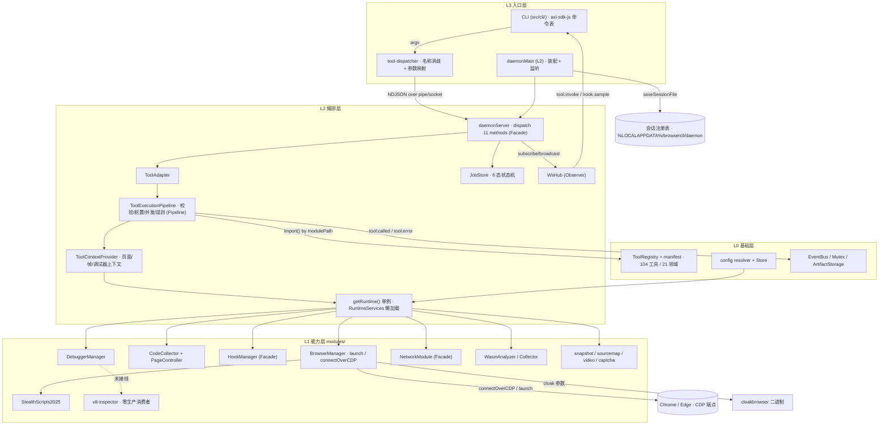
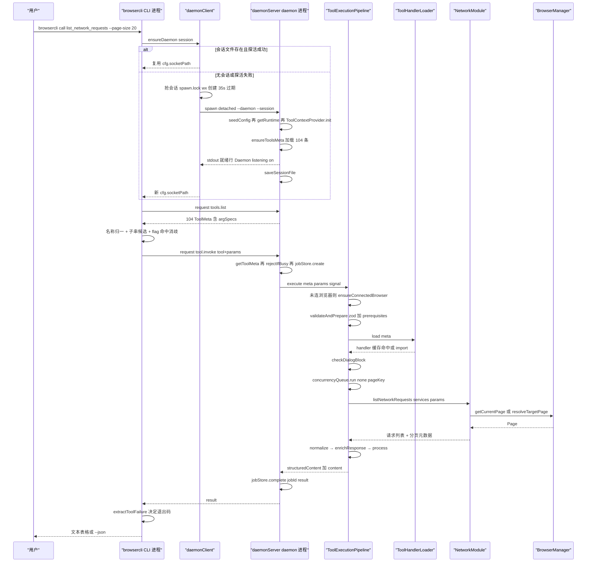
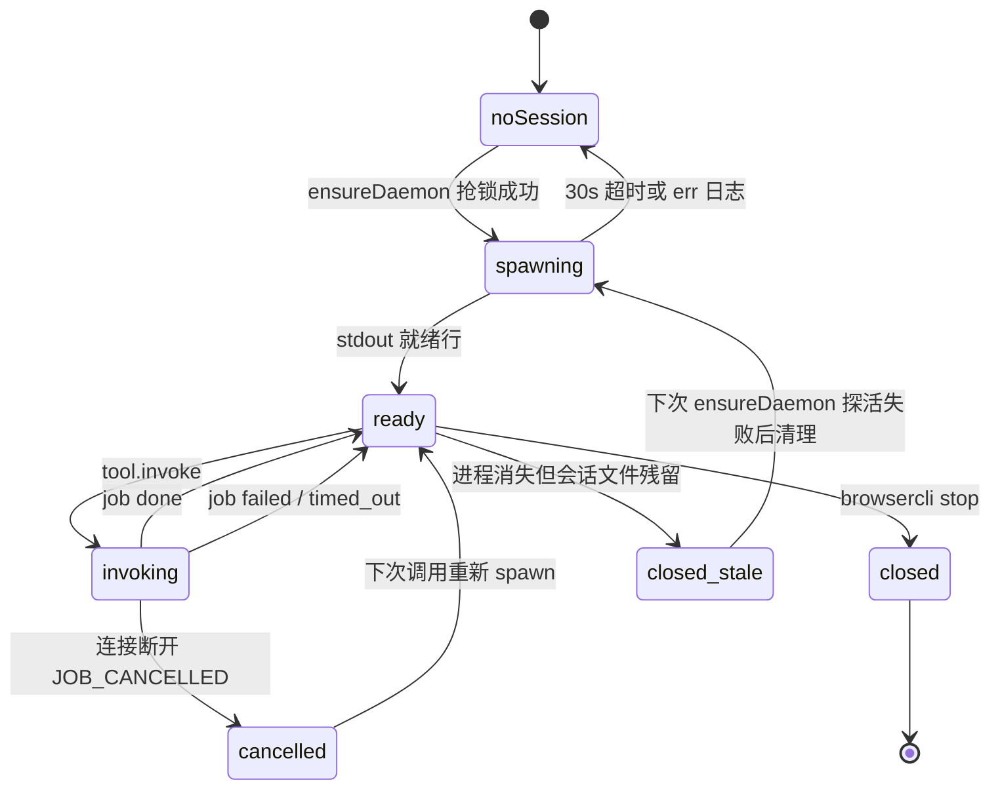

# browsercli 技术分析与二次开发规划

> 分析基准：`D:/work/reverse-engineering/plugin/browsercli`，提交 `96938384`，分析日期 2026-11-24。
> 本文所有结论以该提交的**工作区代码**为准。工作区存在未提交的"工具目录扁平化"改造（`git status` 实测 154 个删除、84 个修改、32 个未跟踪，另有本文档本身；其中删除集中在 `src/tools` 127 个、`docs/{knowledge,architecture,optimization,recommend,guides}` 24 个，另 `src/modules/hook/AIHookGenerator.ts` 与 `skills/hello_js_reverse_skill` 各 1 个），凡与该改造相关的结论都会显式标注。标注"推断"的内容未经代码直接证实。

## 0. 摘要

browsercli 是一个面向 JS 逆向的**浏览器控制工具集**：一个 detached daemon 进程持有浏览器与全部逆向能力模块，一个 CLI 通过本地命名管道 / Unix socket 逐次调用工具。架构风格是**微内核 + 插件注册表 + 事件驱动**——`ToolRegistry` 从 21 个领域 manifest 汇聚 104 个工具，`ToolExecutionPipeline` 是唯一执行闸口，`Runtime` / `RuntimeServices` 是能力单例容器，`ipc/daemonServer.ts` 用构造参数注入依赖而不直接 import 工具层。

三个最重要的发现：

1. **工作区处于"工具目录扁平化"半迁移状态**。`src/tools/` 下 127 个原目录文件已被删除、21 个扁平域文件（`debugger.ts` / `hook.ts` / `network.ts` …）是未跟踪新文件，`npx tsc --noEmit` 直接失败：初始工作区报 **2 条** `TS2307`（`generated-tools-index.ts` 里 `./video.js` 与 `video.test.ts` 里 `src/tools/video/video.js`）；把索引还原成 HEAD 版本则报 **22 条**（21 个已删域目录 + 1 个测试）；跑一次 `npm run build:index` 把 import 改写成扁平路径后降到 **1 条**，只剩测试文件仍指向旧路径。纯源码构建下 `list-tools` 从 104 掉到 103、`call video` 返回 `UNKNOWN_TOOL`；同一批改动还删了 `src/modules/hook/AIHookGenerator.ts`，把 `openai` 依赖变成悬空。这不是设计缺陷，是**未完成的重构**，但它决定了任何二次开发都必须先收口。
2. **工具面是唯一且经过校验的契约**。`tests/unit/tools/all-tools-contract.test.ts` 断言 "full profile exposes exactly 104 tools"，`tests/unit/docs/tool-reference.test.ts` 逐条校验 `docs/reference/tool-reference.md` 与注册表不漂移。改工具必然连带改测试与文档，契约是硬的。
3. **存在成规模但未接线的代码**。`src/modules/v8-inspector/`（13 文件 4725 行）、`src/modules/action/ActionGuard.ts`（170 行）、`src/utils/ToolExecutionScheduler.ts` 在生产代码中零消费者（只有 1 个单测 + 3 个 integration/perf/property 测试引用）。

最值得做的一条改进：**先把扁平化迁移收口并用现有契约测试兜住**（见 4.1）。它是其他改进的前置条件——迁移未完成时，任何改动的验证结论都不可信。

| 项目 | 内容 |
| --- | --- |
| 语言 / 运行时 | TypeScript 5.9（`package.json` devDependencies）；Node `^20.19.0 \|\| ^22.12.0 \|\| >=23`（`package.json` `engines`），`.nvmrc` = `v22` |
| 主要框架 / 库 | patchright ^1.59.0（Playwright fork，经 `src/third_party/playwright.ts` 转出）、axi-sdk-js ^0.1.4（CLI 框架）、zod ^3.25.76、yargs 18、@babel/*、cheerio、wabt、sm-crypto、node-forge；`openai` ^4.73.0 已无任何 import（悬空依赖，见 1.7）；optional：chrome-devtools-frontend、cloakbrowser ^0.3.28、webcrack |
| 构建 / 包管理 | npm；swc（`.swcrc`，target es2022，keepClassNames）分三段：`build:index`（生成工具索引）→ `build:compile`（swc 编译）→ `build:post`（后处理）；`tsc --noEmit` 仅做类型检查（`strict: false`） |
| 测试框架 | Node 内置 `node:test`（跑 `build/tests/**/*.test.js`）+ c8 覆盖率；另有 vitest 双 project（`test:vitest:pure` / `test:vitest:browser`） |
| 部署形态 | 单机 CLI + detached daemon 进程，无服务端、无容器、无 CI（`.github/` 下只有一份 code-review 说明，无 `workflows/`） |
| 规模 | `src` 253 个 `.ts` / 73962 行；`tests` 243 个 `.ts` / 46649 行（git 跟踪的 `tests/**/*.test.ts` = 234）；`docs` 187 个 md；`src/modules` 独占 116 文件 / 38094 行（占 src 行数 52%） |

## 1. 项目整体与核心模块分析

### 1.0 模块全景

真实模块边界按目录与职责划分如下（行数为工作区实测）：

| 模块名 | 路径 | 职责 | 主要依赖 |
| --- | --- | --- | --- |
| CLI | `src/cli/`（23 文件 4689 行） | 命令解析、会话发现、spawn daemon、工具名消歧、结果渲染 | axi-sdk-js、`src/ipc`、`src/cli/sessionPaths.ts` |
| Daemon 入口 | `src/worker/daemonMain.ts`（251 行） | 装配 Runtime / ToolAdapter / JobStore / WsHub，监听 socket，写会话注册表 | `src/runtime`、`src/ipc`、`src/tools` |
| IPC 传输 | `src/ipc/`（5 文件 1094 行） | NDJSON 帧协议、`dispatch` 方法路由、`WsHub` 频道广播、会话注册表 | `node:net`、`node:fs` |
| 工具定义与注册 | `src/tools/`（41 文件 17680 行） | 104 个 `defineTool` 定义 + 21 个领域 manifest + 注册表 + 元数据加载 | zod、`src/modules` |
| 工具执行管线 | `src/worker/ToolExecutionPipeline.ts`（537 行）等 | 校验、前置条件、并发队列、动态加载、响应规范化、遥测 | `src/tools`、`src/worker/*` |
| Runtime 容器 | `src/runtime.ts`（139 行）+ `src/runtime/RuntimeServices.ts`（78 行） | 能力单例装配、lazy 服务、页面上下文绑定 | `src/modules` |
| 浏览器与反检测 | `src/modules/browser/`（16 文件 4060 行）+ `src/modules/stealth/`（2 文件 1142 行） | 启动 / CDP 连接、cloak 二进制、stealth 脚本注入、target 发现 | patchright、cloakbrowser |
| 代码采集 | `src/modules/collector/`（17 文件 5853 行） | 脚本收集、缓存、压缩、页面控制、DOM 检查、动态脚本监听 | patchright、`src/modules/network` |
| Hook | `src/modules/hook/`（6 文件 2751 行） | Hook 代码生成、类型注册、持久化幂等注册、记录存储 | CDP `Page.addScriptToEvaluateOnNewDocument` |
| 调试 | `src/modules/debugger/`（16 文件 5121 行）+ `src/modules/v8-inspector/`（13 文件 4725 行） | CDP 断点 / 单步 / 作用域；V8 字节码与 TurboFan 图分析 | patchright CDPSession |
| 网络 | `src/modules/network/`（9 文件 2619 行） | 请求 / 响应、WebSocket、重放、Mock、curl 导出 | CDP Network 域 |
| 其他逆向能力 | `dom/` `snapshot/` `sourcemap/` `wasm/` `video/` `captcha/` `recorder/` `extension/` | VOM 渲染、可访问性快照、SourceMap 还原、WASM 反编译与 VMP trace、会话录屏、验证码识别、交互录制、扩展管理 | wabt、terser、javascript-obfuscator |
| 配置 | `src/config/`（8 文件 1296 行） | schema 校验、优先级解析、运行时 store、持久化 | zod |
| 通用工具 | `src/utils/`（20 文件 3202 行） | EventBus、Mutex、ArtifactStorage、TokenBudget、日志、路径 | `node:*` |

模板映射（通用类别 → 本项目真实位置）：

| 通用类别 | 对应模块 / 位置 | 说明 |
| --- | --- | --- |
| 用户认证与权限控制 | **未实现** | 检查了 `src/ipc/daemonServer.ts` 的 `dispatch` 全部分支（`:239-287`）、`src/cli/`、`src/config/schema.ts`：无 token、无账号、无 RBAC。安全边界只有文件系统权限——daemon 目录 `mode: 0o700`（[daemonClient.ts:313](src/cli/daemonClient.ts#L313)），会话按 workspace 哈希隔离 |
| 数据处理 / 业务逻辑层 | `src/worker/`（20 文件 4997 行）+ `src/modules/` | 没有独立 "service" 层：业务逻辑就在 `modules/*`，编排逻辑在 `worker/*` |
| API 接口层 / 控制器 | `src/ipc/daemonServer.ts` + `src/tools/*.ts` | 等价于"控制器"的是 `dispatch` 的 11 个 method 分支（`status`/`hello`/`tools.list`/`tool.invoke`/`browser.status`/`browser.connect`/`browser.disconnect`/`jobs.list`/`jobs.cancel`/`subscribe`/`stop`）；工具 handler 是二级控制器 |
| 数据持久化 / ORM / DAO | **无数据库**。等价物：`src/cli/sessionPaths.ts` + `src/ipc/registry.ts`（会话注册表 JSON）、`src/config/runtimeConfigPersistence.ts`（用户配置 JSON）、`src/utils/ArtifactStorage.ts`（大响应落盘）、`~/.browsercli/` 与 `%LOCALAPPDATA%\browsercli\daemon` | 检查了 `package.json` 依赖与全仓 grep：无 sqlite / prisma / typeorm / redis |
| 配置管理 / 启动流程 | `src/config/` + `src/worker/daemonMain.ts` + `src/cli/app.ts` | 启动分两条：CLI 侧 `createWorkerContext` → `ensureDaemon` → spawn；daemon 侧 `runDaemon` |
| 中间件 / 插件机制 / 扩展点 | `src/tools/registry/ToolRegistry.ts` + `src/tools/manifest.ts` + `scripts/generate-tools-index.ts` | 插件单位是"领域 manifest + `defineTool`"，编译期生成索引，**不是**运行时热插拔 |

### 1.1 CLI 层（`src/cli/`）

- **职责（What & Why）**：把 `browsercli <command> [flags]` 翻译成对 daemon 的 IPC 请求，并负责"daemon 不在就拉起来"。它单独存在的理由是 daemon 必须 detached 存活于 CLI 生命周期之外（[daemonClient.ts:307](src/cli/daemonClient.ts#L307) 起 `spawnDaemon` 用 `detached: true`），CLI 每次调用都是短命进程。
- **核心流程**（以 `browsercli call <tool>` 为例）：
  1. [bin/browsercli.ts:41](src/cli/bin/browsercli.ts#L41) `extractLeadingSession(rawArgv)` 把 `-s=x` 这类前置会话 flag 摘出来，因为 axi 框架要求 flag 位于命令之后。
  2. [bin/browsercli.ts:43-52](src/cli/bin/browsercli.ts#L43-L52) `runAxiCli<WorkerContext>` 注册命令表与帮助生成器。
  3. `resolveContext` → `createWorkerContext`（[app.ts:94](src/cli/app.ts#L94-L119)）→ `ensureDaemon`（[daemonClient.ts:395](src/cli/daemonClient.ts#L395)）→ `DaemonConnection.connect(cfg.socketPath, 3000)`，随后异步 `verifyDaemonVersion`（版本不一致只 warn）。
  4. `toolDispatcherCommand`（[tool-dispatcher.ts:155](src/cli/commands/tool-dispatcher.ts#L155)）先拿 `tools.list` 做名称 / 别名 / 子串消歧，`buildToolArgs` 按 `argSpecs` 把 flag 转成参数，`invokeWithBusyRetry` 发 `tool.invoke`。
  5. 结果经 `extractToolFailure`（[:118](src/cli/commands/tool-dispatcher.ts#L118)）判定失败，`--json` 原样输出，否则走 `successOutput`。
- **关键符号**：

  | 符号 | 位置 | 作用 |
  | --- | --- | --- |
  | `cliCommands` | [app.ts](src/cli/app.ts#L73-L89) | 命令表：9 个有效 + 5 个 `COMMAND_DEPRECATED` 拦截 |
  | `createWorkerContext` | [app.ts](src/cli/app.ts#L94-L119) | 解析 session、合并 spawn flags、`connect()` 内 `ensureDaemon` |
  | `spawnDaemon` | [daemonClient.ts](src/cli/daemonClient.ts#L307-L394) | `spawn(process.execPath, [entry, '--daemon', ...], {detached:true})`，`Promise.race` 等 stdout 出现 `Daemon listening on`（30s 超时） |
  | `ensureDaemon` | [daemonClient.ts](src/cli/daemonClient.ts#L395-L520) | 复用探活 → 抢 `<session>.spawn.lock`（`openSync(..., 'wx')`，35s 过期 + 持锁 pid 存活检查）→ 二次检查 → spawn |
  | `invokeWithBusyRetry` | [tool-dispatcher.ts](src/cli/commands/tool-dispatcher.ts#L48-L110) | `WORKER_BUSY` 按 `[200,500,1000]ms` 退避；browser-connect 轮询 15s / 500ms，两个计数独立 |
  | `extractToolFailure` | [tool-dispatcher.ts](src/cli/commands/tool-dispatcher.ts#L118-L145) | `structuredContent.success===false` 或 `isError===true` 判定失败 |
  | `startCommand` | [start.ts](src/cli/commands/start.ts#L24-L107) | 存在会话则 probe → stop → 重启（对齐 chrome-devtools 语义）；仅当显式传浏览器 flag 才发 `browser.connect`（`:50-53`） |

- **依赖关系**：上游是 `bin/browsercli.ts`；下游是 `src/ipc`（连接与注册表）、`src/cli/sessionPaths.ts`（路径计算）、`src/config`（读用户配置）。方向单向 `cli → ipc/config`，没有 `ipc → cli` 的反向引用（`scripts/check-arch.ts` 的分层规则会拦住）。
- **问题**：
  - **帮助文本版本号恒为 `1.0.0`**：[help.ts:31](src/cli/help.ts#L31) `const version = options?.version ?? '1.0.0'`，而 [app.ts:92](src/cli/app.ts#L91-L92) 的 `homeCommand` 与 [browsercli.ts:46](src/cli/bin/browsercli.ts#L46) 都无参调用 `generateTopLevelHelp()`。实测 `browsercli --help` 打印 `browsercli v1.0.0`，真实版本是 2.0.3（[daemonClient.ts:61](src/cli/daemonClient.ts#L61) `CLI_VERSION = readPackageVersion()`）。传参后实测输出 `browsercli v2.0.3`。修复需改两处源码（`help.ts` 默认值、`app.ts` 的 `homeCommand` 传 `cliVersion`）并同步改一条测试——`tests/unit/cli/help.test.ts:18` 把 `browsercli v1.0.0` 写成了期望值。
  - **帮助文本仍称 "MCP 工具"**：[help.ts:15-16](src/cli/help.ts#L15-L16) 写 `'调用 MCP 工具，或兼容调用已迁移为 Tool 的旧技能'`、`'列出所有可用的 MCP 工具及旧技能兼容映射'`，与 ADR 0006（删除 MCP 传输、定位为 daemon + CLI）直接冲突。
  - **`ensureDaemon` 单函数 126 行**，混合了"锁获取 / 过期判定 / 复用探活 / 二次检查 / spawn"五种职责，且用抛对象 `{reusedConfig}` 做控制流（[:465-476](src/cli/daemonClient.ts#L465-L476)），是 `try/catch` 里抛非 Error 的隐式契约。

### 1.2 Daemon 与 IPC（`src/worker/daemonMain.ts`、`src/ipc/`）

- **职责（What & Why）**：daemon 是唯一持有浏览器状态与能力模块的进程，必须脱离 CLI 存活；IPC 层把"进程内调用"包装成可被多个独立 CLI 进程访问的请求 / 响应协议。
- **核心流程**（启动）：
  1. [daemonMain.ts:142](src/worker/daemonMain.ts#L142) `seedConfig(plan)`：CLI 缓存配置 → spawnFlags → minimalStealth 覆盖，播种 `RuntimeConfigStore`。
  2. 同 session 排他（`:95-140`）：已有存活且响应（1.5s socket connect）的 daemon 则本进程 `exit(0)`；存活但无响应则 `killPidForce` 接管。
  3. `getRuntime()` → `new ToolContextProvider(runtime)`（`:145`）→ `contextProvider.init()`（`:147`，`syncPages()` + `syncBrowserState()`）→ `setBrowserConnector`（`:149`）。
  4. `new ToolAdapter(contextProvider)`（`:154`）→ `ensureToolsMeta()`（`:155`，失败仅 warn）。
  5. `new JobStore()` / `new WsHub()`（`:159-160`），订阅 `toolAdapter.onInvoke` 广播 `tool.invoke`、HookStore `sample` 广播 `hook.sample`。
  6. `makePipePath(info.workspaceDirHash, plan.session)`（`:177`）→ `createGracefulShutdown`（`:178`）→ `startDaemonServer`（`:199`）→ **监听成功后才** `saveSessionFile`（`:219`）→ `console.log('Daemon listening on ...')`（`:230`，CLI 的就绪判据）。
- **关键符号**：

  | 符号 | 位置 | 作用 |
  | --- | --- | --- |
  | `runDaemon` | [daemonMain.ts](src/worker/daemonMain.ts#L93-L251) | 装配全部服务并保持存活 |
  | `seedConfig` | [daemonMain.ts](src/worker/daemonMain.ts#L79) | 把 daemon plan 播种进配置 store |
  | `PROTOCOL_VERSION = 1` | [socketConnection.ts](src/ipc/socketConnection.ts#L14) / [daemonClient.ts](src/cli/daemonClient.ts#L33) | 两侧必须同步修改（两处都有注释说明） |
  | `dispatch` | [daemonServer.ts](src/ipc/daemonServer.ts#L239-L287) | 11 个 method 分支，未知 → `UNKNOWN_METHOD` |
  | `handleToolInvoke` | [daemonServer.ts](src/ipc/daemonServer.ts#L291-L336) | 校验 tool → `getToolMeta` → `rejectIfBusy` → `jobStore.create` → `runJob` → 非 `done` 抛错 |
  | `runJob` | [daemonServer.ts](src/ipc/daemonServer.ts#L475-L500) | `markRunning` → `raceWithAbort(executeTool(...))` → `complete` / `fail` |
  | `WsHub` | [eventHub.ts](src/ipc/eventHub.ts#L147) | `subscribe`(`:154`) / `unsubscribe`(`:184`) / `broadcast`(`:197`)；频道 `worker.status`(`:17`)、`tool.invoke`/`hook.event`/`hook.sample`/`log`(`:22-26`) |
  | `createGracefulShutdown` | [WorkerLifecycle.ts](src/worker/WorkerLifecycle.ts#L35) | `isShuttingDown` 幂等 + 10s 超时释放 ContextProvider |
  | `saveSessionFile` / `loadSessionFile` / `listSessionFiles` | [registry.ts](src/ipc/registry.ts#L52-L92) | 会话注册表读写（`<name>.session` JSON） |

- **依赖关系**：`daemonMain → runtime/ipc/tools/worker`；`ipc/daemonServer` 通过构造参数 `DaemonDeps` 拿 `contextProvider` / `toolAdapter` / `jobStore` / `wsHub` / `listToolsMeta` / `getToolMeta`，**不直接 import `src/tools`**——这是本项目最干净的一处依赖倒置。`daemonMain.ts:14-42` 以 `// 依赖注入：` 分节列出 20 余条 import，是装配点的单一真相。
- **问题**：
  - **单活跃任务**：`activeJob` 是模块级单变量（[daemonServer.ts:327](src/ipc/daemonServer.ts#L327)），`rejectIfBusy('tool', getActiveJob())`（`:307`）让同一 session 同时只能跑一个工具。`JobStore` 支持 `maxJobs=1000`、6 态状态机（[JobStore.ts:8-15](src/worker/JobStore.ts#L8-L15)），但这份并发能力实际被 `rejectIfBusy` 关掉了——`jobs.list` 永远最多 1 条 running。设计意图（推断）是"浏览器状态不可并发"，代价是 `JobStore` 的排队 / 保留逻辑大部分未被使用。
  - **`ensureToolsMeta` 失败被吞**：[daemonMain.ts:155-157](src/worker/daemonMain.ts#L155-L157) 只 `console.warn`，随后 `dispatch` 的 `tools.list` 返回空数组，CLI 侧表现为"没有工具"，而不是启动失败。
  - **连接关闭即取消任务**：连接断开时 abort 该连接的 activeJob（`JOB_CANCELLED`），对长任务（如 `wasm_vmp_trace`）意味着 CLI 一中断任务就死，没有"后台继续"语义。
  - **`status` 与 `hello` 同分支**：`dispatch` 里 `case 'status': case 'hello':` 返回同一结构，协议上保留两个名字但没有语义差异，属于历史遗留。

### 1.3 工具定义、注册与执行管线（`src/tools/`、`src/worker/ToolExecutionPipeline.ts`）

这是全项目最核心、也最值得二开时理解的模块。

- **职责（What & Why）**：把"104 个能力"统一成可发现、可校验、可并发控制、可观测的单一契约。[ToolDefinition.ts:292](src/tools/ToolDefinition.ts#L292-L296) 的 `defineTool` 只是恒等函数，价值全在类型约束。
- **核心流程**（一次 `tool.invoke` 的完整链路）：
  1. **注册期（构建时）**：`scripts/generate-tools-index.ts` 扫 `src/tools/*.ts`，要求同时出现 `export const manifest = {` 与 `satisfies DomainManifest`（`readDomainManifests`，`:286`），用正则抽 `modulePath` / `handlerName` / `profile`（`parseToolEntries`，`:75`），再二次解析 `TOOL_REGISTRY` 常量块（`extractRegistryBlock`，`:38`），生成 `src/tools/generated-tools-index.ts`（`renderGeneratedIndex`，`:225`）。实测输出 `Generated 21 manifests with 104 tools`。
  2. **元数据期（启动时）**：`TOOL_REGISTRY = new ToolRegistry(GENERATED_DOMAIN_MANIFESTS).listTools(getConfiguredToolProfile())`（[tools-meta.ts:95-97](src/tools/tools-meta.ts#L95-L97)）。`ToolRegistry.listTools`（[ToolRegistry.ts:38](src/tools/registry/ToolRegistry.ts#L38-L60)）按 `PROFILE_ORDER{workflow:0, full:1}`（`:17`）过滤：`effectiveProfile <= maxProfile` 即保留，`effectiveProfile = tool.profile ?? manifest.profile ?? 'workflow'`。
  3. **加载期**：`loadToolMeta`（[tools-meta.ts:134](src/tools/tools-meta.ts#L134-L200)）`await import('../tools' + entry.modulePath.replace(/^\./,''))`，要求导出对象含 `handler` 函数；manifest 与 `annotations.requirements` 不一致则 warn 并丢弃该工具。结果缓存到 `toolsMetaCache`（`:209`），名称 / 别名映射到 `toolsByNameCache`。
  4. **执行期**：`ToolExecutionPipeline.execute`（[ToolExecutionPipeline.ts:324](src/worker/ToolExecutionPipeline.ts#L324-L370)）包在 `activityCoordinator.runTool` 里；未连浏览器则先 `ensureConnectedBrowser()`（`:331-341`）；`generateTraceId`（`:408`，`tr_<base36 ts>_<rand6>`）；`validateAndPrepare`（`:412`，zod 校验 + `prerequisiteChecker.check`）；`loadHandler`；`checkDialogBlock`（`:383`，`blockedByDialog` 且存在 dialog → `PREREQUISITE` 错误并给 `recovery.command = 'browsercli call handle_dialog --action accept'`）；`concurrencyQueue.run(concurrency, pageKey, ...)`（`:356`）→ `processRequest`（`:451`，router 执行 → `normalize` → `contextGuard.enrichResponse` → `processor.process`）；成功 / 失败都 `recordSuccess`/`recordFailure`（`:465`/`:506`）写遥测与 `ToolResultRecorder`；异常统一 `wrapError`（`:528`）成 `ToolError`。
  5. **响应期**：`ToolResponseProcessor`（[ToolResponse.ts:214](src/worker/ToolResponse.ts#L214)）`normalize` 把裸返回值包成 `{structuredContent}`；`autoOffload` 开启且内容超 `DEFAULT_OFFLOAD_THRESHOLD_BYTES = 16 * 1024`（[ArtifactStorage.ts:13](src/utils/ArtifactStorage.ts#L13)）时，`ArtifactStorage.createReference`（`:79`）落盘并返回 `{_referenceOverValue: true, artifactPath, totalBytes, summary, preview}`。
- **关键符号**：

  | 符号 | 位置 | 作用 |
  | --- | --- | --- |
  | `defineTool` | [ToolDefinition.ts](src/tools/ToolDefinition.ts#L292-L296) | 恒等函数，承载 `ToolDefinition` 类型 |
  | `ToolRuntimeRequirements` | [ToolDefinition.ts](src/tools/ToolDefinition.ts#L46-L53) | `browser:'connected'` / `page:'selected'` / `frame:'selected'` / `debugger:'available'\|'paused'\|'running'` / `nativeTools` / `recovery` |
  | `ToolConcurrency` | [ToolDefinition.ts](src/tools/ToolDefinition.ts#L56-L65) | `'exclusive'` / `'page'` / `'none'`，注释写明参考 chrome-devtools-mcp |
  | `ConcurrencyQueue` | [ToolExecutionPipeline.ts](src/worker/ToolExecutionPipeline.ts#L73-L129) | `exclusiveMutex` + 每页 `Mutex` + `activePageCount` + `pageDrainWaiters` |
  | `ToolHandlerLoader` | [ToolExecutionPipeline.ts](src/worker/ToolExecutionPipeline.ts#L132-L160) | 按 `` `${modulePath}:${handlerName}` `` 缓存 `await import()` |
  | `ToolExecutionRouter` | [ToolExecutionPipeline.ts](src/worker/ToolExecutionPipeline.ts#L163-L169) | 分 `defineTool` / `frame` / `context` / 默认四种调用形态 |
  | `ToolCallContextGuard` | [ToolCallContextGuard.ts](src/worker/ToolCallContextGuard.ts#L34-L80) | `recordCall` 统计连续同名调用，`enrichResponse` 追加提示 |
  | `ToolPrerequisiteChecker.check` | [ToolPrerequisiteChecker.ts](src/tools/prerequisites/ToolPrerequisiteChecker.ts#L40) | 运行时检查 `requirements`，比 schema 校验更靠后 |
  | `PageHealthTracker` | [PageHealthTracker.ts](src/worker/context/PageHealthTracker.ts#L16) | `recordTimeout`(`:45`) 达 `timeoutThreshold=2` 标记 unresponsive |
  | `ToolTelemetry` | [ToolResponse.ts](src/worker/ToolResponse.ts#L332) | `TokenBudgetManager.recordToolCall`（`:342`）+ `eventBus.emit('tool:called'/'tool:error')` |

- **依赖关系**：`worker/ToolExecutionPipeline → tools/{manifest,registry,tools-meta,ToolDefinition,prerequisites}` 与 `worker/{ToolContext,ToolResponse,WorkerActivityCoordinator}`；`tools/* → modules/*`（单向）。`ipc/daemonServer` 只依赖 `ToolAdapter` 的 `executeTool` / `onInvoke` 两个方法。
- **问题**：
  - **`'page'` 并发策略实现有竞态**：`ConcurrencyQueue.run` 的 `'page'` 分支（[:112-118](src/worker/ToolExecutionPipeline.ts#L112-L118)）先 `await exclusiveMutex.acquire()` 再立刻 `dispose()`，然后才拿 page mutex。在 acquire 与 dispose 之间若有 exclusive 任务进入，page 任务会先通过"检查"再与 exclusive 任务并行——这把 `'exclusive'` 的语义从"独占"弱化成"排队点"。正确做法是持有 exclusive guard 直到 page 任务完成，或用读写锁。`tests/unit/worker/` 下未发现对应并发交错用例。
  - **`modulePath` 指向已不存在的文件**：[screencast.ts:116](src/tools/screencast.ts#L116) 的 manifest 写 `modulePath: './video.js'`，但扁平化后文件是 `screencast.ts`。`generate-tools-index.ts` 会用 basename 修正 import（实测生成 `from './screencast.js'`），却**不修正 manifest 内部的 `modulePath`**，于是 `loadToolMeta` 的 `import('../tools/video.js')` 在纯源码构建下抛 `ERR_MODULE_NOT_FOUND`。实测后果：删掉遗留 `build/src/tools/video.js` 后 `list-tools` 从 104 掉到 103、`call video` 返回 `UNKNOWN_TOOL`、`all-tools-contract.test.js` 报 `video:video failed to load`。修好后 `list-tools` 回到 104、`call video --action capabilities` 正常返回 `version: 1` / `format: mp4`。
  - **生成索引被提交**：`src/tools/generated-tools-index.ts` 在 git 中（`git ls-files` 命中），文件头写 `Generated by scripts/generate-tools-index.ts. Do not edit manually.`，但内容必须手改才能修上述 `modulePath`。改 manifest 后忘记 `npm run build:index` 会静默漂移——实测 `git diff --stat` 该文件 152 增 / 116 删。
  - **`DOMAIN_DESCRIPTIONS` 缺 screencast 键**：[generate-tools-index.ts:16](scripts/generate-tools-index.ts#L16) 只有 20 个键，`video` 域会走 `` `${domain} tools.` `` 兜底描述，与 `screencast.ts:112` 手写的 `'Browser session video recording and management.'` 冲突（`writeDomainManifests` 会覆写回去）。
  - **工厂式定义绕过静态核对**：`stepInto`/`stepOver`/`stepOut` 由 `defineStepTool(...)` 生成（[debugger.ts:1733](src/tools/debugger.ts#L1733)/`:1748`/`:1763`），`breakOnXhr`/`removeXhrBreakpoint` 由 `defineXhrBreakpointTool` 生成（`:2434`/`:2447`）。任何"用 `= defineTool` 正则核对注册表"的脚本都会误报这 5 条缺失。

### 1.4 Runtime 容器与服务装配（`src/runtime.ts`、`src/runtime/RuntimeServices.ts`）

- **职责（What & Why）**：把 10+ 个有状态能力模块收敛成单例，让工具 handler 通过 `runtime` 参数取用而不关心构造。代价是一个隐式全局——这是项目里**最重的架构耦合点**。
- **核心流程**：`getRuntime()`（[runtime.ts:67](src/runtime.ts#L67-L136)）首次调用时构造 `BrowserManager.getInstance()`、`CodeCollector`、`DOMInspector`、`PageController`、`HookManager`、`RuntimeServices`、`DetailedDataManager.getInstance()`、`UnifiedCacheManager`、`EventBus<AppEventMap>`；`networkModule` / `wasm*` / `sourceMapService` / `videoManager` 全部是 getter，委托 `RuntimeServices` 的 `??=` 懒创建（[RuntimeServices.ts:23](src/runtime/RuntimeServices.ts#L23)）；`bindPageContext`(`:121`) / `syncPageContext` / `clearPageContext` 维护 `collector.setPageResolver`。
- **关键符号**：

  | 符号 | 位置 | 作用 |
  | --- | --- | --- |
  | `Runtime` 接口 | [runtime.ts](src/runtime.ts#L42-L64) | 16 个成员，含 `contextProvider?`（daemon 启动后回填） |
  | `getRuntime` | [runtime.ts](src/runtime.ts#L67) | 单例；注释标 `@stable` 且声明"57+ 调用方，改返回类型前必须跑 impact 分析" |
  | `setRuntime` | [runtime.ts](src/runtime.ts#L137) | 测试替换入口 |
  | `RuntimeServices` | [RuntimeServices.ts](src/runtime/RuntimeServices.ts#L23) | 7 个 `??=` 懒服务（network / wasm×4 / sourcemap / video） |

- **依赖关系**：`worker/*`、`tools/*`、`ipc/*` 全部依赖 `getRuntime()`；`runtime.ts` 反向依赖 `modules/*`。`scripts/check-arch.ts` 把 `runtime.ts` 放在 L2，允许它依赖 L1 的 `modules`。
- **问题**：
  - **配置环依赖已登记为架构债**：[resolver.ts:7](src/config/resolver.ts#L7) 有 `/* eslint-disable import/no-cycle -- 已知例外：loadUserConfig() 播种 store 与 getRuntimeConfigStore() 读回 store 的初始化时序契约。见 spec §2.1 目标 2 与 §5.1 环 1 决议 A */`，`scripts/check-arch.ts:264` 硬编码允许 `RuntimeConfigStore.ts <-> resolver.ts`。实测 `check-arch` 输出 `INFO: Found documented initialization cycle exception`。
  - **`getRuntime()` 是可变全局**：`runtime.contextProvider = contextProvider`（[daemonMain.ts:146](src/worker/daemonMain.ts#L146)）在构造后回填，`setRuntime(undefined)` 可重置。当前一个进程一个 session 所以安全，但 `DaemonConnection` 支持多 session 连接，扩展时这里会互相污染。

### 1.5 浏览器连接与反检测（`src/modules/browser/`、`src/modules/stealth/`）

- **职责（What & Why）**：统一"启动新浏览器 / 连接已有 CDP 端点"两条路径，并在此层集中所有反检测手段，让上层工具无感。
- **核心流程**：`BrowserManager.getInstance(config?)`（[browser.ts:226](src/modules/browser/browser.ts#L226)）→ 三条路径：
  - `connectToRemoteBrowser()` → `chromium.connectOverCDP(connectEndpoint, {timeout, headers})`（`:397`）；
  - `launchBrowser()`（`:748`）：cloak 仅对 chromium 生效，`executablePath = cloakSetup.executablePath ?? configExecutablePath`，args 追加 cloak args；
  - 启动 / 连接后 `StealthScripts2025.injectAll(page, stealthOptions)` 遍历所有 context 的 page，并对新 page 注册 `ctx.on('page', ...)`（`:1046-1050`）。
- **关键符号**：

  | 符号 | 位置 | 作用 |
  | --- | --- | --- |
  | `BrowserManager` | [browser.ts](src/modules/browser/browser.ts#L226) | 单例，持有 `browser` / `config` / `stealthInjected` |
  | `StealthScripts2025.injectAll` | [StealthScripts2025.ts](src/modules/stealth/StealthScripts2025.ts#L371) | 按 preset 注入；`:1109` 有 `@deprecated` 旧入口 |
  | `cloak.ts` | [cloak.ts](src/modules/browser/cloak.ts)（121 行） | cloakbrowser 二进制探测与参数拼装 |
  | `stealth-args.ts` | [stealth-args.ts](src/modules/browser/stealth-args.ts)（161 行） | 最小参数集 `--test-type` / `--hide-crash-restore-bubble` |
  | `BrowserTargetInspector` | [BrowserTargetInspector.ts](src/modules/browser/BrowserTargetInspector.ts) | 枚举 CDP target |
  | `connectBrowser` / `getBrowserConnectionMode` | [BrowserConnectionManager.ts](src/worker/BrowserConnectionManager.ts)（255 行） | 模块级 `inFlightConnectPromise` / `inFlightConnectTarget` 去重；模式判定顺序 ws-endpoint → attach → launch |

- **依赖关系**：`browser → stealth/third_party(patchright)`；`worker/BrowserConnectionManager.ts` 在其上做并发去重；`tools/*` 通过 `ToolContext` 的 `ensureConnectedBrowser()` 间接触达。
- **问题**：
  - **`browser.ts` 1170 行、单类承担启动 / 连接 / 上下文 / 页面 / stealth / 关闭**，是全项目最大的类。反检测细节（`cloak`、`stealth-args`、`StealthScripts2025`）已抽出，但装配仍留在 `launchBrowser` 内。
  - **profile 目录两套**：README 称 `~/.cache/chrome-devtools-mcp/chrome-profile` 与 `cloak-profile`，源码中未见统一常量（推断：散落在 `browser-helpers.ts`）。命名沿用上游 chrome-devtools-mcp，与本项目的 `~/.browsercli/` 目录约定不一致。

### 1.6 代码采集（`src/modules/collector/`，17 文件 5853 行）

- **职责**：把页面脚本、网络请求、控制台、WebSocket 采集成可检索的本地语料。这是"逆向"最前置的一环，也是 `workflow` profile 的主战场（`collector` 5 个工具、`script` 1 个、`dom` 5 个）。
- **核心流程**：`CodeCollector`（[CodeCollector.ts:49](src/modules/collector/CodeCollector.ts#L49)）持有 `CodeCache` / `CollectedFileRegistry` / `CodeCompressor` / `SmartCodeCollector`；`setPageResolver(resolver)`（`:200`）由 `runtime.bindPageContext` 注入，保证"当前选中页"始终生效；`PageController`（[PageController.ts:33](src/modules/collector/PageController.ts#L33)）把 Playwright 动作封装成 `navigate` / `reload` / `goBack` / `goForward` / `click` / `clickAt` / `setFiles` / `type` / `select` / `hover` / `scroll`；`CdpNetworkMonitor` 与 [collectors.ts](src/worker/collectors.ts) 的 `NetworkRequestCollector`(`:61`) / `ConsoleMessageCollector`(`:206`) / `WsCollector`(`:321`) 做环形缓冲。
- **关键符号**：

  | 符号 | 位置 | 作用 |
  | --- | --- | --- |
  | `CodeCollector` | [CodeCollector.ts](src/modules/collector/CodeCollector.ts#L49) | 脚本采集门面 |
  | `setPageResolver` | [CodeCollector.ts](src/modules/collector/CodeCollector.ts#L200) | 页面上下文注入点 |
  | `PageController` | [PageController.ts](src/modules/collector/PageController.ts#L33) | 页面动作统一入口 |
  | `DOMInspector` | [DOMInspector.ts](src/modules/collector/DOMInspector.ts#L55) | DOM 查询与属性提取 |
  | `TrackedRequest` / `TrackedConsoleMessage` / `TrackedWebSocketData` | [collectors.ts](src/worker/collectors.ts#L42-L53) | 带 `stableId` 的采集实体 |
  | `DynamicScriptWatcher` | `src/modules/collector/DynamicScriptWatcher.ts` | 监听后续插入的脚本 |

- **依赖关系**：`collector → network/dom/snapshot`；`tools/{collector,script,dom,page,navigation}.ts → collector`。
- **问题**：
  - **三个 `PageCollector` 子类结构重复**：`NetworkRequestCollector` / `ConsoleMessageCollector` / `WsCollector` 各自维护缓冲与 `stableId` 分配，未共享分页逻辑；分页在 `NetworkModule.listRequests` 又实现一遍。
  - **采集与展示耦合**：`src/formatters/`（4 文件 1130 行）负责把采集结果渲染成文本，但 `tools/*` 里也有格式化片段（如 `src/tools/network.ts` 的 curl 导出），同一份数据两条渲染路径。

### 1.7 Hook（`src/modules/hook/`，6 文件 2751 行；`AIHookGenerator.ts` 已在工作区删除）

- **职责**：生成 JS Hook 脚本、注入页面、跨导航持久化、回收记录。它对应 README 方法论里的 "Hook-preferred"——在断点之前优先用 Hook 拿证据。
- **核心流程**：`HookManager`（[HookManager.ts:109](src/modules/hook/HookManager.ts#L109)）是门面，组合 `HookCodeBuilder`（生成脚本）+ `HookStore`（记录）+ `HookTypeRegistry`（Hook 类型）+ `PersistentHookRegistry`（跨帧注册）。持久化注册用 `hashPersistentHookScript(script)`（[PersistentHookRegistry.ts:50](src/modules/hook/PersistentHookRegistry.ts#L50)）做 sha 摘要幂等，返回 `RegisterPersistentHookResult{entry, registered, idempotent, appliedFrames, failedFrames, partial, warnings}`（`:114` 起）。
- **关键符号**：

  | 符号 | 位置 | 作用 |
  | --- | --- | --- |
  | `HookManager` | [HookManager.ts](src/modules/hook/HookManager.ts#L109) | 门面（Facade），`HookCreateOptions` 含 action（log/block/modify/passthrough）、capture、condition、lifecycle、store、asyncAware、protocolFallback |
  | `HookStore` | [HookStore.ts](src/modules/hook/HookStore.ts#L29) | 记录存储，`events.emit('sample')` 供 WsHub 广播 |
  | `hashPersistentHookScript` | [PersistentHookRegistry.ts](src/modules/hook/PersistentHookRegistry.ts#L50) | 脚本摘要，幂等键 |
  | `PersistentHookRegistry` | [PersistentHookRegistry.ts](src/modules/hook/PersistentHookRegistry.ts#L83) | 逐帧注册 + 失败聚合 |
  | `AIHookGenerator` | **工作区已删除**（git 中仍跟踪，`git status` 显示 ` D src/modules/hook/AIHookGenerator.ts`） | 原为"AI 驱动 Hook 代码生成"，只调 `HookManager` 不重复实现 Hook 逻辑；删除后 `package.json` 的 `openai` ^4.73.0 在 `src/`、`scripts/`、`tests/` 中零 import，成为悬空依赖 |

- **依赖关系**：`tools/hook.ts`（1584 行，6 个工具）→ `HookManager` → `HookCodeBuilder` / `HookStore` / `PersistentHookRegistry`；`daemonMain` 订阅 `HookStore.events.on('sample')` 转发到 `WsHub`。
- **问题**：
  - **`requestedWorld` 恒被收敛为 `'main'`**：`PersistentHookRegistry` 中 `effectiveWorld: 'main'` 写死，调用方传的 `world` 参数无效。若确为 CDP 限制（`Page.addScriptToEvaluateOnNewDocument` 只能主世界），应删参数或明确报错，而不是静默忽略。
  - **`tools/hook.ts` 1584 行单文件承载 6 个工具 + 类型 + manifest**（靠 `// ─── types.ts ───` 这类分节注释维持可读性），是扁平化迁移的直接产物。
  - **`openai` 成为悬空依赖**：`AIHookGenerator.ts` 被删后，`grep -rn "openai" --include=*.ts src/ scripts/ tests/` 零命中，但 `package.json:86` 仍声明 `"openai": "^4.73.0"`。这是扁平化迁移的第二个未收口点（回指 1.X 问题 1）。

### 1.8 调试（`src/modules/debugger/`、`src/modules/v8-inspector/`）

- **职责**：CDP 断点 / 单步 / 作用域 / 表达式求值，以及更深的 V8 层分析（Ignition 字节码、TurboFan 图、堆快照）。
- **核心流程**：`DebuggerManager`（[DebuggerManager.ts:83](src/modules/debugger/DebuggerManager.ts#L83)）`enable(client?)`（`:198`）→ `setBreakpointByUrl`（`:328`）/ `setBreakpointByUrlRegex`（`:337`）→ 事件转成 `get_paused_info` / `inspect_locals` 的返回结构。`LogpointManager` 提供 `set_logpoints`。
- **关键符号**：

  | 符号 | 位置 | 作用 |
  | --- | --- | --- |
  | `DebuggerManager` | [DebuggerManager.ts](src/modules/debugger/DebuggerManager.ts#L83) | 断点与执行控制 |
  | `LogpointManager` | `src/modules/debugger/LogpointManager.ts`（**未跟踪新文件**） | 日志点，配合 `set_logpoints` 工具 |
  | `v8-inspector/index.ts` | [index.ts](src/modules/v8-inspector/index.ts) | 导出 `HeapSnapshotParser`/`BytecodeExtractor`/`JITInspector`/`V8InspectorClient`/`VersionDetector`/`DominatorTreeBuilder`/`collectTurboFanIR*`/`printNativeIgnitionBytecode` |

- **依赖关系**：`tools/debugger.ts`（3621 行，31 个工具）→ `DebuggerManager`。**`src/modules/v8-inspector` 在生产代码中零消费者**（见 1.X 问题 5）。
- **问题**：
  - `tools/debugger.ts` 3621 行 / 31 工具，是全仓最大工具文件。31 个工具里 `stepInto` / `stepOver` / `stepOut` / `breakOnXhr` / `removeXhrBreakpoint` 是工厂生成（见 1.3 问题 5）。
  - `debugger` 域是唯一整域 `profile: 'full'` 的大域（31 个工具），意味着 `workflow` profile 用户完全拿不到断点能力——这与 README 方法论里 "Breakpoint-last"（断点是最后一招，但仍需要）的表述存在张力。

### 1.9 网络（`src/modules/network/`，9 文件 2619 行）

- **职责**：请求 / 响应详情、WebSocket 帧、重放、Mock、curl 导出。`network` 域 12 个工具，是工具数第二多的域。
- **核心流程**：`NetworkModule.listRequests(services, params)` 先 `resolveTargetPage` 定位页，支持 `waitForRequest` 轮询；`replayRequest`（[NetworkModule.ts:591](src/modules/network/NetworkModule.ts#L591)）/ `replayBatch`（`:725`）用保存的请求重建并发送。
- **关键符号**：

  | 符号 | 位置 | 作用 |
  | --- | --- | --- |
  | `NetworkModule` | [NetworkModule.ts](src/modules/network/NetworkModule.ts#L210) | 请求查询与重放（1191 行，全仓最大 module 文件之一） |
  | `NetworkMockManager` | `src/modules/network/NetworkMockManager.ts`（**未跟踪新文件**） | `mock_network` / `remove_network_mock` 的落地实现 |
  | `networkFormatter` | `src/formatters/networkFormatter.ts` | 文本渲染 |

- **依赖关系**：`tools/network.ts`（1201 行，12 工具）→ `NetworkModule` → `worker/collectors.ts`。
- **问题**：`listRequests` 单方法处理分页 + 等待 + 扩展请求 + 保留请求四个维度，参数对象已达 8+ 字段，是典型的"参数爆炸"。分页逻辑与 `collectors.ts` 的缓冲逻辑职责重叠。

### 1.10 其他逆向能力模块

| 模块 | 路径 | 关键符号（行号） | 接入点 | 备注 |
| --- | --- | --- | --- | --- |
| DOM / VOM | `src/modules/dom/`（6 文件 2703 行） | `vom/render.ts`（1659 行）、`SnapshotReader.ts` | [dom.ts:385](src/tools/dom.ts#L385) `query_dom` | `render.ts` 是全项目最长单文件 |
| 快照 | `src/modules/snapshot/` | `PageSnapshotManager.capture`（[PageSnapshotManager.ts:65](src/modules/snapshot/PageSnapshotManager.ts#L65)）、`captureAx`(`:76`)、`captureVom`(`:137`) | `tools/{dom,script}.ts`、[elementLocator.ts:9](src/tools/shared/elementLocator.ts#L9) | 双通道（可访问性树 + VOM） |
| SourceMap | `src/modules/sourcemap/`（5 文件 1741 行） | `SourceMapService.parse`（[SourceMapService.ts:76](src/modules/sourcemap/SourceMapService.ts#L76)）、`reconstructTree`(`:166`) | [RuntimeServices.ts:11](src/runtime/RuntimeServices.ts#L11) | 可还原源码树 |
| WASM | `src/modules/wasm/`（9 文件 4182 行） | `WasmAnalyzer`（[WasmAnalyzer.ts:31](src/modules/wasm/WasmAnalyzer.ts#L31)）、`WasmCollector`（[WasmCollector.ts:98](src/modules/wasm/WasmCollector.ts#L98)）、`WasmDecompiler`、`WasmRuntimeInspector` | `tools/wasm.ts`（4 工具，`full` profile） | 依赖 wabt / terser |
| 录屏 | `src/modules/video/`（7 文件 1137 行） | `VideoManager.capabilities`（[manager.ts:94](src/modules/video/manager.ts#L94)）、`start`(`:140`)、`stop`(`:322`)、`save`(`:385`) | `tools/screencast.ts`、`cli/commands/video.ts` | 唯一"工具名与文件名不一致"的域 |
| 验证码 | `src/modules/captcha/`（4 文件 817 行） | `CaptchaDetector.assess`（[CaptchaDetector.ts:90](src/modules/captcha/CaptchaDetector.ts#L90)）、`waitForClear`(`:203`) | [page.ts:7](src/tools/page.ts#L7) | 规则驱动（`rules.ts`） |
| 交互录制 | `src/modules/recorder/` | `InteractionRecorder`（[InteractionRecorder.ts:41](src/modules/recorder/InteractionRecorder.ts#L41)）、`globalInteractionRecorder` | [recorder.ts:7](src/tools/recorder.ts#L7) | 2 工具 |
| 扩展 | `src/modules/extension/` | `ExtensionManager`（[ExtensionManager.ts:30](src/modules/extension/ExtensionManager.ts#L30)） | `tools/extensions.ts`（5 工具，`full`） | 加载 / 卸载 / 重载 / 触发 action |
| **V8 Inspector** | `src/modules/v8-inspector/`（13 文件 4725 行） | 见 1.8 | **无生产接入** | 仅单测覆盖 |
| **ActionGuard** | `src/modules/action/ActionGuard.ts`（170 行） | `isVolatileElement` / `verifyStability`（[ActionGuard.ts:34](src/modules/action/ActionGuard.ts#L34)） | **无生产接入** | 仅 `tests/unit/modules/action/actionGuard.test.ts` |

### 1.11 配置系统（`src/config/`，8 文件 1296 行）

- **职责**：优先级（CLI 参数 > `~/.browsercli/config.json` > 内置默认，[resolver.ts:304](src/config/resolver.ts#L304) `resolveConfig`）的强类型配置，并支持 daemon 侧运行时改写。
- **核心流程**：`loadUserConfig(filePath)`（[resolver.ts:268](src/config/resolver.ts#L268)）读 JSON → zod `GlobalConfigSchema` 校验 → 播种 `RuntimeConfigStore`；`RuntimeConfigStore.preview(partial)`（[RuntimeConfigStore.ts:42](src/config/RuntimeConfigStore.ts#L42)）先算出合并结果再校验，避免脏 store；`DEEP_MERGE_KEYS = new Set(['browser','toolResultRecording'])`（`:22`）只对这两个键深合并，其余浅覆盖；`commit` 才落盘。
- **关键符号**：

  | 符号 | 位置 | 作用 |
  | --- | --- | --- |
  | `ResolvedConfig` | [resolver.ts](src/config/resolver.ts#L49) | `browserUrl`/`wsEndpoint`/`headless`/`executablePath`/`runtimeDirName`/`debug`/`cloak`/`jsStealth`/`fullStealthArgs` |
  | `loadUserConfig` | [resolver.ts](src/config/resolver.ts#L268) | 读文件 + 校验 |
  | `resolveConfig` | [resolver.ts](src/config/resolver.ts#L304) | 优先级合并 |
  | `RuntimeConfigStore` | [RuntimeConfigStore.ts](src/config/RuntimeConfigStore.ts#L24) | `preview`(`:42`) / `commit`(`:66`) 两阶段 |
  | `BrowserConfigSchema` | [schema.ts](src/config/schema.ts#L62-L113) | `headless`/`executablePath`/`channel`（含 `bidi-*` / `moz-*` 路由）/`browserURL`/`wsEndpoint` |
  | `src/config.ts` | [config.ts](src/config.ts)（7 行） | 只做 `export * from './config/index.js'`，兼容旧 import 路径 |

- **依赖关系**：`cli`、`worker`、`modules/browser` 都读配置；`resolver.ts ↔ RuntimeConfigStore.ts` 是唯一的环（见 1.4）。
- **问题**：
  - **`config.json.example` 与 schema 漂移**：示例含 schema 中不存在的 `rpcHost`、`group`、`browser.useStealthScripts`，`browser.browserURL` 默认 `http://127.0.0.1:19222`，`toolResultRecording.outputDir: "~/.jsreverse/tool-results"`（旧路径 `~/.jsreverse` vs 现 `~/.browsercli`）。照示例写配置会被 zod 静默剥离或报错。
  - **`resolver.ts` 文件头声明"不再支持 .env"**，但全仓仍读 20+ 个 `process.env.*`（见 6.1）。"不再支持 .env"仅指不加载 `.env` 文件，不是不读环境变量——文档表述容易误读。

### 1.X 跨模块问题汇总

| # | 问题 | 涉及模块 | 证据 | 严重度 |
| --- | --- | --- | --- | --- |
| 1 | 工具目录扁平化迁移未收口：127 个文件已删、21 个扁平域文件未跟踪，`src/tools/video.js` 缺失导致 typecheck 失败与 `video` 工具加载失败 | `src/tools`、`src/cli`、`tests` | `npx tsc --noEmit` 实测三种状态：初始工作区 **2 条**（`./video.js` + [video.test.ts:10](tests/unit/tools/video/video.test.ts#L10)）；`git checkout -- src/tools/generated-tools-index.ts` 还原成 HEAD 版本后 **22 条**（[generated-tools-index.ts:9-29](src/tools/generated-tools-index.ts#L9-L29) 逐域 import `./<domain>/manifest.js`，21 个目录已删）；再跑 `npm run build:index` 后降到 **1 条**（只剩测试文件）。`src/tools/screencast.ts:116` 的 `modulePath: './video.js'` 生成器不修正；删 `build/src/tools/video.js` 后 `list-tools` 104→103、`call video` → `UNKNOWN_TOOL`、`all-tools-contract` 报 `video:video failed to load`；同批改动删了 `src/modules/hook/AIHookGenerator.ts`，使 `package.json:86` 的 `openai` ^4.73.0 在 `src/`/`scripts/`/`tests/` 中零 import | 高 |
| 2 | `ConcurrencyQueue` 的 `'page'` 分支与 `'exclusive'` 存在竞态，独占语义被弱化 | [ToolExecutionPipeline.ts:112-118](src/worker/ToolExecutionPipeline.ts#L112-L118) | 先 `acquire` 再立即 `dispose` exclusive guard，然后才拿 page mutex | 高 |
| 3 | 文档 / 契约工具计数三方不一致：README 90（3 处）、ADR 0006 114、实际 104（workflow 57） | `README.md`、`docs/adr/0006-*.md`、`src/tools` | README `:57`/`:209`/`:242`；`docs/adr/0006-remove-mcp-entry-and-position-as-daemon-cli.md:5`；实测 `list-tools` = 104、`JS_REVERSE_TOOL_PROFILE=workflow` = 57 | 中 |
| 4 | 生成索引二次解析 + 产物入库，改 manifest 后不重跑 `build:index` 会静默漂移；生成器不修正 manifest 内 `modulePath` | `scripts/generate-tools-index.ts`、`src/tools/generated-tools-index.ts` | `parseToolEntries`(`:75`) 正则解析、`DOMAIN_DESCRIPTIONS`(`:16`) 缺 screencast；`git diff --stat` 该文件 152+/116- | 中 |
| 5 | 大模块死代码：`v8-inspector`（13 文件 4725 行）、`ActionGuard`（170 行）、`ToolExecutionScheduler` 生产零消费者 | `src/modules/v8-inspector`、`src/modules/action`、`src/utils` | `grep -rn "v8-inspector" src/ tests/` 除自身外 14 处全部在 `tests/`（8 个测试文件），`src/` 内 0 处引用；`ActionGuard` 仅 1 个单测引用；`ToolExecutionScheduler` 在 `src/` 内 0 引用（仅 4 个测试文件引用） | 中 |
| 6 | 单活跃任务：`activeJob` 模块级单变量 + `rejectIfBusy`，使 `JobStore` 的 6 态状态机与 1000 容量基本闲置 | [daemonServer.ts:327](src/ipc/daemonServer.ts#L327)、[JobStore.ts:8-15](src/worker/JobStore.ts#L8-L15) | `rejectIfBusy('tool', getActiveJob())`（`:307`） | 中 |
| 7 | `ensureToolsMeta` 失败仅 warn，随后 `tools.list` 返回空数组 | [daemonMain.ts:155-157](src/worker/daemonMain.ts#L155-L157) | `.catch(err => console.warn(...))` | 中 |
| 8 | 测试基线不可信：`npm run test:quick` 504 tests / 486 pass / 12 fail，失败源于测试与源码同时在改 + 缺 Playwright 浏览器 | `tests/unit/tools/*` | `locatorE2e.test.js` 报 `Executable doesn't exist at ...chromium_headless_shell-1217...`；`basic-tools.extended.test.js:239` `false !== true`；`jshook-tools.handlers.test.js:622` | 中 |
| 9 | 文档陈旧 / 错置：`docs/reference/cli-tool-call-flow.md` 全篇引用已删除的 `src/bin/js-reverse.ts` / `call-skill` / `DaemonContext`；`installation.md` 讲的是别的项目（oh-my-openagent / omo / OpenCode） | `docs/reference`、根目录 | `installation.md` 正文；`cli-tool-call-flow.md` 全文 | 中 |
| 10 | CLI 帮助版本号恒 `1.0.0`、文案仍称 MCP 工具 | [help.ts:31](src/cli/help.ts#L31)、`:15-16` | 实测 `browsercli --help` → `browsercli v1.0.0` | 低 |
| 11 | 覆盖率门槛形同虚设：`coverage:core` 只 include `dom.js` + `hook.js` 两个单文件，而 `tests/README.md:133` 声称含 `dom/**`、`hook/**`、`stealth/**` | `package.json`、`tests/README.md` | scripts 原文 vs README 文本 | 低 |
| 12 | `config.json.example` 与 `src/config/schema.ts` 漂移 | `config.json.example` | 含 `rpcHost`/`group`/`useStealthScripts`，schema 无 | 低 |
| 13 | `src/AGENTS.md` 的 Layout 列出不存在的 `database/`、`reverse/`、`services/`；`scripts/check-arch.ts` 分层表也仍列 `services/`、`reverse/`（`src/` 下均不存在） | `src/AGENTS.md`、`scripts/check-arch.ts` | `ls src/` 无这三个目录 | 低 |
| 14 | `tsconfig.json` `strict: false`，删掉 127 个被 import 的文件后类型检查只报"模块找不到"（TS2307），没有一条真正的类型错误 | `tsconfig.json` | `strict:false`/`noImplicitAny:false`/`noUnusedLocals:false` | 中 |

## 2. 设计模式与架构风格分析

### 2.1 架构风格

**微内核 + 插件注册表 + 事件驱动**，分层由 `scripts/check-arch.ts` 强制：

| 层 | 目录 | 允许依赖 |
| --- | --- | --- |
| L0 | `utils/`、`config/`、`types/`、`third_party/` | 只依赖 L0 与 `node:*` |
| L1 | `modules/`、`formatters/`、`diagnostics/` | L0 |
| L2 | `worker/`、`runtime/`、`runtime.ts`、`index.ts` | L0–L1 |
| L3 | `tools/`、`ipc/`、`cli/` | L0–L2 |

实测 `node --experimental-strip-types scripts/check-arch.ts` 输出：`Scanned 254 source files`、`Parsed 697 relative import edges`、`Level0: PASS: 0 violations`、`Level1: PASS: 0 violations`、`INFO: Found documented initialization cycle exception: RuntimeConfigStore.ts <-> resolver.ts`、`PASS: 0 unexpected runtime value cycles`、`Architecture Check: PASSED`。

偏离标准微内核的地方有三处，都有代码证据：

1. **内核不通过接口调用插件，而通过 `import()` 按路径字符串加载**（[ToolExecutionPipeline.ts:135](src/worker/ToolExecutionPipeline.ts#L135)）。插件注册是编译期（`scripts/generate-tools-index.ts`）而非运行期，所以"插件"实际是"编译进产物的模块"。
2. **L2 的 `runtime.ts` 是可写全局**（见 1.4），内核状态通过全局单例而非显式上下文传递，绕过了分层的依赖约束意图。
3. **L3 的 `ipc/` 被 L2 的 `daemonMain.ts` 依赖**（`daemonMain` import `startDaemonServer`）。严格分层下这是逆向依赖；`check-arch.ts` 的 L2 表包含 `index.ts` 但未把 `worker/` 对 `ipc/` 的引用单列为违规，属于规则未覆盖。

### 2.2 已使用的设计模式

| 模式 | 类别 | 使用位置 | 解决的问题 | 是否符合标准意图 | 优点 | 缺陷 |
| --- | --- | --- | --- | --- | --- | --- |
| 门面 Facade | 结构型 | `HookManager`（[HookManager.ts:109](src/modules/hook/HookManager.ts#L109)）、`NetworkModule`、`CodeCollector` | 把 4–6 个子组件收敛成一个入口 | 符合 | 工具层只需认识一个类 | 门面自身膨胀（`NetworkModule` 1191 行） |
| 注册表 Registry | 结构型 | `ToolRegistry`（[ToolRegistry.ts:38](src/tools/registry/ToolRegistry.ts#L38)）、`HookTypeRegistry` | 集中登记 + 按 profile 过滤 | 符合 | 新增工具零侵入内核 | 索引由脚本二次解析生成，脆弱（见 1.3 问题 3） |
| 责任链 / 管线 Pipeline | 行为型 | `ToolExecutionPipeline.execute`（[:324](src/worker/ToolExecutionPipeline.ts#L324)） | 校验 → 前置 → 加载 → 执行 → 规范化 → 遥测 | 符合 | 每个关注点可独立测试 | 单函数 46 行内嵌 7 步，且 `ToolAdapter` 构造时传 3 个 `undefined` 占位（[ToolAdapter.ts:48-56](src/worker/ToolAdapter.ts#L48-L58)），可读性受损 |
| 观察者 Observer | 行为型 | `EventBus<TMap>`（[EventBus.ts:27](src/utils/EventBus.ts#L27)）、`WsHub` | 工具完成 / Hook 采样向订阅方广播 | **部分符合**：`emit` 是 fire-and-forget（`void handler(...)`，[:55-57](src/utils/EventBus.ts#L55-L57)），异常不会传播给发布方 | 类型安全（`TMap`）、`on` 返回取消函数、可选 validator | 同步 `emit` 中 handler 抛错会成为 unhandled rejection；需要错误可见时必须显式用 `emitAsync` |
| 单例 Singleton | 创建型 | `getRuntime()`、`BrowserManager.getInstance()`、`DetailedDataManager.getInstance()`、`UnifiedCacheManager`、`TokenBudgetManager` | 全局唯一浏览器与缓存 | 符合 | 工具 handler 零参数取用 | 5 个单例 + 1 个可变全局，测试隔离靠 `setRuntime()` 手工替换 |
| 策略 Strategy | 行为型 | `ToolConcurrency`（`'exclusive'`/`'page'`/`'none'`）、`Channel`（state/stream）、`BrowserConnectionMode` | 运行时切换行为 | 符合 | 声明在工具定义上，无需改内核 | `'page'` 策略有竞态（1.3 问题 1） |
| 模板方法 Template Method | 行为型 | `PageCollector<T>` → `NetworkRequestCollector` / `ConsoleMessageCollector` / `WsCollector`（[collectors.ts](src/worker/collectors.ts#L61)） | 共用缓冲与 `stableId` 分配 | 符合 | 三类采集结构一致 | 分页逻辑未上提，与 `NetworkModule` 重复 |
| 适配器 Adapter | 结构型 | `RuntimeServices` 的 7 个 `??=`（[RuntimeServices.ts:23](src/runtime/RuntimeServices.ts#L23)）、`CacheAdapters`、`DetailedDataManagerAdapter` | 把可选重服务适配成 Runtime 成员 | 符合 | 惰性创建，未用不付费 | 7 个 getter 写法重复 |
| 依赖注入 DI（手工） | 创建型 | `daemonServer` 的 `DaemonDeps`、`ToolAdapter(contextProvider)` | 让 IPC 层不 import 工具层 | 符合，但只做了半套 | 单向依赖、易测 | 无容器，`daemonMain` 手写 20+ import 装配；`ToolAdapter` 内部又 `new` 了 5 个协作者，DI 只到第一层 |

最短代码示例——`EventBus.emit` 的 fire-and-forget 语义（[EventBus.ts:55-57](src/utils/EventBus.ts#L55-L57)）：

```ts
this.handlers.get(event)?.forEach(handler => {
  void handler(validatedPayload);
});
```

这段是 `emit` 的全部实现：同步遍历、不 `await`、不捕获。对比同文件的 `emitAsync`（[:59-72](src/utils/EventBus.ts#L59-L72)）用 `Promise.allSettled` 并重新抛出首个 rejection。两个语义并存，调用方需自行判断用哪个——`ToolTelemetry.success` 用的是 `emit`（[ToolResponse.ts:344](src/worker/ToolResponse.ts#L344)）。

### 2.3 可引入但尚未使用的模式

| 模式 | 目标位置 | 对应痛点（回指 1.X） | 引入后的样子 |
| --- | --- | --- | --- |
| 读写锁（ReadWriteLock） | `ConcurrencyQueue`（[ToolExecutionPipeline.ts:73](src/worker/ToolExecutionPipeline.ts#L73)） | 问题 2：`'page'` 与 `'exclusive'` 竞态 | `'exclusive'` 取写锁、`'page'` 取读锁（按 pageKey 分段），语义严格且无需 `pageDrainWaiters` 手工排空 |
| 声明式工具清单（单一真相） | `scripts/generate-tools-index.ts` + `src/tools/*/manifest.ts` | 问题 4：二次解析 + 产物入库 | 工具定义与 manifest 同源（例如从 `defineTool` 的 `name` 自动派生 `handlerName`），生成物进 `.gitignore`，`build` 时生成、`check-arch` 校验 |
| 健康检查/就绪探针（Readiness） | `daemonMain.ts:155` | 问题 7：`ensureToolsMeta` 失败被吞 | daemon 启动阶段收集 `readiness: {toolsLoaded: number, expected: number}`，不足则 `process.exit(1)` 并把原因写进 `.err` 日志；`status` 命令暴露该字段 |
| 断路器（Circuit Breaker） | `BrowserConnectionManager`（`inFlightConnectPromise`） | 反复连接失败时每次都跑满 30s 超时 | 连续 N 次 connect 失败后进入 open 状态，直接返回上次错误并给出退避时间，避免 CLI 每次卡 30s |

## 3. 可视化图表

### 3.1 系统架构图



读图要点：

- **两条独立的生命周期**：CLI 进程短命（每次 `browsercli call` 一个新进程），daemon 进程长命。二者只通过 `dispatch` 的 11 个 method 通信，没有共享内存。
- **`tool.invoke` 是唯一的业务入口**：`dispatch` 的其他 10 个 method 都是控制面（状态查询、连接管理、任务列表、订阅、停止）。工具 handler 才是"业务逻辑"。
- **`import()` 是内核与插件的唯一连接点**：`ToolHandlerLoader` 用 `modulePath` 字符串动态 import，因此工具不需要在内核注册任何符号。
- **`WsHub` 是单向推送**：daemon → CLI，用于 `--watch` 场景（`tool.invoke`/`hook.event`/`hook.sample`/`log`），CLI 侧不做反向订阅控制。
- **`v8-inspector` 虚线**表示该模块无生产调用者（1.X 问题 5）。

### 3.2 核心业务流程：一次 `browsercli call list_network_requests`

选这条流程的原因：它同时穿过 CLI 消歧、daemon 首次启动、IPC 协议、工具加载、前置条件检查、并发队列、网络模块查询、响应规范化七个环节，是理解本项目的最高信息密度路径。



逐跳说明表：

| 步骤 | 文件:函数 | 输入 | 输出 | 失败时怎么办 |
| --- | --- | --- | --- | --- |
| 1 会话发现 | [daemonClient.ts:395](src/cli/daemonClient.ts#L395) `ensureDaemon` | session 名、spawnFlags | `SessionConfig` | 探活失败则杀孤儿 pid、删会话文件后重新 spawn |
| 2 抢锁 | [daemonClient.ts:418](src/cli/daemonClient.ts#L418) `acquireLock` | lock 文件路径 | 释放函数 | 30s 内拿不到 → `等待 daemon 启动锁超时`；锁过期（35s 或持锁 pid 已死）则删除重试 |
| 3 spawn + 握手 | [daemonClient.ts:307](src/cli/daemonClient.ts#L307) `spawnDaemon` | 入口路径、argv | 子进程 | 30s 未见 `Daemon listening on` → 读 `<session>.err` 报错；就绪后再轮询会话文件 20×100ms 校验 `protocol` |
| 4 daemon 装配 | [daemonMain.ts:93](src/worker/daemonMain.ts#L93) `runDaemon` | daemon plan | 监听中的 server | 同 session 已有响应者则 `exit(0)`；无响应则 `killPidForce` 接管 |
| 5 工具列表 | [daemonServer.ts:239](src/ipc/daemonServer.ts#L239) `dispatch` → `tools.list` | — | `{tools: ToolMeta[]}` | `ensureToolsMeta` 失败时为空数组（1.X 问题 7） |
| 6 名称消歧 | [tool-dispatcher.ts:155](src/cli/commands/tool-dispatcher.ts#L155) `toolDispatcherCommand` | positionals[0] | 唯一 `ToolMeta` | 无匹配 → `UNKNOWN_TOOL`；多匹配且 flag 无法消歧 → 列出候选 |
| 7 忙判定 | [daemonServer.ts:307](src/ipc/daemonServer.ts#L307) `rejectIfBusy` | activeJob | — | 抛 `WORKER_BUSY`；CLI 侧 `invokeWithBusyRetry` 按 `[200,500,1000]ms` 退避重试 |
| 8 管线执行 | [ToolExecutionPipeline.ts:324](src/worker/ToolExecutionPipeline.ts#L324) `execute` | meta、params、signal | 规范化响应 | 校验失败 → `VALIDATION`；前置不满足 → `PREREQUISITE` 并附 `recovery`；dialog 阻塞 → `PREREQUISITE` + `handle_dialog` 命令 |
| 9 工具实现 | [NetworkModule.ts:210](src/modules/network/NetworkModule.ts#L210) `listRequests` | params | 请求列表 | 无活跃页 → `NO_ACTIVE_PAGE_MESSAGE`（[activePageResolver.ts](src/tools/shared/activePageResolver.ts)）；超时 → `PageHealthTracker.recordTimeout` |
| 10 结果落地 | [daemonServer.ts:475](src/ipc/daemonServer.ts#L475) `runJob` | jobId | `jobStore.complete` | 非 `done` 状态一律抛错给 CLI，错误码取 `final.error.code` |
| 11 渲染 | [tool-dispatcher.ts:118](src/cli/commands/tool-dispatcher.ts#L118) `extractToolFailure` | result | 退出码 + 文本 | `structuredContent.success===false` 或 `isError===true` → 失败输出 |

### 3.3 会话与任务状态机



状态来源：会话态来自 `src/ipc/registry.ts` 的 `.session` 文件与 `src/cli/commands/status.ts` 的 `probeSession`；任务态来自 [JobStore.ts:8-15](src/worker/JobStore.ts#L8-L15) 的 `pending|running|done|failed|timed_out|cancelled`。实测 `browsercli status` 会返回 `status: "closed-stale"` 这类残留会话行。

## 4. 二次开发与架构优化建议

### 4.1 收口"工具目录扁平化"迁移，把工具清单变成单一真相

- **目标区域**：`src/tools/`（30 个扁平 `.ts`，其中 21 个未跟踪 + 21 个领域 manifest）、`scripts/generate-tools-index.ts`、`src/tools/generated-tools-index.ts`、`tests/unit/tools/video/`
- **现状问题**：回指 1.X 问题 1 与 4。`src/tools/screencast.ts:116` 的 manifest 仍写 `modulePath: './video.js'`，`npx tsc --noEmit` 实测：初始 2 条、还原索引到 HEAD 版本 22 条、跑过 `build:index` 后 1 条（始终指向 `tests/unit/tools/video/video.test.ts:10`）；纯源码构建下 `list-tools` = 103、`call video` = `UNKNOWN_TOOL`、`all-tools-contract` 报 `video:video failed to load`。生成器只修 import 的 basename，不修 manifest 内部的 `modulePath`；`DOMAIN_DESCRIPTIONS` 缺 `screencast` 键会让 `video` 域描述被覆写成 `video tools.`。
- **实施方案**：
  1. 把 `src/tools/screencast.ts:116` 的 `modulePath` 改为 `'./screencast.js'`；`tests/unit/tools/video/video.test.ts:10` 的 import 改为 `'../../../../src/tools/screencast.js'`。**已实测**：改这两处后 `npx tsc --noEmit` 退出码 0；`npm run build` 后 `list-tools` 恢复 104、`call video --action capabilities` 返回 `version: 1` / `format: mp4`。
  2. 删掉 `build/src/tools/video.js` 这份遗留产物（`build/` 在 `.gitignore:148`，但旧文件不会被 swc 清理，是"源码坏、build 好"能长期存在的直接原因）。
  3. 让 `generate-tools-index.ts` 在生成前校验：每个 manifest 的 `modulePath` 去掉 `.js` 后必须等于该 manifest 所在文件的 basename，否则 `process.exit(1)` 并打印期望值。这条断言把 4.1.1 这类手工失误变成构建失败。
  4. 补 `DOMAIN_DESCRIPTIONS.screencast` 键（值取 `screencast.ts:112` 现有描述），或改为"manifest 已有 `description` 时不再覆写"。
  5. 把 `src/tools/generated-tools-index.ts` 加入 `.gitignore`，由 `build:index` 每次生成；`check-arch` 或 `typecheck` 前置一次生成即可。这样 `Do not edit manually` 才成立。
  6. 迁移完成后提交已删的 127 个旧路径（`git add -A src/tools`），让 `git status` 回到干净态，测试基线才有意义。
  7. 顺手清掉悬空依赖：`package.json:86` 的 `openai` ^4.73.0 已无任何 import（`AIHookGenerator.ts` 被删），从 `dependencies` 移除可减一个含大量子依赖的包；若保留 AI Hook 能力则应恢复该文件并接线到 `create_hook`。
- **预期收益**：`typecheck` 恢复绿；工具数从"源码 103 / build 104"的二元状态回到单一值 104；`git status` 从 154 删除 / 33 未跟踪（含本文档）收敛为一次性提交。后续任何工具改动都能被 `all-tools-contract` + `tool-reference` 两条测试立即验证。
- **风险与成本**：影响 2 个源码文件 + 1 个测试 + 1 个脚本 + 1 个 gitignore + 1 处 `package.json`，不动公共接口。需要一次 `npm run build && npm run docs:generate` 同步 `docs/reference/tool-reference.md`。工作量约 0.5 人日（含跑全量 `test:unit` 收敛剩余 11 条失败）。

### 4.2 修正 `ConcurrencyQueue` 的独占语义

- **目标区域**：[ToolExecutionPipeline.ts:73-129](src/worker/ToolExecutionPipeline.ts#L73-L129)
- **现状问题**：回指 1.X 问题 2。`'page'` 分支先 `acquire` exclusive guard 再立刻 `dispose`，然后才拿 page mutex；`'exclusive'` 的语义从"独占"退化成"排队点"，两个不同页的 `'page'` 任务可在此期间与一个新进的 `'exclusive'` 任务并行。`tests/unit/worker/` 下没有并发交错用例。
- **实施方案**：改用分段读写锁语义，最小改动版本：
  - 保留 `exclusiveMutex` 作为写锁；新增 `activePages: Set<string>` 与 `noPageWaiters`。
  - `'exclusive'`：`await exclusiveMutex.acquire()` 后**等 `activePages.size === 0`**（复用现有 `pageDrainWaiters`），再执行，完成后 `dispose()`。
  - `'page'`：先等 `exclusiveMutex` 空闲（用 `tryAcquire` 语义或读锁计数），登记 `activePages.add(pageKey)`，再拿该页 mutex，完成后 `delete` 并唤醒 `pageDrainWaiters`。
  - 补 3 条测试：`exclusive` 不会与任何 `page` 重叠；同页 `page` 串行；不同页 `page` 并行。
- **预期收益**：消除一个只在并发 CLI 调用下才出现的正确性漏洞（例如 `take_screenshot` 声明 `exclusive`，却可能与另一页的 `navigate_page` 同时操作同一个 CDP session）。改动集中在 1 个类，约 40 行。
- **风险与成本**：`ConcurrencyQueue` 是 `ToolExecutionPipeline` 内部类，无外部导出，不破坏公共接口。风险是误改导致死锁——必须有上述 3 条测试兜底。工作量约 1 人日（含测试）。

### 4.3 让启动失败可见，而不是退化成"没有工具"

- **目标区域**：[daemonMain.ts:155-157](src/worker/daemonMain.ts#L155-L157)、`src/ipc/daemonServer.ts` 的 `status` 分支、`src/cli/commands/status.ts`
- **现状问题**：回指 1.X 问题 7 与 3.2 表格第 5 步。`ensureToolsMeta().catch(err => console.warn(...))` 吞掉加载失败，`tools.list` 返回空数组，CLI 侧表现为 `list-tools` 无输出、`call <tool>` 报 `TOOL_NOT_FOUND`，用户无法区分"工具不存在"和"工具全部加载失败"。
- **实施方案**：
  1. `daemonMain` 里把 `ensureToolsMeta()` 改成不 catch；失败则 `console.error` 后 `process.exit(1)`，由 CLI 侧读 `<session>.err` 报出真实原因（现有 `spawnDaemon` 已经在超时时读 err 日志）。
  2. `dispatch` 的 `status`/`hello` 分支追加 `toolCount` 与 `expectedToolCount`（后者取 `GENERATED_TOOL_REGISTRY.length`），`status` 命令展示这两个值。
  3. 可选：`loadToolMeta` 的 warn 累积成 `loadFailures: {modulePath, handlerName, reason}[]`，一并放进 `status`。
- **预期收益**：把"静默降级"变成"启动即失败 + 可诊断"。这是 1.X 问题 1 那类事故最有效的防线——如果当初 `ensureToolsMeta` 失败会退出，`video` 缺失在第一次启动就会暴露，而不是等到跑契约测试。
- **风险与成本**：影响 3 个文件，不改 IPC 协议（只加字段，`PROTOCOL_VERSION` 不需升）。风险是某些工具在无浏览器环境下加载失败会导致 daemon 起不来——需确认 `defineTool` 定义阶段没有浏览器副作用（`src/tools/*.ts` 顶层只有 `defineTool` 调用与 import，实测 `import` 不触发浏览器）。工作量约 0.5 人日。

### 4.4 处置死代码：`v8-inspector`、`ActionGuard`、`ToolExecutionScheduler`

- **目标区域**：`src/modules/v8-inspector/`（13 文件 4725 行）、`src/modules/action/ActionGuard.ts`（170 行）、`src/utils/ToolExecutionScheduler.ts`
- **现状问题**：回指 1.X 问题 5。三者生产零消费者。`v8-inspector` 尤其可疑：4725 行占 `src/modules` 的 12%，导出 `HeapSnapshotParser` / `BytecodeExtractor` / `JITInspector` / `TurboFanTraceCollector` 等，却没有一个工具或模块调用它。
- **实施方案**（二选一，需产品决策）：
  - **接线**：新增 2–3 个 `full` profile 工具（如 `analyze_heap_snapshot`、`dump_ignition_bytecode`、`collect_turbofan_ir`），放在 `src/tools/wasm.ts` 或新建 `src/tools/v8.ts` 域，走标准 `defineTool` + manifest 流程，并按 `docs/reference/tool-reference.md` 契约补文档。这是"这些代码本来就是为了做工具"的假设下的正解。
  - **移除**：整目录删除 + 对应 8 个测试文件（`tests/unit/modules/v8-inspector/*.test.ts`）删除，`src/modules` 减 12% 行数。
  - 无论哪个方向，`ActionGuard`（170 行、5 个静态方法、只测不用）建议直接接入 `tools/shared/elementLocator.ts` 的点击路径——它解决的正是"点了会变的元素（倒计时、`aria-live` 区域）导致断言不稳"这个真实问题；若不接入则删除。
- **预期收益**：消除"读了 4725 行才发现没人用"的认知负担。接线方向能补齐 V8 层深度分析（当前最深的工具只到 CDP 断点）；移除方向能直接减少维护面。
- **风险与成本**：接线方向影响 1–3 个新工具文件 + 1 个 manifest + 文档 + 契约测试（`all-tools-contract` 的 `104` 断言要同步），工作量约 3–5 人日。移除方向约 0.5 人日但会丢掉已有实现。

### 4.5 文档与契约的机器校验

- **目标区域**：`README.md`、`docs/adr/0006-*.md`、`docs/reference/cli-tool-call-flow.md`、`installation.md`、`src/AGENTS.md`、`tests/README.md`
- **现状问题**：回指 1.X 问题 3、9、11、13。工具数三处不一致（90 / 114 / 104）；`cli-tool-call-flow.md` 全篇引用已删除的 `src/bin/js-reverse.ts`；`installation.md` 讲的是另一个项目；`tests/README.md:133` 的覆盖率范围与实际脚本不符。
- **实施方案**：
  1. README 的工具计数改为从 `docs/reference/tool-reference.md` 的头部数字引用（该文件已由 `scripts/generate-docs.ts` 自动生成且被测试锁住），或干脆删掉具体数字改为"见 tool-reference"。
  2. 删除 `docs/reference/cli-tool-call-flow.md` 中已失效章节，或整篇重写为当前 `dispatch` 11 method 的真实流程（可直接引用本文 3.2 的逐跳表）。
  3. 删除 `installation.md`（内容属其他项目），把有效信息合并进 `README.md:100-142` 或 `docs/guides/getting-started.md`。
  4. `tests/README.md:133` 改为与 `package.json` 的 `coverage:core` 实际 include 一致；若要恢复 80% 目标，把 `coverage:core` 的 include 扩到 `build/src/tools/**`、`build/src/modules/**`，并把 `coverage:strict` 作为 CI 门槛（当前无 CI）。
  5. 新增一条轻量测试（类似现有 `tool-reference.test.ts`）：断言 `README.md` 中出现的 "N 个工具" 数字等于 `GENERATED_TOOL_REGISTRY.length`。这把文档漂移变成测试失败。
- **预期收益**：把三处不一致收敛到零，且新增的测试能防止再次漂移。成本极低（1 个测试文件 + 若干文本修改）。
- **风险与成本**：纯文档与测试，不影响运行时代码。工作量约 0.5 人日。

### 4.6 优先级表

| 建议 | 收益 | 成本 | 建议顺序 |
| --- | --- | --- | --- |
| 4.1 收口扁平化迁移 + 工具清单单一真相 | 高（恢复 typecheck、消除二元工具数） | 0.5 人日 | 1 |
| 4.3 启动失败可见（toolCount / 退出码） | 高（把静默降级变可诊断） | 0.5 人日 | 2 |
| 4.2 修正 `ConcurrencyQueue` 独占语义 | 中高（并发正确性漏洞） | 1 人日 | 3 |
| 4.5 文档与契约机器校验 | 中（防止再次漂移） | 0.5 人日 | 4 |
| 4.4 处置死代码（接线或移除） | 中（认知负担 / 能力补齐） | 0.5–5 人日 | 5（需产品决策） |

## 5. 项目目录结构解析

```text
browsercli/                        # 包名 browsercli v2.0.3，type: module
├── src/                           # 253 个 .ts / 73962 行
│   ├── index.ts                   # daemon 进程入口 → runDaemon(plan)
│   ├── runtime.ts                 # getRuntime() 单例（@stable，57+ 调用方）
│   ├── config.ts                  # 仅 re-export ./config/index.js
│   ├── cli/                       # 23 文件 4689 行 — L3
│   │   ├── bin/browsercli.ts      # bin 入口，runAxiCli
│   │   ├── app.ts                 # cliCommands（9 有效 + 5 废弃）
│   │   ├── daemonClient.ts        # spawn / ensureDaemon / 会话探活（701 行）
│   │   ├── commands/              # 12 个命令实现（含 tool-dispatcher 286 行）
│   │   └── sessionPaths.ts        # workspace 哈希 → daemonDir / pipe 路径
│   ├── ipc/                       # 5 文件 1094 行 — L3
│   │   ├── daemonServer.ts        # dispatch 11 methods（512 行）
│   │   ├── socketConnection.ts    # NDJSON 帧 + PROTOCOL_VERSION=1
│   │   ├── eventHub.ts            # WsHub 频道广播
│   │   └── registry.ts            # <session>.session 注册表读写
│   ├── tools/                     # 41 文件 17680 行 — L3（正在扁平化）
│   │   ├── ToolDefinition.ts      # defineTool + requirements + concurrency（338 行）
│   │   ├── manifest.ts            # DomainManifest / ToolDependency
│   │   ├── registry/ToolRegistry.ts # profile 过滤（workflow=0, full=1）
│   │   ├── tools-meta.ts          # TOOL_REGISTRY + 动态 loadToolMeta（337 行）
│   │   ├── generated-tools-index.ts # 【生成物】21 manifests / 104 tools
│   │   ├── debugger.ts            # 3621 行 / 31 工具（最大工具文件）
│   │   ├── shared/                # activePageResolver / elementLocator / ...
│   │   └── prerequisites/ToolPrerequisiteChecker.ts
│   ├── worker/                    # 20 文件 4997 行 — L2
│   │   ├── daemonMain.ts          # 装配 + 监听 + 就绪行（251 行）
│   │   ├── ToolAdapter.ts         # 管线装配 + onInvoke 桥接
│   │   ├── ToolExecutionPipeline.ts # 并发队列 + 加载器 + 路由（537 行）
│   │   ├── ToolContext.ts         # 页面/帧/调试器上下文（592 行）
│   │   ├── JobStore.ts            # 6 态任务状态机
│   │   └── WorkerActivityCoordinator.ts # WORKER_BUSY 门控
│   ├── modules/                   # 116 文件 38094 行 — L1（占 src 52%）
│   │   ├── browser/ 16           # BrowserManager 1170 行 / cloak / stealth-args
│   │   ├── collector/ 17         # CodeCollector 903 / PageController / DOMInspector
│   │   ├── debugger/ 16          # DebuggerManager 838 / LogpointManager(未跟踪)
│   │   ├── hook/ 6                # HookManager / HookStore / PersistentHookRegistry
│   │   ├── network/ 9            # NetworkModule 1191 / NetworkMockManager(未跟踪)
│   │   ├── v8-inspector/ 13      # 4725 行，生产零消费者
│   │   ├── wasm/ 9               # Analyzer / Collector / Decompiler / Inspector
│   │   ├── dom/ 6                # vom/render.ts 1659 行（最长单文件）
│   │   ├── sourcemap/ 5 · video/ 7 · captcha/ 4 · snapshot/ 2 · stealth/ 2
│   │   └── action/ 1 · recorder/ 1 · screenshot/ 1 · extension/ 1
│   ├── config/                    # 8 文件 1296 行 — L0
│   ├── utils/                     # 20 文件 3202 行 — L0（EventBus / Mutex / ArtifactStorage）
│   ├── formatters/ · diagnostics/ · types/ · third_party/   # L0/L1
│   └── AGENTS.md                  # 目录说明（Layout 已失真，见 1.X 问题 13）
├── tests/                         # 243 个 .ts / 46649 行，与 src 目录镜像
│   ├── unit/                      # 主体；tools 23、worker 19、cli 15、modules 15
│   ├── integration/ · property/ · performance/
│   ├── setup.js / setup.ts        # --require 前置
│   └── README.md                  # 80% 覆盖率目标（与脚本不符）
├── scripts/                       # 18 项
│   ├── generate-tools-index.ts    # 扫 manifest → 生成工具索引
│   ├── generate-docs.ts           # 生成 docs/reference/tool-reference.md
│   ├── check-arch.ts              # L0–L3 分层校验（697 import 边）
│   ├── post-build.ts / prepare.ts / sed.ts / verify-skills-schema.ts
│   └── cases/                     # 公开案例脚本（douyin-a-bogus 等）
├── docs/                          # 187 个 md
│   ├── adr/ 7                     # 0001–0007 架构决策
│   ├── reference/ 18              # tool-reference.md（自动生成，104 条）
│   ├── CDP/ 59 · guides/ 9 · superpowers/ 82 · agents/ 3
├── skills/browsercli/             # 19 文件（SKILL.md + references + scripts）
├── .github/instructions/          # 只有 code-review-graph 说明，无 workflows
├── build/                         # swc 产物（.gitignore:148）
├── package.json · .swcrc · tsconfig.json · eslint.config.mjs · .prettierrc.cjs
├── AGENTS.md · GLOSSARY.md · README.md
└── config.json.example            # 与 schema 漂移（1.X 问题 12）
```

| 目录 / 文件 | 角色 | 边界说明 |
| --- | --- | --- |
| `src/cli/` | 短命客户端 | 只与 daemon 通过 IPC 通信；不直接持有浏览器 |
| `src/ipc/` | 传输与路由 | 不 import `src/tools`，靠 `DaemonDeps` 注入（最干净的边界） |
| `src/tools/` | 能力定义（插件面） | 只声明 + 调 `modules`，不互相调用；`tools/* → modules/*` 单向 |
| `src/worker/` | 编排层 | 唯一装配点；`daemonMain` 是进程内最外层 |
| `src/modules/` | 能力实现 | 不知道 `tools`/`worker` 的存在，可被独立单测 |
| `src/utils/`、`src/config/`、`src/types/`、`src/third_party/` | 基础层 | 只依赖 `node:*` 与同层 |
| `tests/` | 镜像测试树 | 与 `src/` 目录一一对应（`AGENTS.md` 明确要求） |
| `scripts/` | 构建期工具 | 不进产物；`check-arch.ts` 是分层规则的唯一执行者 |
| `build/` | 产物 | `test` 脚本全部跑 `build/tests/**`，**不跑源码**——这是"源码坏 build 好"能长期存在的原因 |

**测试结构与覆盖情况**：243 个 `.ts` 文件（`git ls-files 'tests/**/*.test.ts'` = 234，差额为 `setup.ts` 等非测试文件与未跟踪新增），分层为 unit / integration / property / performance。`tests/README.md:125` 声明 80% 目标，但 `coverage:core` 只 include `build/src/tools/dom.js` 与 `build/src/tools/hook.js` 两个单文件（`coverage:strict` 才全量）。无 CI：`.github/` 下只有 `instructions/code-review-graph.instructions.md`。

**启动入口**：两个。`bin.browsercli` → `build/src/cli/bin/browsercli.js`（CLI）；`js-reverse-worker` → `build/src/index.js`（daemon，由 CLI `spawn` 拉起）。

**构建与部署文件**：`package.json`（scripts 三段式 build）、`.swcrc`（target es2022、keepClassNames）、`tsconfig.json`（**`strict: false`**、noEmit）、`eslint.config.mjs`（flat config，含测试覆写）、`.prettierrc.cjs`（singleQuote / trailingComma all / arrowParens avoid / endOfLine lf）。无 Dockerfile、无 docker-compose、无 CI workflow。

## 6. 新开发者实战入门指南

### 6.1 本地环境搭建

| 软件 | 版本 | 出处 |
| --- | --- | --- |
| Node.js | `^20.19.0 \|\| ^22.12.0 \|\| >=23` | `package.json` `engines` |
| Node.js（推荐） | `v22` | `.nvmrc` |
| npm | 随 Node 附带（`package-lock.json` 存在） | `package-lock.json` |
| Chrome 或 Edge | 任意近期版本 | `README.md:100-142`「需本地 Chrome/Edge」 |
| Playwright 浏览器（跑 e2e 测试用） | 随 patchright ^1.59.0 | `npx playwright install` 后落到 `%LOCALAPPDATA%\ms-playwright` |

依赖安装：

```bash
git clone <repo> && cd browsercli
npm install
npx playwright install        # 仅跑 e2e 测试时需要（locatorE2e 等）
```

环境变量（从代码读取点收集，非 `.env` 文件——[resolver.ts](src/config/resolver.ts#L7) 明确"不再支持 .env"）：

| 名称 | 用途 | 必填 | 默认值 | 读取位置 |
| --- | --- | --- | --- | --- |
| `BROWSERCLI_SESSION` / `PROXYCLI_SESSION` | 默认会话名 | 否 | `default` | [sessionPaths.ts:173](src/cli/sessionPaths.ts#L173) |
| `BROWSERCLI_WORKSPACE` / `PROXYCLI_WORKSPACE` | 覆盖 workspace 哈希来源 | 否 | `process.cwd()` | [sessionPaths.ts:38](src/cli/sessionPaths.ts#L38) |
| `BROWSERCLI_DAEMON_DIR` / `PROXYCLI_DAEMON_DIR` | 覆盖 daemon 注册表目录 | 否 | `%LOCALAPPDATA%\browsercli\daemon` | [sessionPaths.ts:63](src/cli/sessionPaths.ts#L63) |
| `BROWSERCLI_CONFIG_DIR` / `PROXYCLI_CONFIG_DIR` | 覆盖用户配置目录 | 否 | `~/.browsercli` | `src/config/resolver.ts` |
| `BROWSERCLI_ENTRY` / `PROXYCLI_ENTRY` | 覆盖 daemon 入口 JS 路径 | 否 | `package.json` `bin` 推导 | `src/cli/daemonClient.ts` `resolveEntryPath` |
| `BROWSERCLI_ISOLATE_WORKSPACE` / `PROXYCLI_ISOLATE_WORKSPACE` | 强制隔离 workspace（`global` 分组） | 否 | 未设置 | [sessionPaths.ts:119](src/cli/sessionPaths.ts#L119) |
| `BROWSER_URL` / `BROWSER_WS_ENDPOINT` | 覆盖浏览器连接目标 | 否 | 未设置 | `src/config/resolver.ts` |
| `BROWSER_WS_HEADERS` | CDP WebSocket 自定义 header（JSON） | 否 | 未设置 | `src/config/schema.ts` |
| `BROWSER_USER_DATA_DIR` / `BROWSER_EXECUTABLE_PATH` | 覆盖 profile 目录 / 浏览器可执行文件 | 否 | 未设置 | `src/config/schema.ts` |
| `BROWSER_OUTPUT_DIR` | 输出目录 | 否 | `./artifacts` | `src/config/resolver.ts` |
| `JS_REVERSE_TOOL_PROFILE` | 工具档位 `workflow` \| `full` | 否 | `full` | [tools-meta.ts](src/tools/tools-meta.ts) `getConfiguredToolProfile` |
| `LOG_LEVEL` | 日志级别 | 否 | 由 `parseLogLevel` 决定 | [logger.ts:292](src/utils/logger.ts#L292) |
| `NODE_ENV` | `test` 时静默日志输出 | 否 | 未设置 | [logger.ts:294](src/utils/logger.ts#L294) |
| `LOCALAPPDATA` / `XDG_STATE_HOME` / `XDG_CACHE_HOME` | 平台路径基准 | 否 | 平台默认 | [sessionPaths.ts:72](src/cli/sessionPaths.ts#L72) |
| `RUN_PERF_TESTS` | 启用性能测试 | 否 | 未设置 | `tests/README.md` |

### 6.2 从 0 到运行

```bash
# 1) 安装
npm install                                   # 预期：无报错，node_modules 生成

# 2) 构建（三段：生成索引 → swc 编译 → 后处理）
npm run build
# 预期（已验证）：build:index 打印 "Generated 21 manifests with 104 tools"；
#                build:compile 打印 "Successfully compiled: 503 files with swc"（src+tests+scripts 合计）；
#                build:post 静默完成

# 3) 类型检查
npx tsc --noEmit
# 现状（已验证）：初始 2 条 TS2307；还原索引到 HEAD 版本 22 条；
#                跑过 build:index 后 1 条（tests/unit/tools/video/video.test.ts:10）——见 1.X 问题 1
# 修好 4.1 后预期：无输出、退出码 0

# 4) 分层校验
npm run check-arch
# 预期（已验证）："Architecture Check: PASSED"，其中含
#   "INFO: Found documented initialization cycle exception: RuntimeConfigStore.ts <-> resolver.ts"

# 5) 直接跑 CLI（不 npm link）
node build/src/cli/bin/browsercli.js --help
# 预期（已验证）：打印 9 个命令。注意版本行显示 v1.0.0（1.X 问题 10）

# 6) 起一个会话并列出工具
node build/src/cli/bin/browsercli.js -s=demo list-tools | grep -c '  - \[3\]'
# 预期：104（修好 4.1 且删掉遗留 build/src/tools/video.js 后仍为 104）

# 7) 起浏览器并调用工具
node build/src/cli/bin/browsercli.js -s=demo start --channel chrome
node build/src/cli/bin/browsercli.js -s=demo call list_pages
node build/src/cli/bin/browsercli.js -s=demo call diagnose_environment
# 预期（已验证）：status ok，summary "Diagnostics completed with status=ok (ok=3, warn=0, fail=0)."
#   三项检查 node_version / build_output / artifacts_dir 全 ok

# 8) 收尾
node build/src/cli/bin/browsercli.js -s=demo stop

# 9) 测试
npm run test:unit          # 全量单测（跑 build/tests/**，需先 build）
npm run test:quick         # 只跑 tools/services/utils
# 现状（已验证）：test:quick = 504 tests / 486 pass / 12 fail —— 见附录"未验证项"
```

常见报错与处理：

| 报错 | 原因 | 处理 |
| --- | --- | --- |
| `TS2307: Cannot find module './video.js'` | 扁平化迁移未收口 | 见 4.1 |
| `Cannot find module '...build\src\tools\video.js'` | 同上，运行期表现 | 见 4.1 |
| `error: 未知工具：video` / `code: UNKNOWN_TOOL` | 同上 | 见 4.1 |
| `Executable doesn't exist at ...chromium_headless_shell-1217...` | 未装 Playwright 浏览器 | `npx playwright install` |
| `WORKER_BUSY` | 同 session 已有任务在跑（`rejectIfBusy`） | CLI 会自动按 `[200,500,1000]ms` 退避；持续出现则检查是否有卡死任务（`browsercli jobs`） |
| `NO_ACTIVE_PAGE` / `当前无活跃页面，请先通过 new_page 或 select_page 创建/选择页面` | 工具要求 `page: 'selected'` | 先 `call new_page` 或 `call select_page` |
| `等待 daemon 启动锁超时` | 另一个 CLI 正在 spawn daemon 且未释放 | 等 35s 锁过期，或手动删 `%LOCALAPPDATA%\browsercli\daemon\<hash>\<session>.spawn.lock` |

### 6.3 最小改动示例（Hello World）

- **目标**：新增一个只读工具 `echo_env`，返回当前 `JS_REVERSE_TOOL_PROFILE` 与 `NODE_ENV`，并让它出现在 `list-tools` 与 `docs/reference/tool-reference.md`。
- **涉及文件**：
  1. 新建 `src/tools/echo.ts`（工具 + manifest，参照最短的现有域 [diagnostics.ts](src/tools/diagnostics.ts)）
  2. `scripts/generate-tools-index.ts` 的 `DOMAIN_DESCRIPTIONS` 加一个 `echo` 键
  3. 重新生成 `src/tools/generated-tools-index.ts` 与 `docs/reference/tool-reference.md`
  4. 新建 `tests/unit/tools/echo.test.ts`
- **改动**（`src/tools/echo.ts` 全文，44 行）：

```ts
/**
 * @license
 * Copyright 2026 Browser-CLI
 * SPDX-License-Identifier: Apache-2.0
 */

import {zod} from '../third_party/index.js';

import {ToolCategory} from './categories.js';
import type {DomainManifest} from './manifest.js';
import {defineTool} from './ToolDefinition.js';

// ─── echoEnv.ts ──────────────────────────────────────────

export const echoEnvTool = defineTool({
  name: 'echo_env',
  description: '回显当前工具档位与 NODE_ENV，用于验证工具注册链路。',
  annotations: {
    category: ToolCategory.DIAGNOSTICS,
    readOnlyHint: true,
  },
  schema: {
    upper: zod.boolean().optional().describe('是否将键名转为大写，默认 false。'),
  },
  handler: async (request, response) => {
    const upper = request.params.upper === true;
    const key = (k: string) => (upper ? k.toUpperCase() : k);
    const data = {
      [key('profile')]: process.env.JS_REVERSE_TOOL_PROFILE ?? 'full',
      [key('nodeEnv')]: process.env.NODE_ENV ?? '(unset)',
    };
    response.setStructuredContent({
      success: true,
      message: '环境回显完成',
      tooltype: 'echo_env',
      data,
    });
  },
});

// ─── manifest.ts ─────────────────────────────────────────

export const manifest = {
  name: 'echo',
  description: 'Environment echo tool for verifying the tool registry.',
  profile: 'workflow',
  tools: [
    {
      modulePath: './echo.js',
      handlerName: 'echoEnvTool',
    },
  ],
} satisfies DomainManifest;
```

  并在 `scripts/generate-tools-index.ts:16` 的 `DOMAIN_DESCRIPTIONS` 里加一行 `echo: 'Environment echo tool for verifying the tool registry.'`。

- **运行与验证**：

```bash
npm run build            # 预期：Generated 22 manifests with 105 tools；Successfully compiled: 504 files
npm run docs:generate    # 同步 docs/reference/tool-reference.md（否则 tool-reference 测试失败）
# 注意（已实测）：此步依赖 4.1 已完成。若 src/tools/screencast.ts:116 仍是 './video.js'，
#                 会抛 ERR_MODULE_NOT_FOUND: Cannot find module 'build/src/tools/video.js'
npx tsc --noEmit         # 预期：无输出（前提是 4.1 已修）

node build/src/cli/bin/browsercli.js -s=hw list-tools | grep echo_env
# 预期（已验证）：
#   - [3]: echo_env,"[--upper <bool>]",回显当前工具档位与 NODE_ENV，用于验证工具注册链路。
#   （-s=hw list-tools 总行数从 104 变 105）

node build/src/cli/bin/browsercli.js -s=hw call echo_env --upper
# 预期（已验证）：structuredContent.data 里键为 PROFILE / NODEENV，值为 full / (unset)
#   （不加 --upper 时键为 profile / nodeEnv）
node build/src/cli/bin/browsercli.js -s=hw stop

node --require ./build/tests/setup.js --test build/tests/unit/tools/echo.test.js
node --require ./build/tests/setup.js --test build/tests/unit/tools/all-tools-contract.test.js
# 注意：all-tools-contract 里 "full profile exposes exactly 104 tools" 的断言需同步改为 105
```

- **延伸**：做完这个示例后建议依次读 [ToolDefinition.ts](src/tools/ToolDefinition.ts)（`requirements` 与 `concurrency` 的语义）、[ToolExecutionPipeline.ts:324](src/worker/ToolExecutionPipeline.ts#L324)（工具从校验到遥测的完整路径）、[tools-meta.ts:134](src/tools/tools-meta.ts#L134)（`modulePath` 如何变成 `import()`），最后读 [all-tools-contract.test.ts](tests/unit/tools/all-tools-contract.test.ts) 理解契约边界。

## 附录

### A. 未验证项清单

| 项 | 原因 | 影响 |
| --- | --- | --- |
| `npm run test:unit` 全量结果 | 只跑了 `test:quick`（504 tests / 486 pass / 12 fail）；全量含 integration / property，需先解决 `playwright install` 与 12 条失败 | 测试基线数字仅覆盖 tools/services/utils 三块 |
| 12 条测试失败的真实归属 | 失败测试源文件均为 ` M`（工作区已改），对应 `src/tools/{collector,debugger,hook,navigation,network}.ts` 是 `??` 未跟踪新文件，无法区分"迁移未完成"与"真实回归" | 见 1.X 问题 8；修好 4.1 后需重跑确认 |
| `locatorE2e` 系列 | 缺 Playwright 浏览器二进制 | 3 条失败属环境问题，非代码缺陷 |
| `cloakbrowser` 实际生效路径 | optional 依赖，未在本机安装验证；`cloak.ts` 的 `executablePath` 探测未实际跑过 | 反检测章节（1.5）的 cloak 行为来自代码阅读，未做运行时验证 |
| `src/modules/v8-inspector` 是否"曾经接过线" | 只确认当前零消费者；git 历史未追溯 | 4.4 的方案选择需要产品决策 |
| README 中 workflow 53 / full 90 的来源 | 实测为 57 / 104；未找到生成这两个数字的脚本 | 1.X 问题 3 |
| `test:vitest:pure` / `test:vitest:browser` 结果 | 未运行 | 与 node:test 的关系（是否覆盖同一批用例）未确认 |

### B. 文档与代码不一致之处

| 文档 | 文档说 | 代码实际 |
| --- | --- | --- |
| `README.md:57`、`:209`、`:242` | 90 个工具（workflow 53 / full 90），按 20 个领域划分 | 104 个工具（workflow 57 / full 104），21 个领域 |
| `docs/adr/0006-remove-mcp-entry-and-position-as-daemon-cli.md:5` | `The tool surface itself is unchanged — 114 tools` | 104 |
| `src/cli/help.ts:15-16` | "调用 MCP 工具" / "列出所有可用的 MCP 工具" | ADR 0006 已删除 MCP 传输，唯一调用面是 `browsercli call <tool>` |
| `src/cli/help.ts` 输出 | `browsercli v1.0.0` | `package.json` version = `2.0.3` |
| `docs/reference/cli-tool-call-flow.md` | `src/bin/js-reverse.ts`、`js-reverse call ...`、`call-skill` / `list-skills` / `repl`、`DaemonContext`、`startSocketServer()` / `handleCommand()` | `src/cli/bin/browsercli.ts`、`browsercli call ...`、`WorkerContext`、`startDaemonServer` / `dispatch` |
| `installation.md` | 安装 oh-my-openagent / omo / OpenCode / Codex CLI | 与本项目无关，遗留误置 |
| `tests/README.md:133` | `coverage:core` includes `build/src/tools/dom/**`, `hook/**`, `stealth/**` | 实际 `--include=build/src/tools/dom.js --include=build/src/tools/hook.js`（两个单文件，无 stealth） |
| `src/AGENTS.md` Layout | 列出 `database/`、`reverse/`、`services/` | `src/` 下这三个目录均不存在 |
| `scripts/check-arch.ts` 分层表 | L1 含 `services/`、L2 含 `reverse/` | 两个目录均不存在 |
| `config.json.example` | `rpcHost`、`group`、`browser.useStealthScripts`、`~/.jsreverse/tool-results` | `src/config/schema.ts` 无前三个字段；当前配置根为 `~/.browsercli` |
| `docs/reference/tool-reference.md` 头部计数 | 由 `scripts/generate-docs.ts` 生成，被测试锁住 | 与代码一致（104），**此处无漂移** |

### C. 术语表（摘自 `GLOSSARY.md`，补本项目实际用法）

| 术语 | 含义 |
| --- | --- |
| Tool | 用 `defineTool()` 定义的能力单元；以 `browsercli call <tool_name>` 调用，**不是** CLI 子命令 |
| Daemon Session | 一个 detached daemon 进程 + 其 `<session>.session` 注册表文件 + 一个命名管道 / Unix socket |
| Lifecycle Commands | `start` / `stop` / `status`（对齐 chrome-devtools），旧的 `open` / `close` / `list` / `kill-all` / `browser` 已废弃并返回 `COMMAND_DEPRECATED` |
| Navigation Bucket | 一次导航期间产生的请求分组（ADR 0001） |
| Operation Evidence | 工具执行的结构化证据（ADR 0002） |
| Profile | `workflow`（57 工具，轻量）或 `full`（104 工具），由 `JS_REVERSE_TOOL_PROFILE` 或 `ToolRegistry.listTools(profile)` 决定 |
| Domain / Manifest | 工具按域分组，每个域一个 `<domain>.ts`（或历史上的 `<domain>/manifest.ts`），导出 `manifest satisfies DomainManifest` |
| Connection Fallback | 浏览器连接模式判定顺序：`wsEndpoint` → attach 到已有端点 → launch 新进程 |
| WORKER_BUSY | `WorkerActivityCoordinator` 在已有工具或浏览器操作进行中时抛出的错误码，CLI 侧自动退避重试 |
