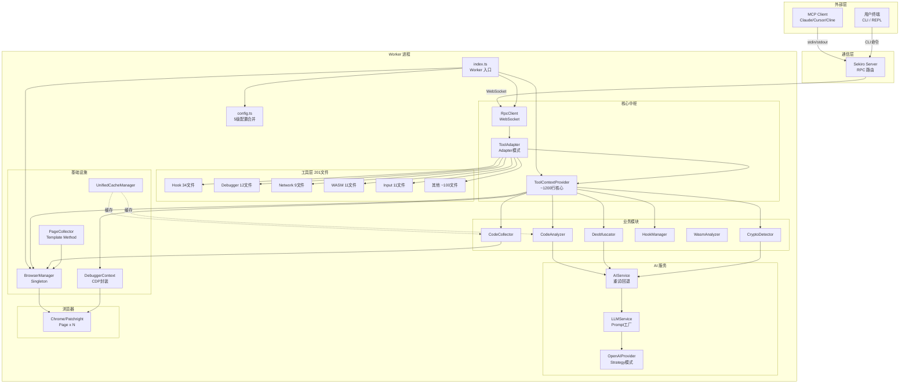
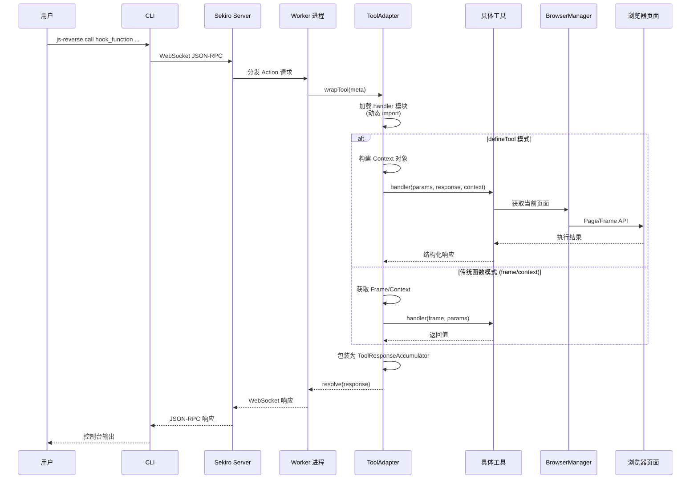
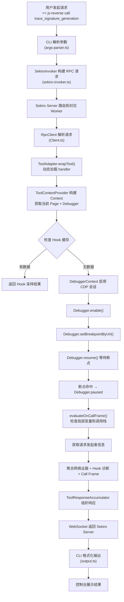
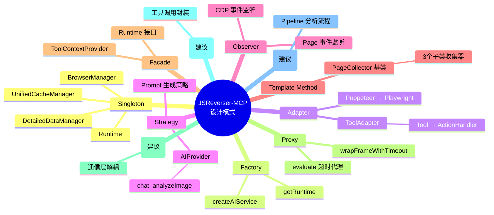

# JSReverser-MCP 全面技术分析与架构解构

> 生成时间：2026-05-12  
> 分析范围：项目完整源码（`src/`、`tests/`、`config/`、`docs/`）  
> 分析目标：模块解构、设计模式识别、可视化架构、二次开发建议、新手指南

---

## 目录结构解析（Project Structure）

```
JSReverser-CLI/
├── src/                          # 核心业务代码（326 个 .ts 文件）
│   ├── bin/js-reverse.ts         # CLI 启动入口
│   ├── index.ts                  # Worker 进程入口（MCP Worker）
│   ├── cli.ts                    # CLI 参数解析（yargs-based）
│   ├── config.ts                 # 全局统一配置管理（5 级优先级合并）
│   ├── runtime.ts                # 运行时聚合工厂（Singleton 模式）
│   ├── DebuggerContext.ts         # CDP Debugger 协议封装（单页）
│   ├── PageCollector.ts          # 泛型页面数据收集器基类
│   ├── browser/                  # 浏览器管理
│   │   ├── browser.ts            # BrowserManager（Singleton）
│   │   ├── DevToolsConnectionAdapter.ts
│   │   ├── SessionManager.ts
│   │   ├── stealth-args.ts       # 浏览器 Stealth 参数
│   │   └── polyfill.ts
│   ├── cli/                      # CLI 实现
│   │   ├── commands/             # 9 个子命令（start/stop/status/call/...）
│   │   ├── index.ts              # 公共导出
│   │   ├── app.ts                # CLI 主应用逻辑
│   │   ├── args-parser.ts        # 参数解析器
│   │   ├── errors.ts             # 错误类型定义
│   │   ├── help.ts               # 帮助生成
│   │   ├── output.ts             # 输出格式化
│   │   ├── sekiro-invoker.ts     # Sekiro RPC 调用器
│   │   ├── tool-aliases.ts       # 工具别名系统
│   │   ├── tool-arg-validator.ts # 参数校验器
│   │   ├── tools-meta.ts         # Tool 元数据注册表
│   │   ├── types.ts              # 类型定义
│   │   ├── worker-manager.ts     # Worker 进程管理
│   │   └── zod-introspect.ts     # Zod schema 内省
│   ├── tools/                    # MCP 工具实现（201 个 .ts 文件）
│   │   ├── ToolDefinition.ts     # 工具定义契约（defineTool）
│   │   ├── categories.ts         # 工具分类枚举
│   │   ├── analyzer/             # 代码分析工具
│   │   ├── anti-debug/           # 反调试检测工具
│   │   ├── collector/            # 代码采集工具
│   │   ├── console/              # Console 日志工具
│   │   ├── crypto/               # 加密检测工具
│   │   ├── debugger/             # 断点/调试工具（12 文件）
│   │   ├── dialog/               # 弹框处理工具
│   │   ├── dom/                  # DOM 操作工具
│   │   ├── emulation/            # 设备仿真工具
│   │   ├── hook/                 # Hook 注入工具（34 文件，最大子目录）
│   │   ├── input/                # 输入自动化工具（11 文件）
│   │   ├── navigation/           # 页面导航工具
│   │   ├── network/              # 网络请求分析工具（9 文件）
│   │   ├── page/                 # 页面管理工具
│   │   ├── performance/          # 性能分析工具
│   │   ├── rebuild/              # 本地复现工具
│   │   ├── screenshot/           # 截图工具
│   │   ├── script/               # 脚本管理工具
│   │   ├── shared/               # 共享工具逻辑
│   │   ├── stealth/              # Stealth 注入工具
│   │   ├── wasm/                 # WebAssembly 分析工具（11 文件）
│   │   └── workflow/             # 工作流工具
│   ├── modules/                  # 核心业务模块
│   │   ├── analyzer/             # 代码分析器（CodeAnalyzer, AISummarizer）
│   │   ├── collector/            # 采集器（CodeCollector, DOMInspector, PageController）
│   │   ├── crypto/               # 加密算法检测器（CryptoDetector）
│   │   ├── debugger/             # 调试器模块
│   │   ├── deobfuscator/         # 反混淆器（Deobfuscator）
│   │   ├── hook/                 # Hook 管理器（HookManager）
│   │   ├── stealth/              # Stealth 模块（StealthScripts2025）
│   │   └── wasm/                 # WASM 分析模块
│   ├── services/                 # 服务层
│   │   ├── AIService.ts          # AI 服务（含重试、回退机制）
│   │   ├── LLMService.ts         # LLM 服务（Prompt 工厂）
│   │   ├── OpenAIProvider.ts     # OpenAI Provider 实现
│   │   ├── DatabaseService.ts    # PostgreSQL 数据库服务
│   │   ├── SiteExperienceService.ts  # 站点经验服务
│   │   └── index.ts
│   ├── worker/                   # Worker 进程组件
│   │   ├── BuiltinActions.ts     # 内置 Actions
│   │   ├── collectors.ts         # 网络/Console/WebSocket 收集器
│   │   ├── ToolAdapter.ts        # Tool → Sekiro Action 适配器
│   │   ├── ToolContextProvider.ts # 工具上下文提供者（核心中枢，1132 行）
│   │   ├── ToolResponseAccumulator.ts
│   │   ├── WorkerArgs.ts         # Worker 参数解析
│   │   └── WorkerLifecycle.ts    # Worker 生命周期管理
│   ├── protocol/Client.ts        # Sekiro RPC 客户端（WebSocket）
│   ├── reverse/ReverseTaskStore.ts  # 逆向任务持久化存储
│   ├── database/                 # 数据库 ORM（Drizzle + PostgreSQL）
│   │   ├── index.ts
│   │   └── schema.ts
│   ├── formatters/               # 格式化器
│   │   ├── consoleFormatter.ts
│   │   ├── networkFormatter.ts
│   │   └── websocketFormatter.ts
│   ├── trace-processing/parse.ts # 性能追踪解析
│   ├── types/                    # 类型定义
│   │   ├── devtools.ts, index.ts, platform.ts, rpc.ts
│   │   └── chrome-devtools-frontend.d.ts
│   ├── third_party/              # 第三方库适配层
│   │   ├── cdp.ts, index.ts, playwright.ts
│   │   ├── puppeteer-compat.ts, stubs.ts
│   └── utils/                    # 通用工具（19 个工具类）
│       ├── logger.ts, errors.ts, config.ts
│       ├── UnifiedCacheManager.ts, CacheAdapters.ts
│       ├── DetailedDataManager.ts
│       ├── TokenBudgetManager.ts
│       ├── ToolExecutionScheduler.ts
│       └── ...
├── tests/                        # 测试目录（133 个测试文件）
│   ├── unit/                     # 单元测试（107 文件）
│   ├── integration/              # 集成测试
│   ├── property/                 # 属性测试（fast-check）
│   ├── performance/              # 性能测试
│   ├── bin/                      # 二进制测试
│   ├── daemon/                   # 守护进程测试
│   └── manual/                   # 手动测试
├── docs/                         # 文档（44 个 .md 文件）
│   ├── guides/                   # 用户指南
│   │   ├── getting-started.md, browser-connection.md
│   │   ├── client-configuration.md, http-mode.md
│   │   └── llm-provider-config.md
│   └── reference/                # 参考文档
│       ├── reverse-bootstrap.md, reverse-workflow.md
│       ├── tool-reference.md, tool-io-contract.md
│       ├── env-patching.md, reverse-artifacts.md
│       └── ...
├── skills/                       # 技能定义（40 文件，MCP Skills 协议）
├── scripts/                      # 工具脚本和公开 case
│   └── cases/                    # 公开逆向案例（jd-h5st, ks, douyin 等）
├── artifacts/                    # 生成产物目录（任务模板 + 证据）
├── config.json                   # 项目配置文件
├── package.json                  # 依赖管理（Node ^20+）
├── tsconfig.json                 # TypeScript 配置
└── eslint.config.mjs            # ESLint 扁平配置
```

---

## 1. 项目整体与核心模块分析（Module Decomposition）

### 1.1 架构全景

JSReverser-MCP 是一个将浏览器自动化、JavaScript 逆向流程标准化、AI 辅助分析整合为 MCP（Model Context Protocol）服务的工程化系统。其架构遵循 **Observe-first → Hook-preferred → Breakpoint-last → Rebuild-oriented** 的逆向方法论。

**整体分层架构：**

```
┌──────────────────────────────────────────────────────────┐
│                    CLI 层 (src/cli/)                      │
│   start/stop/status/call/call-skill/scaffold/repl        │
└───────────────┬──────────────────────────────────────────┘
                │ 通过 WorkerManager 启动 Worker 进程
                ▼
┌──────────────────────────────────────────────────────────┐
│                  Worker 进程 (src/index.ts)               │
│  ┌──────────────────────────────────────────────────────┐│
│  │  RPC 通信层 (src/protocol/Client.ts)                ││
│  │  WebSocket → Sekiro Server ←→ MCP Client            ││
│  └────────────────┬─────────────────────────────────────┘│
│                   │                                      │
│  ┌────────────────▼─────────────────────────────────────┐│
│  │  ToolAdapter + ToolContextProvider (src/worker/)     ││
│  │  ← 核心中枢 — 将 100+ Tool 适配为 RPC Actions       ││
│  └────────────────┬─────────────────────────────────────┘│
│                   │                                      │
│  ┌────────────────▼─────────────────────────────────────┐│
│  │  工具层 src/tools/ (201 个工具实现)                  ││
│  │  Hook │ Debugger │ Network │ DOM │ WASM │ ...       ││
│  └────────────────┬─────────────────────────────────────┘│
└───────────────────┼──────────────────────────────────────┘
                    │
┌───────────────────▼──────────────────────────────────────┐
│         核心业务模块层 src/modules/ + src/services/        │
│  CodeAnalyzer │ Deobfuscator │ CryptoDetector │ LLM    │
│  HookManager  │ WasmAnalyzer │ AIService │ Database    │
└───────────────────┬──────────────────────────────────────┘
                    │
┌───────────────────▼──────────────────────────────────────┐
│         基础设施层                                         │
│  BrowserManager │ DebuggerContext │ PageCollector       │
│  UnifiedCacheManager │ DetailedDataManager              │
└──────────────────────────────────────────────────────────┘
```

---

### 1.2 核心模块详解

#### 1.2.1 CLI 入口层 — `src/cli/`

**职责：** 提供用户交互入口，包括命令行、REPL 交互、子命令分发。

**关键文件：**

| 文件 | 职责 |
|------|------|
| `bin/js-reverse.ts` | 二进制入口，解析 CLI 参数，分派到对应命令处理器 |
| `commands/start.ts` | 启动后台 Daemon Worker 进程 |
| `commands/tool-dispatcher.ts` | 调用 MCP 工具（`call <tool>`） |
| `commands/repl.ts` | 交互式 REPL 模式 |
| `app.ts` | CLI 主应用逻辑 |
| `worker-manager.ts` | Worker 进程生命周期管理（启动/停止/状态检查） |
| `sekiro-invoker.ts` | 通过 WebSocket 向 Sekiro Server 发起 RPC 调用 |

**依赖方向：** CLI → WorkerManager → Worker 进程（通过子进程或 RPC）→ Sekiro Server

**存在的问题：**
- WorkerManager 的状态管理和 worker 进程的生命周期监控较为朴素，缺少进程守护（如 PM2 适配）
- REPL 模式与命令行模式的交互路径存在一定冗余

---

#### 1.2.2 Worker 进程层 — `src/index.ts` + `src/worker/`

**职责：** Worker 进程是系统的运行时核心，负责初始化所有服务、连接浏览器、注册工具到 Sekiro Server。

**启动流程（`src/index.ts`）：**

1. 解析 CLI 参数并合并配置（`resolveConfig` + `parseWorkerArgs`）
2. 初始化数据库连接（可选，基于 PostgreSQL）
3. 创建聚合 Runtime（`getRuntime()` — Singleton）
4. 连接/启动浏览器（`ensureBrowser()`）
5. 初始化 `ToolContextProvider`（注入 Runtime）
6. 创建 `RpcClient` 连接到 Sekiro Server
7. 通过 `ToolAdapter` 注册所有 Tool 为 Action
8. 进入等待状态，处理 RPC 请求

**`ToolContextProvider` (1132 行)：**

这是系统中**最大、最核心的单一类**。职责：
- 聚合所有运行时服务（BrowserManager、CodeCollector、HookManager 等）
- 管理页面 / Frame / Debugger 会话
- 收集网络请求、Console 消息、WebSocket 流量
- 提供分析器、检测器、Hook 管理器的惰性加载（fallback 模式）
- 生命周期：init → use → dispose

**设计特点：**
- 状态集中化：所有页面级状态（Network、Console、WebSocket）都使用 `WeakMap<Page, ...>` 存储
- 导航分组：每次主 frame 导航自动分割存储历史，保留最近 N 段
- 惰性 fallback：支持 `Runtime` 注入模式，没有时会自动创建 fallback 实例

**边界不清的问题：**
- `ToolContextProvider` 承担了过多职责：页面管理 + 数据收集 + 服务供应 + 调试管理 → 接近 1200 行
- 内联收集逻辑和新的 `PageCollector` 基类并存，存在双写路径

---

#### 1.2.3 工具层 — `src/tools/`（201 个文件）

**职责：** 所有对外暴露的 MCP 工具实现，分类存放在子目录中。

**工具注册机制：**

```
ToolDefinition 契约（Zod Schema + handler）
    → tools-meta.ts 元数据注册表（动态扫描）
    → ToolAdapter.wrapTool() 包装为 ActionHandler
    → RpcClient.registerAction()
```

**分类目录（10 个类别）：**

| 类别 | 数量 | 说明 |
|------|------|------|
| Hook | 34 文件 | **最大类别** — create_hook, inject_hook, hook_function, trace_function 等 |
| Debugger | 12 文件 | 断点管理、执行上下文、调用帧分析 |
| Input | 11 文件 | click, type_text, fill, fill_form, drag, upload_file 等 |
| WASM | 11 文件 | WebAssembly 分析工具集 |
| Network | 9 文件 | 网络请求收集、签名追踪、WebSocket 分析 |
| Analyzer | 15 文件 | 代码理解、风险面板、加密检测 |
| 其他 | ~100 文件 | DOM / Dialog / Screenshot / Navigation / Emulation / Performance 等 |

**工具定义模式（`defineTool`）：**

```typescript
export interface ToolDefinition<Schema> {
  name: string;
  aliases?: string[];
  description: string;
  annotations: { title?: string; category: ToolCategory; readOnlyHint: boolean };
  schema: Schema;             // Zod schema
  handler: (request, response, context) => Promise<void>;
}
```

这种 **Schema-first 设计** 使得参数验证、文档生成、类型安全天然自洽。

---

#### 1.2.4 核心业务模块层 — `src/modules/`

| 模块 | 文件 | 职责 |
|------|------|------|
| **HookManager** | `modules/hook/HookManager.ts` | 创建和管理 Hook 定义，支持函数 Hook、属性 Hook、拦截器 Hook |
| **CodeAnalyzer** | `modules/analyzer/CodeAnalyzer.ts` | 静态代码分析，识别技术栈、业务逻辑、安全风险 |
| **AISummarizer** | `modules/analyzer/AISummarizer.ts` | AI 驱动的代码总结和摘要 |
| **Deobfuscator** | `modules/deobfuscator/Deobfuscator.ts` | 代码反混淆（本地规则 + LLM 增强） |
| **CryptoDetector** | `modules/crypto/CryptoDetector.ts` | 加密算法检测（AST 规则 + 可选 AI） |
| **CodeCollector** | `modules/collector/CodeCollector.ts` | 页面代码采集和缓存 |
| **WasmAnalyzer** | `modules/wasm/WasmAnalyzer.ts` | WebAssembly 分析 |
| **StealthScripts2025** | `modules/stealth/` | 浏览器反检测注入 |

**模块间调用关系：**

```
CodeCollector → CodeAnalyzer → AISummarizer (通过 LLMService)
CodeCollector → Deobfuscator → LLMService
CodeCollector → CryptoDetector → LLMService
PageController → CodeCollector
HookManager (独立，不依赖其他模块)
WasmAnalyzer ← WasmCollector → PageController
```

**问题：**
- `Deobfuscator` 和 `CryptoDetector` 都依赖 `LLMService`，但 LLM 不可用时功能会降级
- 模块间缺少统一的管道（Pipeline）编排，每次调用都是直接方法调用

---

#### 1.2.5 AI 服务层 — `src/services/`

**`AIService` (166 行)：**
- 实现 `AIProvider` 接口抽象（当前只有 OpenAI）
- 提供重试机制（指数退避，3 次重试）
- 重试策略：网络错误（ECONNRESET/ETIMEDOUT）、429、5xx 可重试

**`LLMService` (115 行)：**
- 作为 AIService 的包装器和 Prompt 工厂
- 提供 `generateCodeAnalysisPrompt`、`generateCryptoDetectionPrompt`、`generateDeobfuscationPrompt` 等方法
- 依赖注入：`serviceFactory` 参数使测试可 mock

**`DatabaseService`：**
- 基于 Drizzle ORM + PostgreSQL
- 主要用于站点经验存储（SiteExperience）
- 数据库连接为可选，不强制

**问题：**
- 只支持 OpenAI（虽然 `LLMProvider` 类型只定义了 `'openai'`），README 声称支持 Anthropic/Gemini 但代码层面未实现
- `AIService` 的 `analyzeImage` 暴露了底层 provider 的 API，没有做抽象对齐

---

#### 1.2.6 浏览器管理层 — `src/browser/`

**`BrowserManager`（Singleton）：**
- 统一管理 Chrome 浏览器实例
- 支持三种连接模式：远程连接（CDP）、自动发现、新启动
- 崩溃检测 + 自动重启（5 秒轮询）
- Stealth 注入支持（`StealthScripts2025.injectAll`）
- 跨平台浏览器路径检测（Windows/macOS/Linux）

**核心方法：**

```
ensureBrowser() → connectToRemoteBrowser() | launchBrowser()
    ↓
connectToRemoteBrowser():
  1. 尝试 fetch /json/version 获取版本信息和 WebSocket URL
  2. 使用 Playwright connectOverCDP 连接
  3. 获取浏览器窗口边界自动适配 Viewport
  4. 启动崩溃检测

launchBrowser():
  1. 构建启动参数（DEFAULT_ARGS + STEALTH_ARGS）
  2. 使用 Playwright chromium.launch()
  3. 设置 crash detection 和 viewport
```

---

#### 1.2.7 RPC 通信层 — `src/protocol/Client.ts`

基于 Sekiro 协议的 WebSocket 客户端：
- 注册 Action（`registerAction`）
- WebSocket 生命周期管理（连接/重连/心跳）
- 指数退避重连策略
- 消息路由和响应封装

**通信数据流：**

```
MCP Client → (stdin/stdout) → Sekiro Server ← (WebSocket) → Worker (RpcClient)
```

---

### 1.3 隐式耦合与边界问题总结

| 问题 | 位置 | 描述 |
|------|------|------|
| **ToolContextProvider 过重** | `src/worker/ToolContextProvider.ts` | ~1200 行，同时承担数据收集、服务聚合、上下文管理 |
| **收集器双写** | 同上 | 既有内联 `_networkStorage/WeakMap` 收集，又有 `PageCollector` 基类收集 |
| **LLM Provider 单一** | `src/services/OpenAIProvider.ts` | 代码中只实现了 OpenAI，与 README 宣传的多 Provider 不符 |
| **配置优先级复杂** | `src/config.ts` | 5 级配置合并逻辑散落在大量 `if/else` 分支中 |
| **模块启动顺序隐式依赖** | `src/index.ts` → `runtime.ts` | Runtime 创建和 ToolContextProvider 初始化依赖外部调用顺序 |

---

## 2. 设计模式与架构风格分析（Design Pattern Analysis）

### 2.1 已识别的设计模式

#### 2.1.1 Singleton（单例）— 多处使用

| 位置 | 描述 |
|------|------|
| `runtime.ts:getRuntime()` | 全局唯一 Runtime 实例 |
| `browser.ts:BrowserManager.getInstance()` | 全局唯一浏览器管理器 |
| `utils/UnifiedCacheManager.ts:getInstance()` | 缓存管理器 |
| `utils/detailedDataManager.ts:getInstance()` | 数据管理器 |

**实现方式：** 模块级变量 + 惰性初始化
**评价：** 标准实现，但用全局变量（`let runtime`）导致测试时需要手动重置，测试隔离性差。

> `browser.ts` 的 `BrowserManager` 提供了 `resetInstance()` 方法来缓解测试问题，值得借鉴。

#### 2.1.2 Factory（工厂）— 多处使用

| 位置 | 描述 |
|------|------|
| `config.ts:createAIService()` | 根据 Provider 类型创建不同的 AI 服务实例 |
| `runtime.ts:getRuntime()` | 聚合 Runtime 对象的工厂方法 |

**评价：** `createAIService` 当前只有 OpenAI 分支，但 switch-case 结构已为扩展预留。

#### 2.1.3 Adapter（适配器）

| 位置 | 描述 |
|------|------|
| `worker/ToolAdapter.ts` | 将 `ToolDefinition.handler` 适配为 `ActionHandler` |
| `third_party/puppeteer-compat.ts` | Puppeteer → Playwright 兼容层 |

**ToolAdapter 适配流程：**

```
ToolDefinition.handler(params, response, context) → Promise<void>
    ↓ ToolAdapter.wrapTool()
ActionHandler(rpcRequest, resolve, reject) → void
```

**评价：** 适配器模式的核心应用，使得 100+ 工具可以统一注册为 RPC Actions。

#### 2.1.4 Strategy（策略）

| 位置 | 描述 |
|------|------|
| `services/AIService.ts` + `services/OpenAIProvider.ts` | `AIProvider` 接口定义了 chat/analyzeImage 策略 |
| `services/LLMService.ts` 中的 Prompt 生成 | 不同分析任务使用不同的 Prompt 策略 |

**评价：** AI Provider 策略模式当前只有一种实现，接口预留了对 Anthropic、Gemini 的支持，但未实现。

#### 2.1.5 Observer（观察者）

| 位置 | 描述 |
|------|------|
| `DebuggerContext.ts` | 监听 CDP 事件（`Debugger.scriptParsed`, `Debugger.paused` 等） |
| `ToolContextProvider.ts` | 监听页面事件（`request`, `console`, `websocket`, `framenavigated`） |
| `PageCollector.ts` | 泛型观察者基类，子类实现 `attachListeners/detachListeners` |

**评价：** 事件驱动是系统的核心模式之一，CDP 事件通过 Playwright/page.on() 统一监听。

#### 2.1.6 Template Method（模板方法）

| 位置 | 描述 |
|------|------|
| `PageCollector.ts` | 抽象基类定义了收集器的骨架流程 |
| `worker/collectors.ts` | `NetworkRequestCollector`, `ConsoleMessageCollector`, `WsCollector` 继承基类 |

**模板方法骨架：**

```
attachToPage(page)              ← 基类实现
  ├── createIdGenerator()       ← 基类
  ├── attachListeners(page)     ← 子类实现（抽象）
  └── splitOnNavigation(page)   ← 子类可覆盖
```

#### 2.1.7 Facade（外观）

| 位置 | 描述 |
|------|------|
| `src/index.ts` (Worker 入口) | 对外暴露完整的服务，内部协调配置解析、浏览器管理、RPC 注册 |
| `src/runtime.ts` | 聚合多个服务实例为一个统一的 `Runtime` 接口 |

**评价：** `Runtime` 接口聚合了 15+ 个子服务，提供了一个统一的入口点，降低了调用方的耦合。

#### 2.1.8 Proxy（代理）- 特定用途

| 位置 | 描述 |
|------|------|
| `worker/ToolAdapter.ts:wrapFrameWithTimeout()` | 为 `frame.evaluate()` 添加超时保护的 Proxy |

```typescript
function wrapFrameWithTimeout(frame: Frame, timeoutMs = 10000): Frame {
  return new Proxy(frame, {
    get(target, prop, receiver) {
      if (prop === 'evaluate') {
        return function evaluateWithTimeout(...args) {
          return Promise.race([evalPromise, timeoutPromise]);
        };
      }
      return value.bind(target);
    },
  });
}
```

---

### 2.2 可以引入但尚未使用的设计模式优化点

#### 2.2.1 Command 模式 — 用于工具调用统一化

**现状：** Tool 调用直接在 `ToolAdapter.wrapTool()` 中通过 `switch(meta.callMode)` 分发。

**建议：** 引入 Command 模式封装调用上下文：

```typescript
interface ToolCommand {
  execute(tool: ToolMeta, params: unknown): Promise<unknown>;
}
class FrameToolCommand implements ToolCommand { ... }
class ContextToolCommand implements ToolCommand { ... }
class DefineToolCommand implements ToolCommand { ... }
```

#### 2.2.2 Chain of Responsibility（职责链）— 用于管道式分析

**现状：** `Deobfuscator`、`CryptoDetector`、`CodeAnalyzer` 独立调用，没有编排。

**建议：** 引入 Pipeline/Chain 模式编排分析流程：

```
CodeCollect → [Minify → Deobfuscate → Analyze → CryptoDetect → Summarize]
```

#### 2.2.3 Decorator（装饰器）— 用于工具增强

**现状：** `ToolAdapter.wrapTool()` 中的超时、日志、性能统计都是硬编码。

**建议：** 使用装饰器模式：

```typescript
const handler = compose(
  withTimeout(30000),
  withPerformanceLogging,
  withErrorBoundary,
)(toolHandler);
```

#### 2.2.4 Bridge（桥接）— 用于通信层解耦

**现状：** Sekiro RPC 协议直接绑定了 `RpcClient`。

**建议：** 桥接模式分离协议实现和消息处理：

```typescript
interface MessageTransport {
  send(message: string): void;
  onMessage(handler: (msg: string) => void): void;
  connect(): Promise<void>;
  disconnect(): void;
}
class WebSocketTransport implements MessageTransport { ... }
class StdioTransport implements MessageTransport { ... }  // MCP stdio 模式
```

---

## 3. 可视化图表生成（Architecture & Flow Visualization）

### 3.1 系统架构图（Mermaid）



### 3.2 工具调用流程（Mermaid）



### 3.3 一次典型逆向请求的生命周期

以 `trace_signature_generation` 工具为例：



---

## 4. 二次开发与架构优化建议（Refactoring & Extension Proposals）

### 建议 1：ToolContextProvider 职责拆分（高优先级）

**目标模块：** `src/worker/ToolContextProvider.ts`

**当前问题：**
- 单文件 1132 行，承担了页面管理、数据收集（Network/Console/WebSocket）、服务供应、调试器管理等多种职责
- 内联收集逻辑和新的 `PageCollector` 基类并存，存在双写路径
- 类中 WeakMap 数量过多（10+），难以追踪

**具体实施方案：**

将 `ToolContextProvider` 拆分为多个独立模块：

```typescript
// 1. PageManager — 只负责页面/Frame 生命周期管理
class PageManager {
  getSelectedPage(): Page | null
  selectPage(page: Page): void
  newPage(): Promise<Page>
  closePage(pageIdx: number): Promise<void>
  syncPages(): Page[]
}

// 2. DataCollectorManager — 统一的数据收集层
class DataCollectorManager {
  networkCollector: NetworkRequestCollector
  consoleCollector: ConsoleMessageCollector
  wsCollector: WsCollector
  start(context: BrowserContext): void
  dispose(): void
}

// 3. ServiceLocator — 服务注册和定位器
class ServiceLocator {
  getHookManager(): HookManager
  getDeobfuscator(): Deobfuscator
  getCryptoDetector(): CryptoDetector
  // 惰性创建 + fallback
}

// 4. ToolContextProvider — 作为 Facade 聚合上述三个模块
class ToolContextProvider {
  constructor(
    pageManager: PageManager,
    dataCollector: DataCollectorManager,
    serviceLocator: ServiceLocator,
    debuggerContext: DebuggerContext
  )
}
```

**预期收益：**
- 每个类职责单一，可测试性大幅提升
- 移除双写路径，统一使用 `PageCollector` 基类
- 降低认知负荷，新开发者更容易理解

**潜在风险：**
- 需确保现有调用方接口兼容（`getSelectedPage()`、`getNetworkRequests()` 等方法名和签名不变）
- 拆分后可能存在额外的属性访问开销（通过 getter 而非直接字段）

**实施成本估计：** 2-3 人天（含测试覆盖）

---

### 建议 2：多 LLM Provider 支持 + AI Service 扩展（中优先级）

**目标模块：** `src/services/`

**当前问题：**
- 只实现了 OpenAI，与 README 声称的 Anthropic、Gemini 支持不符
- 代码中 `LLMProvider` 类型只定义了 `'openai'`
- `AIService` 的 `analyzeImage` 方法暴露了 provider 特有的 API

**具体实施方案：**

```typescript
// 扩展现有的 Strategy 模式
class AnthropicProvider implements AIProvider {
  async chat(messages: AIMessage[], options?: ChatOptions): Promise<AIResponse>
  async analyzeImage(imageInput: string, prompt: string, isFilePath?: boolean): Promise<string>
}

class GeminiProvider implements AIProvider {
  async chat(messages: AIMessage[], options?: ChatOptions): Promise<AIResponse>
  async analyzeImage(imageInput: string, prompt: string, isFilePath?: boolean): Promise<string>
}

// Factory 增强
function createAIProvider(config: AIConfig): AIProvider {
  switch (config.provider) {
    case 'openai': return new OpenAIProvider(config.openai!);
    case 'anthropic': return new AnthropicProvider(config.anthropic!);
    case 'gemini': return new GeminiProvider(config.gemini!);
    default: throw new Error(`Unknown provider: ${config.provider}`);
  }
}
```

**配置层也需要同步增强：**

```typescript
// src/config.ts 中扩展 AIConfig
export type LLMProvider = 'openai' | 'anthropic' | 'gemini';
export interface AIConfig {
  provider: LLMProvider;
  openai?: OpenAIProviderConfig;
  anthropic?: AnthropicProviderConfig;
  gemini?: GeminiProviderConfig;
}
```

**预期收益：**
- 完成 README 中宣称的能力
- 用户可根据成本和延迟选择不同的 LLM 后端
- 可测试性提升（Provider 接口已设计好，只需增加实现类）

**潜在风险：**
- Anthropic/Gemini 的 API 差异需要适配（如 Anthropic 的消息格式不同）
- 图像分析能力的跨 Provider 对齐需要额外工作

**实施成本估计：** 3-5 人天（含实现 + 测试 + 文档）

---

### 建议 3：引入 Pipeline 编排层处理分析工作流（中优先级）

**目标模块：** `src/modules/` 中的分析器（`CodeAnalyzer`, `Deobfuscator`, `CryptoDetector`, `AISummarizer`）

**当前问题：**
- 每个分析器独立调用，没有编排顺序
- `risk_panel` / `understand_code` 等工具内部硬编码了分析流程
- 缺少中间结果缓存，重复分析浪费资源

**具体实施方案：**

```typescript
// Pipeline 定义
interface AnalysisStep {
  name: string;
  execute(input: AnalysisContext): Promise<AnalysisContext>;
}

class AnalysisPipeline {
  private steps: AnalysisStep[] = [];
  
  addStep(step: AnalysisStep): this { ... }
  
  async execute(initial: AnalysisContext): Promise<AnalysisResult> {
    let context = initial;
    for (const step of this.steps) {
      const start = Date.now();
      context = await step.execute(context);
      context.recordTiming(step.name, Date.now() - start);
    }
    return context.toResult();
  }
}

// 具体步骤
class CodeCollectionStep implements AnalysisStep { ... }
class DeobfuscationStep implements AnalysisStep { ... }
class CryptoDetectionStep implements AnalysisStep { ... }
class AISummaryStep implements AnalysisStep { ... }

// 使用
const pipeline = new AnalysisPipeline()
  .addStep(new CodeCollectionStep())
  .addStep(new DeobfuscationStep())
  .addStep(new CryptoDetectionStep())
  .addStep(new AISummaryStep());
```

**预期收益：**
- 分析流程可配置、可组合、可扩展
- 步骤间可共享中间上下文，避免重复计算
- 容易添加缓存在每个步骤前检查

**潜在风险：**
- 现有工具调用模式（`understand_code` 等）需要适配
- 对 AI 调用的依赖可能导致 Pipeline 整体变慢

**实施成本估计：** 2-3 人天（含 Pipeline 核心 + 现有工具的适配 + 测试）

---

### 建议 4：Worker 进程守护和健康检查（低优先级）

**目标模块：** `src/cli/worker-manager.ts` + `src/worker/WorkerLifecycle.ts`

**当前问题：**
- Worker 进程崩溃后没有自动重启机制
- `WorkerManager` 的状态管理较为朴素
- 没有 Worker 健康检查 API

**具体实施方案：**
- 引入进程重启策略（类似 PM2 的 `max_restarts` + `restart_delay`）
- 添加 Worker 健康检查 endpoint（通过 Sekiro 的 ping/pong）
- 在 CLI 端提供 `js-reverse status` 的详细健康信息

**预期收益：**
- Worker 进程更稳健，避免因浏览器或工具崩溃导致整个服务不可用

**实施成本估计：** 1-2 人天

---

## 5. 设计模式全景总结



---

## 6. 新开发者实战入门指南（Developer Onboarding Guide）

### 6.1 本地环境搭建

**所需软件与版本：**

| 需求 | 版本 |
|------|------|
| Node.js | `^20.19.0` 或 `^22.12.0` 或 `>=23` |
| npm | 随 Node.js 附带的版本即可 |
| Chrome / Chromium | 最新稳定版（用于浏览器调试） |
| TypeScript | 项目自带（`^5.9.2`） |
| Git | 任意版本 |

**可选：**
- PostgreSQL（如需数据库功能）
- OpenAI API Key（如需 AI 辅助分析）

### 6.2 从 0 到运行

```bash
# 1. 克隆代码
git clone <repo-url>
cd JSReverser-CLI

# 2. 安装依赖
npm install

# 3. 构建项目
npm run build

# 4. 启动 Chrome 浏览器（带远程调试端口）
# Windows:
"C:\Program Files\Google\Chrome\Application\chrome.exe" --remote-debugging-port=9222

# macOS:
/Applications/Google\ Chrome.app/Contents/MacOS/Google\ Chrome --remote-debugging-port=9222

# 5. 启动 Worker 服务
npm run start -- --browserUrl http://127.0.0.1:9222

# 6. 另一个终端，使用 CLI 调用工具
node build/src/bin/js-reverse.js status
node build/src/bin/js-reverse.js call check_browser_health
node build/src/bin/js-reverse.js call list_network_requests
```

### 6.3 常用命令速查

```bash
# 查看所有可用工具
node build/src/bin/js-reverse.js call

# 查看工具参数
node build/src/bin/js-reverse.js call <tool-name> --help

# 查看 Worker 状态
node build/src/bin/js-reverse.js status

# 交互式 REPL 模式
node build/src/bin/js-reverse.js repl

# 列出所有技能
node build/src/bin/js-reverse.js list-skills

# 调用技能
node build/src/bin/js-reverse.js call-skill observe-flow --url https://example.com
```

### 6.4 最小改动示例（Hello World）

**场景：** 为工具系统新增一个简单的 `hello_world` 工具。

**步骤 1：创建工具文件**

`src/tools/hello_world.ts`：

```typescript
import {zod} from '../third_party/index.js';
import {defineTool} from './ToolDefinition.js';

export const helloWorldTool = defineTool({
  name: 'hello_world',
  description: '简单的 Hello World 演示工具',
  annotations: {
    title: 'Hello World',
    category: 'data' as const,
    readOnlyHint: true,
  },
  schema: {
    name: zod
      .string()
      .optional()
      .describe('要问候的名字（默认：World）'),
  },
  handler: async (request, response, _context) => {
    const name = request.params.name || 'World';
    response.appendResponseLine(`Hello, ${name}!`);
    response.setStructuredContent({
      greeting: `Hello, ${name}!`,
      timestamp: Date.now(),
    });
  },
});
```

**步骤 2：注册工具**

`src/tools/hello_world.ts` 默认不需要额外注册。`tools-meta.ts` 通过扫描 `src/tools/` 目录下的导出自动发现所有工具。

**步骤 3：运行并验证**

```bash
npm run build

# 通过 CLI 调用
node build/src/bin/js-reverse.js call hello_world --name "Reverse Engineer"

# 预期输出：
# Hello, Reverse Engineer!
```

### 6.5 运行测试

```bash
# 运行所有测试
npm test

# 仅单元测试
npm run test:unit

# 仅特定测试文件
npm run test:quick

# 属性测试
npm run test:property

# 代码格式化检查
npm run check-format
```

### 6.6 项目通信流程速查

```
CLI 命令 → SekiroInvoker (WebSocket RPC)
  → Sekiro Server (路由/分发)
    → Worker RpcClient (接收请求)
      → ToolAdapter.wrapTool (适配)
        → Tool handler (执行)
          → ToolContextProvider (上下文)
            → BrowserManager (浏览器)
              → Playwright/Patchright API
                → Chrome CDP
```

---

## 附录：关键指标统计

| 维度 | 数值 |
|------|------|
| 总源码文件 (src/) | 326 个 .ts 文件 |
| 工具实现数 | 201 个文件 |
| 核心模块数 | 8 个 (modules/) |
| 服务数 | 5 个 (services/) |
| 工具类/函数 | 19 个 (utils/) |
| 测试文件 | 133 个 |
| 文档文件 | 44 个 .md 文件 |
| 最长的核心文件 | 1206 行 (browser.ts) |
| 最长的工具文件 | 1132 行 (ToolContextProvider.ts) |
| 最长的核心模块 | 869 行 (DebuggerContext.ts) |
| NPM 依赖 | ~25 个运行时依赖 |
| 支持的 Node 版本 | ^20.19.0 \|\| ^22.12.0 \|\| >=23 |
